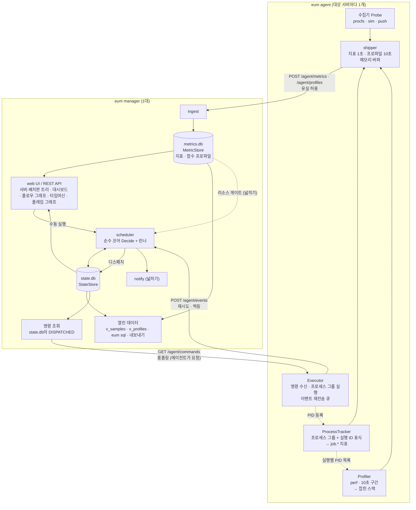
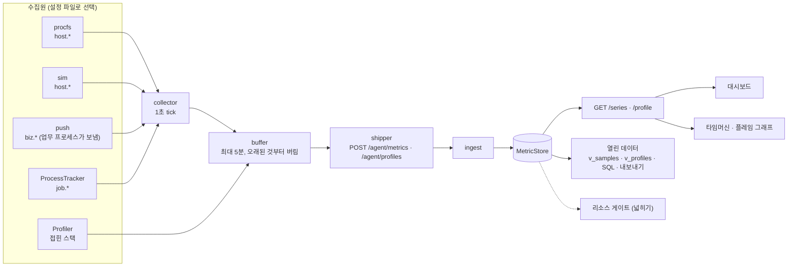
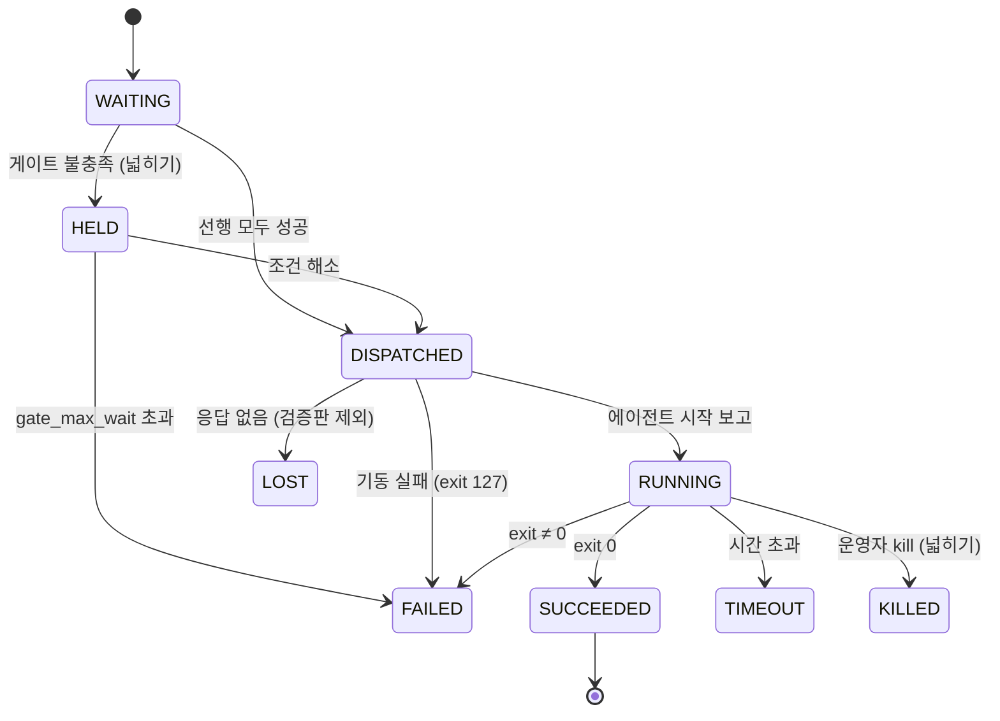

# 02. MVP 아키텍처

> 목표: 배치 스케줄러, 서버 관제, 업무 지표 수집, **함수 단위 추적**을 한 제품으로 새로 만든 **개념 검증판**을 하루에 만든다. 모든 실행, 지표, 함수 프로파일은 공개 스키마로 우리 DB에 쌓고(**데이터 주권**), 확장 지점은 처음부터 인터페이스로 열어 둔다.

**결정 사항 (2026-10-27)**

| 항목 | 결정 |
|---|---|
| 언어 | **Go** 확정 (시연 대상 서비스만 운영 환경과 같은 C) |
| 해커톤 | **하루, 2명**. 대회 규칙상 **코드는 당일 처음부터** 작성한다. 사전에는 설계 문서, 작업카드, AI 지시문, 개발 환경만 준비한다 |
| 심사 | 서류 심사 기준은 창의성 30, **업무 도구 실용성 30**, 구현 가능성 20, 기대 효과 20 ("사내에서 실제 업무 도구로 쓸 수 있는가") |
| 범위 | **새 스케줄러의 개념 검증판.** 개념 7개(스케줄, 원격 실행, 한 통로 수집, 실행 ID 연결, 함수 단위 추적, 데이터 주권, 보안 최소선)를 15:00까지 최소 형태로 잇는다. 기존 도구에 붙이는 래퍼나 단계적 이행 계획은 두지 않는다 |
| 함수 단위 추적 | 스케줄러가 띄운 프로세스(스크립트가 띄운 **C 서비스 프로세스** 포함)의 CPU를 함수별로 상시 표본 수집한다. Linux `perf`, 초당 49 표본, 10초 구간, 실행 ID로 태깅(§5.6) |
| 데이터 주권 | 실행 이력, 지표, 함수 프로파일을 공개 스키마로 저장하고, 분석용 뷰·`eum sql`·내보내기로 연다(§6.1) |
| AI | 제품 안의 AI·ML 기능은 범위에서 뺀다. AI는 **개발 수단**(사람 1명당 AI 세션 2개, 모두 4개)이다. **→ 05 §0에서 바뀜:** 장애 위험 지수(로컬 회귀)와 LLM 연결 자리를 둔다 |
| 운영 환경 | 업무는 **온라인(체결) 중심**이고, 배치는 개장 준비와 정산에 쓴다. 배치 작업은 셸 스크립트이고 스크립트가 띄우는 서비스는 C다(자바 일부). **운영 서버는 perf를 쓸 수 있다(확인)** |
| 업무 지표 | 접수·처리 건수, 대기 건수, 응답시간 같은 처리 현황을 **시스템 지표와 같은 통로**로 받는다. 시연에서는 시연용 C 체결 서비스가 보낸다 |
| 조직화 | 서버가 수십 대, 플로우가 수십 개라는 전제로 화면을 짠다. 서버는 에이전트 설정의 **그룹 경로**(`매매/체결`), 플로우는 `flows/` 아래 **폴더(배치판)** 로 묶고, 화면은 이 경로로 **트리**를 그린다. 업무 지표 화면은 업무마다 다르므로 **업무 패널**을 YAML로 정의한다(§12.1) |
| 시연 | 컨테이너 3개 + 모의 서버 40대(`eum fleet`)와 보조 플로우 37개로 서버 43대·플로우 39개 규모를 채운다. 장애 장면은 **주문량 폭주로 체결 처리가 밀리는 상황**이다. 스케줄, 실행, 프로세스 추적, 함수 프로파일, 수집 경로는 실제로 동작한다. 서버 자원은 시뮬레이터이고, 체결 서비스는 합성 주문으로 부하를 만드는 시연용 C 프로그램이다(함수 이름과 수치는 시연용) |

**추가 결정 (2026-11-04, 기획서 제출 뒤 구현 준비)** — 근거와 전체 목록은 [04 §1](04-implementation-plan.md)

| 항목 | 결정 |
|---|---|
| 이름 | 제품은 **이음(E:UM)**. 실행 파일과 Go 모듈은 `eum`, 환경변수는 `EUM_*`, 설정 경로는 `/etc/eum`. 저장소 이름만 contune으로 둔다 |
| 개발 환경 | 본선은 외부망과 상용 AI로 개발하고 사내 데이터·소스는 쓰지 않는다. `go mod vendor`는 선택이고, 실행할 때는 외부 서비스·CDN 없이 동작한다(uPlot은 바이너리에 내장) |
| 상태 기록 | 상태 전이는 **비교 후 교체(CAS)** 로만 한다: 현재 상태가 기대한 값일 때만 바꾸고 같은 트랜잭션에서 `run_events`에 남긴다. `seq`는 매니저가 실행마다 1부터 매긴다(§7, §8) |
| 명령 전달 | 메모리 명령 큐를 두지 않는다. `GET /agent/commands`가 그 호스트의 `DISPATCHED` 실행을 `state.db`에서 읽어 준다(§6) |
| 최신 값 | `/hosts`, `/panels`, 리소스 게이트는 매니저 메모리의 최신 값 캐시(`live`)를 읽는다(§7.1) |
| 조립 계약 | 패키지마다 공개 생성자와 `Mount` 함수를 계약으로 정한다(§7.1). 계약 카드(K1)가 빈 구현까지 만들어 두고, 이후 카드는 자기 패키지만 고친다 |

**보충 결정 (2026-11-09, 프로토타입 시연 뒤)** — 전부 [05 보충 계약](05-supplement.md)에 있고, **05와 이 문서가 다르면 05가 우선**합니다.

| 이 문서의 자리 | 05에서 바뀌거나 더해진 것 |
|---|---|
| 결정 표의 "AI", §12.2 끝 확장 | 장애 위험 지수(로컬 로지스틱 회귀)와 `LLM` 연결 자리 → 05 §6, §9 |
| §1·§7 "인터페이스 6개" | 8개(`RiskModel`, `LLM` 추가) → 05 §0, §12 |
| §5.1 지표 이름, §5.2 수집기 | 서버 탭 카탈로그(CPU·메모리·시스템·프로세스·IO), `host.cpu.pct` 정의(steal 제외), 메모리 정의, `job.*` 확장 → 05 §2, §3 |
| §5 수집 통로 | 업무 로그(`(E)` 줄) 수집 `logtail`, `/agent/logs`, `log_events` → 05 §4 |
| §5.3·§6.2 설정 | 에이전트 `work_dir`·`vars`·`logs`, 매니저 `editor`·`llm`·`risk`·`alerts` → 05 §11 |
| §6 API | 카탈로그, 서버 프로세스, 로그, 알림, 위험·장애 기록, 운영자 조작, 편집기, 자연어 초안 → 05 §10 |
| §7.1 조립 계약 | `flowdef.Registry`, `sched.Deps.Flows` 함수화, 카드별 mount 함수, 새 패키지(`logtail`, `editor`, `assist`, `llm`, `alert`, `risk`) → 05 §12 |
| §8 DDL | `runs.forced`, `incidents`, `alerts`, `audit`, `log_events`, `v_logs` → 05 §13 |
| §10 상태 머신 | 강제 OK·재실행·강제 종료, **죽음 정의 보정(KILLED·LOST는 재시도 없이 죽음)** → 05 §7 |
| §11 보안 | 명령 출처는 여전히 YAML 파일, 화면 편집기는 허용 목록 안에서 파일을 씀 → 05 §8 |
| §12 화면 | 메뉴 관제·서버·배치·업무·실행, 문구 원칙, 서버 탭·업무 탭·편집기·알림·위험 화면 → 05 §14 |
| §13 시연 | `eum dev`가 1차 환경(Docker 없음), `${DEMO}` 경로, `eum seed` → 05 §1, §15 |

## 1. 설계 원칙: 3원칙을 구체 규칙으로 번역

| 원칙 | 이 프로젝트에서의 규칙 |
|---|---|
| **확장성 (SOLID)** | 확장 지점은 **인터페이스 6개**로 한정합니다: `Probe`, `ProcessTracker`, `Profiler`, `MetricStore`, `StateStore`, `Notifier`. 나머지는 구체 타입으로 시작하고, 구현이 두 번째로 필요해질 때 추상화합니다. 인터페이스는 작게 만들고 사용하는 쪽 패키지에 둡니다(Go 관례). |
| **테스트 보호** | 파서(`/proc`, `perf script` 출력)는 순수 함수 + `testdata/` 고정 파일로 테스트합니다. 저장소 구현은 **공용 계약 테스트**(LSP 검증)를 통과해야 합니다. 스케줄러는 **가짜 시계**로 표 기반 테스트를 합니다. 종단 간 스모크 테스트를 1개 둡니다. |
| **단순성** | 언어 1개, 바이너리 1개, 프로토콜 HTTP/JSON, DB SQLite, 프론트엔드 빌드 단계 없음. 새 의존성은 "표준 라이브러리로 하루 이상 걸리는가?"를 통과할 때만 추가합니다. 함수 프로파일은 커널 내장 기능을 쓰는 `perf`를 실행할 뿐 Go 의존성을 늘리지 않습니다. |
| **데이터 주권** | 화면은 DB 위의 보기 중 하나입니다. 스키마(§8)를 공개하고, 분석용 뷰와 내보내기를 제품 기능으로 둡니다(§6.1). 스키마를 바꿀 때는 컬럼을 추가만 해서 기존 질의가 깨지지 않게 합니다. |
| **부하 최소** | 운영 서비스를 보는 도구가 서비스를 느리게 하면 안 됩니다. 수집은 표본 방식, 구간 단위, 대상 한정(스텝별로 켬, 단명 프로세스 제외)으로 하고, **프로파일러 자신의 CPU도 지표로 보내 화면에 띄웁니다**(§5.6). |

## 2. 기술 스택

| 영역 | 선택 | 이유 |
|---|---|---|
| 언어 | **Go** (에이전트와 매니저 공통) | 단일 정적 바이너리(런타임 의존성 0), goroutine과 channel, `os/exec` + `SysProcAttr{Setpgid: true}`, `net/http`, `embed`, `testing` 모두 표준. AI 코딩 도구와도 잘 맞습니다. |
| SQLite 드라이버 | `modernc.org/sqlite` | CGO가 없어 정적 빌드와 크로스 컴파일이 쉽습니다. |
| cron | `robfig/cron/v3`의 **파서만** 사용 | 실행 루프는 직접 작성합니다(가짜 시계를 주입하기 위해). |
| YAML | `gopkg.in/yaml.v3` | 플로우 정의, 에이전트 설정 |
| 잡 정의 | YAML 파일 | 정의의 기준은 파일 하나(git으로 관리). UI는 조회와 실행만 하고 CRUD 화면은 만들지 않습니다. |
| 함수 프로파일 | Linux **`perf`** (에이전트가 실행) | 커널 내장 표본 수집(`perf_event`). `--call-graph dwarf`로 프레임 포인터 없이 빌드한 C 프로그램도 호출 경로를 복원합니다. 운영 서버는 perf를 쓸 수 있습니다(확인). |
| 웹 | `net/http`(Go 1.22 라우팅) + `embed` + vanilla JS + **uPlot** | 빌드 단계가 없습니다. **플로우 그래프(DAG)** 는 스텝 깊이(level)별 열 배치 SVG, **플레임 그래프**는 접힌 스택에서 직접 그리는 SVG로 만들어 외부 라이브러리를 늘리지 않습니다. |
| 통신 | HTTP/JSON, `Authorization: Bearer <에이전트 토큰>` | curl로 디버깅할 수 있고, 표준 TLS, 프록시, 로드밸런서를 그대로 쓸 수 있습니다. |
| ID | `github.com/oklog/ulid/v2` | 실행 ID(`exec_id`)와 플로우 실행 ID. 시간순으로 정렬되고 발급에 조정이 필요 없습니다. |
| 시간대 | 표준 `time` + `time/tzdata` 내장 | cron은 매니저 설정 `tz`(기본 `Asia/Seoul`)로 해석합니다. 시간대 파일이 없는 최소 이미지에서도 동작합니다. |
| 폐쇄망 대비 | uPlot 파일을 저장소에 넣고 `embed`로 바이너리에 내장 | 실행할 때 외부 다운로드나 CDN이 없습니다. 본선 개발은 외부망이라 `go mod vendor`는 선택입니다. |

> 외부 의존성은 위 4개(SQLite 드라이버, YAML, cron 파서, ULID)로 고정합니다. 나머지는 표준 라이브러리로 만듭니다.

> 바이너리는 하나이고 서브커맨드로 역할을 나눕니다: `eum manager`, `eum agent`, `eum dev`(매니저 + 에이전트 3개를 한 프로세스로, 노트북 시연용), `eum burn`(시연용 CPU 부하 잡), `eum fleet`(설정 파일에 적은 모의 서버 N대를 한 프로세스의 에이전트로 띄움, 시연 규모용, §13), `eum sql`(두 DB를 읽기 전용으로 여는 SQL 조회, §6.1). 시연용 체결 서비스 `matching_svc`는 제품이 아니라 추적 대상이므로 C로 따로 빌드합니다(§13).

## 3. 기능 범위

| 영역 | 이음이 하는 일 | 데이터 |
|---|---|---|
| **배치 스케줄·실행** | YAML 플로우를 cron으로 실행하고 선후행(병렬, 합류, 서버 넘기), 재시도, 시간 초과를 판단한다. 서버마다 에이전트가 명령을 받아 실행하고, 스크립트가 띄운 서비스 프로세스까지 실행 ID로 추적한다 | `runs`, `run_events`, `job.*` 지표 |
| **업무 지표** | 업무 프로세스의 처리 현황(접수·처리 건수, 대기 건수, 응답시간)을 시스템 지표와 **같은 통로**로 받고, 기동한 실행의 `exec_id`로 연결한다 | `biz.*` 지표 |
| **서버 관제** | 서버 자원을 1초 단위로 수집한다 | `host.*` 지표 |
| **함수 단위 추적** | 실행과 그 실행이 띄운 프로세스가 CPU를 쓴 함수를 상시 표본 수집한다. 끝난 배치와 몇 분 만에 지나간 장애 구간도 나중에 구간을 골라 본다 | `stacks`, `profile_samples`, `v_profiles` |
| **열린 데이터** | 공개 스키마, 분석용 뷰, SQL 조회, CSV·접힌 스택 내보내기 | §6.1 |
| **조직화** | 서버를 그룹 경로로, 플로우를 배치판(폴더)으로 묶어 트리로 보이고, 그룹마다 상태를 모아 올린다. 업무 패널은 업무마다 YAML로 정의한다 | `hosts.grp`, 플로우 폴더, `panels/*.yaml` (§12.1) |

**실행(스케줄러) → 처리 현황(업무 지표) → 자원(서버·배치·서비스) → 함수** 를 `exec_id`와 시간축 하나로 잇고, 그 데이터를 우리가 직접 쓰는 것이 핵심입니다. 지금 사내에서는 앞의 세 영역을 서로 다른 세 도구가 따로 맡고 있고, 네 번째(함수)는 맡는 도구가 없습니다(기획서 1장).

## 4. 런타임 구조



> 모든 연결은 **에이전트가 매니저 쪽으로** 엽니다(방화벽 신청: 매니저 포트 1개). 실행 명령도 에이전트가 가져갑니다.

**단방향 연결로 하는 이유**
- 사내망에서 대상 서버에 **인바운드 포트를 여는 신청**은 어렵습니다. 에이전트가 바깥으로 나가는 연결만 쓰면 방화벽 작업이 매니저 포트 하나로 끝납니다.
- 엔드포인트를 나누면 지표나 프로파일이 밀려도 잡 이벤트와 명령은 영향을 받지 않습니다.

## 5. 수집 통로: 지표와 함수 프로파일을 하나로

업무 지표(초당 주문 건수, 응답시간 같은 처리 현황)는 수집기 종류가 다를 뿐, 시스템 지표와 같은 타입·전송·저장·조회·화면을 씁니다. 함수 프로파일도 **같은 에이전트, 같은 실행 ID, 같은 전송기와 토큰, 같은 DB, 같은 열린 데이터**를 지납니다. 다른 것은 저장 모양 하나입니다: 지표는 (시각, 값), 프로파일은 (구간, 스택, 표본 수). **한 통로, 두 모양**입니다.



### 5.1 지표 이름 규칙

| 접두사 | 출처 | 예 |
|---|---|---|
| `host.*` | 서버 자원 수집기(procfs, sim) | `host.cpu.pct`, `host.mem.used_pct`, `host.load1` |
| `job.*` | 프로세스 추적기 (**`exec_id` 필수**) | `job.cpu.pct`, `job.rss.mb`, `job.procs`(그 실행에 속한 살아 있는 프로세스 수) |
| `biz.*` | 업무 지표 수집기(push, 확장: sim, script) | `biz.order.in_tps`(접수), `biz.order.tps`(처리), `biz.order.queue`(처리 대기 건수), `biz.order.latency_p99_ms` |
| `agent.*` | 에이전트 자신 | `agent.profiler.cpu_pct`(프로파일러가 쓴 CPU), `agent.profiler.errors` |

- 값은 모두 **게이지(float64) 하나**입니다. 수집기는 주기마다 **집계된 값**을 냅니다: TPS는 주기 안의 건수 ÷ 초, 응답시간은 p50/p99. 히스토그램 타입은 필요해질 때 추가합니다.
- **CPU 단위가 둘입니다.** `host.cpu.pct`는 서버 전체 = 100(0~100), `job.cpu.pct`와 `agent.profiler.cpu_pct`는 **코어 1개 = 100**(코어 2개를 다 쓰면 200)입니다. 화면은 두 값을 한 축에 섞지 않습니다(§12.2).
- `agent.profiler.errors`는 직전 구간에서 실패한 프로파일 수(게이지)입니다.
- 차원(시장, 채널 등)이 필요해지면 `series`에 `labels` 컬럼을 추가합니다. `samples` 테이블과 API 형태는 바뀌지 않습니다.

### 5.2 수집기 종류 (`Probe` 구현)

| `type` | 검증판 | 내용 |
|---|---|---|
| `procfs` | 핵심 | `/proc/stat`, `/proc/meminfo`, `/proc/loadavg` → `host.*` (`//go:build linux`) |
| `sim` | 핵심 | 프로필 `host`: 랜덤 워크 + 장 시간대 패턴으로 `host.*`. 시드를 받아 테스트에서 결정적으로 동작. 업무 지표 프로필은 필요할 때 추가 |
| `push` | 핵심 | 에이전트가 `127.0.0.1` UDP 포트를 열고, 업무 프로세스가 지표를 보냅니다. 줄 형식 `name value [exec_id]`, 데이터그램 하나에 여러 줄. 수신 값은 버퍼에 두었다가 `Collect` 때 내보냅니다. 시연에서는 C 체결 서비스가 보냅니다 |
| `script` | 제외 | 명령을 주기적으로 실행해 stdout의 `name value` 줄을 파싱(DB 미처리 건수 등) |
| `ebpf` | 제외 | 커널이 지원할 때 |

### 5.3 에이전트 설정 파일

```yaml
# deploy/agent-match-01.yaml (시연용 컨테이너)
host: match-01
group: 매매/체결              # 서버 트리 경로. '/'로 단계를 나눔(§12.1)
manager: http://manager:8080
token: ${EUM_TOKEN}
interval: 1s
probes:
  - type: sim
    profile: host            # host.cpu.pct, host.mem.used_pct
    seed: 1
  - type: push               # 체결 서비스(matching_svc)가 biz.* 를 보냄
    listen: 127.0.0.1:9101
profiler:
  type: perf
  hz: 49                     # 초당 표본 수
  window: 10s                # 이 길이마다 접힌 스택 1묶음
  call_graph: dwarf          # fp | dwarf | none. 프레임 포인터 없이 빌드한 C 프로그램은 dwarf
  min_age: 5s                # 이보다 짧게 산 프로세스(준비 작업 등)는 함수 추적에서 건너뜀
log_dir: /var/lib/eum/logs   # 실행 로그 logs/<exec_id>.log (기본 ./logs)

# 실서버에서는 host.* 수집기만 procfs로 바꿉니다
# probes:
#   - type: procfs
#   - type: push
#     listen: 127.0.0.1:9101
```

### 5.4 수집기 등록 (OCP)

새 수집기는 파일 하나를 추가하고 `Register`만 호출합니다. 다른 코드는 바뀌지 않습니다.

```go
// internal/agent/probe
type Probe interface {
    Name() string
    Collect(ctx context.Context, emit func(model.Sample)) error
}

type Env struct {
    Host string
}

type Factory func(cfg map[string]any, env Env) (Probe, error)

func Register(kind string, f Factory)            // 각 수집기 파일의 init()에서 호출
func Build(cfgs []map[string]any, env Env) ([]Probe, error)
```

### 5.5 실행이 띄운 프로세스 추적 (서비스 프로세스 포함)

운영에서 배치 작업 자체는 셸 스크립트이고, **중요한 것은 스크립트가 띄운 C 서비스 프로세스**입니다. 서비스는 스크립트가 끝난 뒤에도 장중 내내 돌고, 흔히 `setsid`·`nohup`·이중 fork로 스크립트의 프로세스 그룹을 벗어납니다. 그래서 추적기는 두 기준으로 실행에 속한 프로세스를 찾습니다.

| 기준 | 내용 |
|---|---|
| 프로세스 그룹 | Executor가 `Setpgid`로 띄운 스텝의 프로세스 그룹. 시간 초과 시 그룹 전체를 종료하는 기준이기도 합니다 |
| **실행 ID 표식** | Executor가 자식에게 넘긴 환경변수 `EUM_EXEC_ID`, `EUM_FLOW`, `EUM_STEP`, `EUM_HOST`, `EUM_PROFILE`(`1`이면 함수 추적 대상)은 손자, 데몬화한 프로세스까지 상속됩니다. 추적기는 5초마다 `/proc/<pid>/environ`에서 `EUM_EXEC_ID=<id>`를 찾아 그룹을 벗어난 프로세스도 같은 실행에 붙입니다. 에이전트가 재시작해도 `/proc`만 다시 읽으면 실행 ID와 함수 추적 여부까지 복원됩니다. 이때 **`EUM_HOST`가 자기 호스트인 프로세스만** 가져갑니다(한 컨테이너에 모의 서버 40대가 함께 도는 `eum fleet`에서 서로의 프로세스를 가져가지 않도록) |

- 프로세스는 `(pid, 시작 시각)`으로 식별해 PID 재사용에 속지 않습니다. 탐색은 5초, `job.*` 측정은 1초 주기입니다. 탐색은 **이미 본 `(pid, 시작 시각)`을 건너뛰어** 새 프로세스의 `environ`만 읽습니다.
- **스텝이 끝나도 그 실행이 띄운 프로세스가 살아 있으면 추적을 계속합니다.** `job.*` 지표와 함수 프로파일이 같은 `exec_id`로 계속 쌓입니다. 스텝 상태(SUCCEEDED)와 프로세스 생존은 별개이고, 화면은 `job.procs` > 0인 실행을 "서비스 실행 중"으로 표시합니다.
- 업무 지표 연결: 서비스가 `push`로 지표를 보낼 때 자기 환경변수의 `exec_id`를 붙이면, **어느 실행이 띄운 프로세스의 처리량인지** 바로 알 수 있습니다.
- 실측(설계 검토 중): 비root 사용자가 `setsid`로 띄워 init 아래로 옮겨 간 프로세스를 `/proc/<pid>/environ`의 표식으로 찾았습니다.
- 한계: 스크립트가 `sudo`·`su`로 다른 사용자로 띄우면 `environ`을 읽을 수 없고 `sudo`는 환경변수를 지웁니다. 프로세스가 환경변수를 지워도 놓칩니다. 이런 경우는 cgroup v2 구현으로 넓힙니다(§14).
- 기동 확인은 검증판에서 다음 스텝(예: `pgrep`)으로 합니다. 성공 기준이 "기동 후 살아 있음"인 스텝 종류 `kind: service`와 정지 스텝 짝은 확장입니다.

### 5.6 함수 단위 추적 (`Profiler`)

`perf top`은 지금 도는 것만 보여 줍니다. 몇 분 만에 지나간 주문 폭주는 담당자가 perf를 걸 때 이미 끝나 있고, 새벽 배치는 아침에 보면 끝나 있습니다. 원인 코드를 찾으려면 같은 부하를 다시 만들어 재현해야 합니다. 이음은 스케줄러가 띄운 순간부터 그 실행의 프로세스만 골라 **계속 기록**하므로, 지나간 장애 구간과 끝난 배치도 나중에 구간을 골라 함수 단위로 봅니다.

**동작**

1. `window`(10초)마다, YAML에서 `profile: true`인 스텝의 실행 중 살아 있는 프로세스(나이 `min_age` 이상)의 PID 목록을 추적기에서 받습니다.
2. `perf record -e cpu-clock -F <hz> --call-graph dwarf -p <pids> -o <임시 파일> -- sleep <window>`를 실행합니다. 배치를 perf로 감싸지 않고 **옆에서 붙이므로**, 프로파일러가 실패해도 배치와 서비스에는 영향이 없습니다(실패하면 `agent.profiler.errors`를 올리고 다음 구간에 다시 시도).
3. `perf script` 출력을 **접힌 스택**(바깥 → 안쪽 함수를 `;`로 이은 문자열 → 표본 수)으로 바꿔 `POST /api/v1/agent/profiles`로 보냅니다. 원본 perf 파일은 바로 지웁니다.
4. perf와 perf script가 쓴 CPU 시간(rusage)을 `agent.profiler.cpu_pct`로 보내 부하를 화면에 띄웁니다.

**부하 관리:** 표본 방식(초당 49회), 구간 단위, 스텝별로 켬, 단명 프로세스 제외, 원본은 에이전트 안에서 접어 수 KB만 전송.

**실측 (설계 검토 중, 하드웨어 성능 카운터가 없는 클라우드 VM, 비root)**

| 항목 | 결과 |
|---|---|
| 대상 | `-O2 -fomit-frame-pointer`로 빌드한 C 시험 프로그램(운영 빌드와 같은 조건) |
| 프레임 포인터 방식(`-g`) | 호출 경로가 깨짐: `main`, `handle_order`가 빠지고 `book_insert`가 libc 바로 아래에 붙음 |
| dwarf 방식 | `main;handle_order;match_order;book_insert`로 정확히 복원 |
| 프로파일러 CPU | 10초 구간당 perf record 약 0.04초 + perf script 약 0.02초 → 코어 1개의 약 0.6% |
| 대상 프로그램 지연 | 측정 오차 안: 프로파일 없이 13.3~13.4초, 붙였을 때 13.4초 |
| 원본 크기 | dwarf 기준 10초에 약 4MB(에이전트 임시 파일, 바로 삭제). 보내는 접힌 스택은 수 KB |
| 컨테이너 | Docker 기본 보안 설정은 `perf_event_open`을 막음. `cap_add: [PERFMON]`이면 비root로 동작 |

> 작은 시험 프로그램 기준입니다. 심볼이 많은 실서비스 바이너리는 perf script 비용이 커질 수 있어, 시연에서는 `agent.profiler.cpu_pct`를 화면에 띄워 실제 값을 보여 줍니다.

**대상 언어와 프로세스**

| 대상 | 검증판 | 비고 |
|---|---|---|
| **C 서비스 프로세스** (운영 주력, 셸 스크립트가 띄움) | 핵심 | 심볼을 지우지 않은 실행 파일 또는 디버그 심볼 파일 필요. 프레임 포인터 없는 `-O2` 빌드는 `call_graph: dwarf` |
| Go 프로그램 | 핵심 | 프레임 포인터가 기본이라 `fp`로도 됨 |
| 셸 스크립트 자체 | 대상 아님 | 셸 내부 함수만 보입니다. 스크립트가 띄운 C 프로세스가 대상입니다 |
| 준비 작업 등 단명 프로세스 | 제외(`min_age`) | 자원 지표(`job.*`)는 그대로 수집합니다 |
| 자바 | 제외 → 확장 | `Profiler` 구현 추가: JDK 내장 JFR 또는 async-profiler. 결과는 같은 접힌 스택이라 저장·화면·SQL은 그대로 |

**권한:** 운영 서버는 perf를 쓸 수 있음을 확인했습니다. 에이전트와 같은 사용자로 뜬 프로세스는 커널 기본값(`perf_event_paranoid` = 2)에서 비root로 프로파일합니다. 값이 더 높게 잠긴 서버는 sysctl 한 줄 또는 `CAP_PERFMON`이 필요합니다. 대상은 이음이 띄운 프로세스(실행 ID 표식)뿐이고 다른 프로세스는 보지 않습니다.

**한계:** CPU를 쓴 곳(on-CPU)만 보입니다. 잠금이나 디스크를 기다려 느린 경우는 플레임 그래프에 거의 나오지 않고, 대기 시간 분석(off-CPU)은 root와 eBPF가 필요해 확장입니다. DB 안에서 도는 저장 프로시저는 배치 서버가 아니라 DB 쪽에서 봐야 합니다.

## 6. 에이전트 ↔ 매니저 계약 (API v1)

**에이전트용** (`Authorization: Bearer <토큰>` 필수)

| 메서드 · 경로 | 신뢰성 | 내용 |
|---|---|---|
| `POST /api/v1/agent/metrics` | **유실 허용** (실패하면 버퍼에 두고 다음에 재시도, 넘치면 버림) | 1초마다 샘플 묶음 전송 |
| `POST /api/v1/agent/profiles` | **유실 허용** (지표와 같은 버퍼 정책) | 10초 구간마다 실행별 접힌 스택 |
| `POST /api/v1/agent/events` | **반드시 전달** (성공할 때까지 재시도, 순서 유지). 매니저는 **상태 비교 후 교체(CAS)** 로 멱등 처리: `started`는 현재 `DISPATCHED`일 때만, `finished`는 `DISPATCHED`·`RUNNING`일 때만 반영. 같은 이벤트가 다시 와도, 모르는 `exec_id`여도 `200 {"applied":false}` | 잡 시작, 종료 보고와 요약(peak, 로그 tail) |
| `GET /api/v1/agent/commands?host=<id>&wait=25s` | 롱폴링. 매니저는 **그 호스트의 `DISPATCHED` 실행을 `state.db`에서 읽어** 돌려줌(메모리 큐 없음, 매니저가 재시작해도 명령이 남음). 없으면 새 디스패치가 생기거나 `wait`가 끝날 때까지 기다렸다가 빈 목록. 에이전트는 **이미 받은 `exec_id`를 무시** | `run`, `kill`(넓히기) 명령 수신 |

**화면용** (검증판에서는 인증 없음. **→ 05 §16:** `web_auth`를 켜면 로그인 세션과 역할이 필요)

| 메서드 · 경로 | 내용 |
|---|---|
| `GET /api/v1/hosts` | 호스트 목록: 그룹 경로, 마지막 수신 시각, 최신 `host.*` 값, 상태(정상·주의·위험·무응답, §12.1) |
| `GET /api/v1/series?host=&group=&name=&exec_id=&from=&to=&step=` | 시계열 조회. `step`(초) 단위 평균으로 다운샘플. `name`은 `biz.order.*`처럼 접두사로도 받음. `host`를 비우고 `group`을 주면 그 그룹(하위 포함) 서버 전부 |
| `GET /api/v1/profile?exec_id=&from=&to=` | 구간과 겹치는 프로파일을 합친 접힌 스택(표본 수 내림차순) |
| `GET /api/v1/runs?flow=&host=&status=&from=&to=&limit=` | 실행 이력(최신순, 기본 100, 최대 1000). `from`·`to`(ms)는 `scheduled_at` 구간 |
| `GET /api/v1/runs/{exec_id}` | 실행 상세 + 상태 전이 이력 + 지금 살아 있는 프로세스 수(`live.procs`, "서비스 실행 중" 표시용) |
| `GET /api/v1/flows?board=` | 플로우 목록, **배치판 경로 `board`**(접두사로 거름), 스텝 구조(호스트, 선행, **깊이 `level`**), cron 다음 실행 시각, 최근 플로우 실행의 상태와 스텝별 상태·attempt |
| `POST /api/v1/flows/{id}/run` | 플로우 수동 실행 → `201 {"flow_run_id":"..."}`. 이전 실행이 아직 진행 중이면 `409` |
| `GET /api/v1/panels` | 업무 패널 정의(`panels/*.yaml`)와 타일마다 최신 집계 값, 그 값을 보낸 `exec_id` |
| `GET /api/v1/export/samples?from=&to=&host=&name=&exec_id=` | 지표 CSV 내보내기 (§6.1) |
| `GET /api/v1/export/runs?from=&to=` | 실행 이력 CSV 내보내기 (§6.1) |
| `GET /api/v1/export/profile?exec_id=&from=&to=` | 접힌 스택 텍스트(`스택 표본수` 줄) 내보내기 (§6.1) |

```jsonc
// POST /api/v1/agent/metrics
{"host":"match-01","group":"매매/체결","samples":[
  {"ts":1761534000000,"name":"host.cpu.pct","value":42.5},
  {"ts":1761534000000,"name":"biz.order.latency_p99_ms","value":3.8,"exec_id":"01JBQ7..."},
  {"ts":1761534000000,"name":"biz.order.queue","value":0,"exec_id":"01JBQ7..."},
  {"ts":1761534000000,"name":"job.cpu.pct","value":31.2,"exec_id":"01JBQ7..."}]}

// POST /api/v1/agent/profiles
{"host":"match-01","profiles":[
  {"exec_id":"01JBQ7...","ts":1761534000000,"dur_ms":10000,"hz":49,
   "stacks":{"matching_svc;main;handle_order;check_risk":211,
             "matching_svc;main;handle_order;match_order;book_insert":163}}]}

// GET /api/v1/agent/commands 응답
{"commands":[{"type":"run","exec_id":"01JBQ7...","flow":"market-open","step":"start-matching",
              "command":["/svc/start_matching.sh"],"timeout_sec":600,"profile":true}]}

// POST /api/v1/agent/events — 시작
{"host":"match-01","exec_id":"01JBQ7...","seq":1,"type":"started","ts":1761534000000,"pid":4121}

// POST /api/v1/agent/events — 종료
{"host":"batch-01","exec_id":"01JBQ3...","seq":2,"type":"finished","ts":1761535800000,"status":"FAILED","exit_code":1,
 "usage":{"peak_cpu_pct":187.0,"peak_rss_mb":3120},
 "log_tail":"...마지막 200줄..."}

// POST /api/v1/agent/events — 기동 실패(명령을 찾지 못함 등): started 없이 finished만, exit_code 127
{"host":"batch-01","exec_id":"01JBQ4...","seq":1,"type":"finished","ts":1761535800000,"status":"FAILED","exit_code":127,
 "log_tail":"exec: \"/batch/x.sh\": no such file or directory"}
```

- 에이전트 이벤트의 `seq`는 **에이전트 쪽 전송 순서**일 뿐입니다. `run_events.seq`(§8)는 매니저가 따로 매깁니다.

**화면용 응답 형식** (화면 카드와 화면 mock이 이 형식을 그대로 씁니다. 시각은 모두 unix ms, 값이 없으면 `null`이나 `0`)

```jsonc
// GET /api/v1/hosts
{"now":1761534000000,"hosts":[
  {"id":"match-01","group":"매매/체결","last_seen":1761533999000,"state":"warn",   // ok | warn | crit | silent
   "cpu":78.2,"mem":61.0,"load1":3.1,"reasons":["CPU 사용률 ≥ 70%"]}]}

// GET /api/v1/series?group=매매/체결&name=host.cpu.pct&from=&to=&step=30
{"from":1761533100000,"to":1761534000000,"step":30,"series":[
  {"host":"match-01","name":"host.cpu.pct","exec_id":"","points":[[1761533100000,41.2],[1761533130000,43.0]]}]}

// GET /api/v1/panels
{"panels":[{"id":"matching","title":"체결","group":"매매/체결","tiles":[
  {"title":"처리 대기","metric":"biz.order.queue","agg":"sum","unit":"건","warn":500,"crit":2000,
   "value":2240,"state":"crit","exec_id":"01JBQ7...","ts":1761534000000}]}]}   // 값이 없으면 value null, state "none"

// GET /api/v1/flows?board=개장준비
{"now":1761534000000,"flows":[{"id":"market-open","board":"개장준비","schedule":"30 5 * * 1-5","next_run":1761600600000,
  "steps":[{"id":"fetch-master","host":"batch-01","depends":[],"level":0,"profile":false},
           {"id":"start-matching","host":"match-01","depends":["load-equity","load-deriv"],"level":2,"profile":true}],
  "last":{"flow_run_id":"01JBQ0...","trigger":"manual","status":"RUNNING",          // RUNNING | SUCCEEDED | FAILED (§10)
          "started_at":1761532200000,"ended_at":0,
          "steps":{"load-equity":{"exec_id":"01JBQ5...","status":"SUCCEEDED","attempt":2,"started_at":1761532210000,"ended_at":1761532226000,"procs":0},
                   "start-matching":{"exec_id":"01JBQ7...","status":"SUCCEEDED","attempt":1,"started_at":1761532237000,"ended_at":1761532238000,"procs":1}}}}]}

// GET /api/v1/runs?flow=market-open&limit=50
{"runs":[{"exec_id":"01JBQ7...","flow_run_id":"01JBQ0...","flow_id":"market-open","step_id":"start-matching","host":"match-01",
  "trigger":"manual","attempt":1,"status":"SUCCEEDED","scheduled_at":1761532237000,"started_at":1761532237000,
  "ended_at":1761532238000,"exit_code":0,"peak_cpu_pct":2.0,"peak_rss_mb":3.1}]}

// GET /api/v1/runs/{exec_id}
{"run":{ /* 위 runs 항목과 같은 필드 + "log_tail" */ },"board":"개장준비",
 "events":[{"seq":1,"ts":1761532200000,"from":"","to":"WAITING","actor":"scheduler","reason":"manual"},
           {"seq":2,"ts":1761532237000,"from":"WAITING","to":"DISPATCHED","actor":"scheduler","reason":""}],
 "live":{"procs":1,"ts":1761534000000}}

// GET /api/v1/profile?exec_id=01JBQ7...&from=&to=
{"exec_id":"01JBQ7...","from":1761533960000,"to":1761533980000,"samples":980,
 "stacks":[{"frames":"matching_svc;main;handle_order;match_order;book_insert","samples":612}]}
```

- `/series`의 `step`을 비우면 구간을 점 600개 안쪽으로 나누는 값을 매니저가 고릅니다. `points`는 `[ts, value]` 배열입니다(uPlot에 바로 넣기 위해).
- 에러는 `{"error":"메시지"}`와 4xx·5xx 상태 코드로 돌려줍니다.

### 6.1 열린 데이터 (데이터 주권)

화면은 DB 위의 보기 중 하나입니다. 같은 데이터를 화면 없이 꺼내 쓰는 길을 제품 기능으로 둡니다.

| 수단 | 내용 |
|---|---|
| 공개 스키마 | §8의 테이블과 뷰가 곧 공개 스키마입니다. 컬럼을 지우거나 의미를 바꾸지 않고 추가만 합니다 |
| 분석용 뷰 `v_samples` | `series`와 `samples`를 조인해 `(host, name, exec_id, ts, value)`로 펼친 뷰입니다 |
| 분석용 뷰 `v_profiles` | 함수 프로파일을 `(host, exec_id, ts, dur_ms, frames, leaf, samples)`로 펼친 뷰입니다. `leaf`는 표본이 잡힌 맨 안쪽 함수입니다 |
| `eum sql` | `eum sql --data <dir> "<SELECT ...>" [--csv]`. `metrics.db`를 읽기 전용(`mode=ro`)으로 열고 `state.db`를 읽기 전용으로 붙여(ATTACH) 한 질의에서 `runs`와 `v_samples`, `v_profiles`를 조인합니다. 쓰기 질의는 실패합니다 |
| 내보내기 | `GET /api/v1/export/samples` → `ts,host,name,exec_id,value`, `GET /api/v1/export/runs` → `runs` 컬럼 그대로(둘 다 CSV, 헤더 포함), `GET /api/v1/export/profile` → 접힌 스택 텍스트. 접힌 스택은 speedscope, flamegraph.pl 같은 공개 도구에서 바로 열립니다 |
| 보존 정책 | 보존 기간과 수집 주기는 설정 파일로 우리가 정합니다(검증판 기본: 지표와 프로파일 7일, 실행 이력 무기한) |

```sql
-- 접수량 구간별 체결 p99: 초당 몇 건부터 밀리기 시작하나 (eum sql로 실행)
SELECT CAST(i.value / 1500 AS INT) * 1500 AS in_tps,
       COUNT(*)               AS seconds,
       ROUND(AVG(p.value), 1) AS avg_p99_ms,
       MAX(p.value)           AS max_p99_ms
FROM v_samples i
JOIN v_samples p
  ON p.exec_id = i.exec_id
 AND p.ts = i.ts
 AND p.name = 'biz.order.latency_p99_ms'
WHERE i.host = 'match-01'
  AND i.name = 'biz.order.in_tps'
GROUP BY 1
ORDER BY 1;
```

```sql
-- 체결이 밀린 구간(p99 50ms 초과)과 평시에 체결 서비스가 CPU를 쓴 함수 비중(%)
WITH w AS (
  SELECT p.leaf, p.samples,
         EXISTS (SELECT 1 FROM v_samples m
                 WHERE m.exec_id = p.exec_id
                   AND m.name = 'biz.order.latency_p99_ms'
                   AND m.value > 50
                   AND m.ts >= p.ts AND m.ts < p.ts + p.dur_ms) AS slow
  FROM v_profiles p
  JOIN runs r ON r.exec_id = p.exec_id
  WHERE r.step_id = 'start-matching'
)
SELECT leaf,
       ROUND(100.0 * SUM(samples * (1 - slow)) / (SELECT SUM(samples * (1 - slow)) FROM w), 1) AS normal_pct,
       ROUND(100.0 * SUM(samples * slow)       / (SELECT SUM(samples * slow)       FROM w), 1) AS slow_pct
FROM w
GROUP BY leaf
ORDER BY slow_pct DESC
LIMIT 5;
```

- 첫 질의는 용량 판단(서버를 늘릴지, 코드를 고칠지)의 근거이고, 두 번째 질의는 업무 지표와 함수 프로파일을 **같은 실행 ID**로 조인합니다. 두 질의 모두 설계 단계에서 같은 스키마의 합성 데이터로 실행해 확인했습니다.

- 제품 안에 머신러닝 기능은 넣지 않습니다. 같은 데이터를 SQL이나 내보내기로 꺼내 분석 도구에서 돌립니다(예: 소요 시간 이상 탐지, 배치 소요 시간 예측, 서버 용량 예측, **실행마다 함수 비중을 비교한 성능 회귀 탐지**).
- 저장소를 MySQL로 바꾸면 분석하는 사람은 읽기 전용 계정으로 같은 테이블과 뷰를 조회합니다.
- 세 번째 질의 파일 `deploy/queries/deploy-diff.sql`은 **배포 전후 비교**(기획서 12쪽)입니다: 같은 스텝(`start-matching`)의 두 실행을 골라 `leaf`별 비중을 나란히 놓습니다. 실행 두 개만 있으면 되므로 시연에서는 선택입니다.

### 6.2 매니저 설정

```yaml
# deploy/manager.yaml — 명령줄 플래그(--listen, --data, --flows, --panels)가 있으면 그 값이 우선
listen: :8080
data: /data                  # metrics.db, state.db
flows: /flows                # 배치판 폴더들
panels: /panels              # 업무 패널 YAML
token: ${EUM_TOKEN}          # ${VAR}는 환경변수로 바꿈
tz: Asia/Seoul               # cron 해석 시간대
store: sqlite                # sqlite | memory (memory는 dev·테스트용)
host_state: { cpu_warn: 70, cpu_crit: 90, mem_warn: 80, mem_crit: 90, silent_after: 10s }
retention: 168h              # 지표·프로파일 보존(넓히기: 1시간마다 오래된 행 삭제)
notify: { webhook: "" }      # 넓히기: 임계치 알림
```

- 설정 파일이 없어도 위 기본값으로 뜹니다. `eum dev`는 `store: sqlite`, `data: ./data-dev`, 토큰 `dev`를 씁니다.

## 7. 확장 지점: 인터페이스 6개

```go
// internal/model — 의존성 0인 공용 타입
type Sample struct {
    TS     int64   // unix ms
    Host   string
    Name   string  // "host.cpu.pct", "job.rss.mb", "biz.order.tps"
    Value  float64
    ExecID string  // 잡 실행 태그, 일반 지표면 ""
}

type Host struct {
    ID           string
    Group        string // 그룹 경로 '매매/체결' ('' = 미분류)
    LastSeen     int64  // unix ms
    AgentVersion string
}

type HostThresholds struct { CPUWarn, CPUCrit, MemWarn, MemCrit float64; SilentAfter time.Duration }

// 실행 상태 (§10)
type RunStatus string // WAITING DISPATCHED RUNNING SUCCEEDED FAILED TIMEOUT HELD KILLED LOST
func (s RunStatus) Terminal() bool // SUCCEEDED, FAILED, TIMEOUT, KILLED, LOST

type Run struct {
    ExecID, FlowRunID, FlowID, StepID, Host string
    Trigger     string // schedule | manual
    Attempt     int    // 1부터
    Status      RunStatus
    ScheduledAt int64  // 이 시각 이전에는 디스패치하지 않음(재시도 대기에 씀)
    StartedAt, EndedAt int64 // 0 = 아직 없음
    ExitCode    *int
    PeakCPUPct, PeakRSSMB float64
    LogTail     string
}
type RunEvent struct { ExecID string; Seq int; TS int64; From, To RunStatus; Actor, Reason string }
type RunPatch struct { StartedAt, EndedAt *int64; ExitCode *int; PeakCPUPct, PeakRSSMB *float64; LogTail *string }
type Transition struct {          // 비교 후 교체: 현재 상태가 From 중 하나일 때만 To로
    ExecID string
    From   []RunStatus
    To     RunStatus
    TS     int64
    Actor  string                 // 'scheduler' | 'agent:batch-01' | 'user:<id>'
    Reason string
    Patch  RunPatch
}
type RunFilter struct { FlowID, FlowRunID, Host string; Status []RunStatus; From, To int64; Limit int } // From/To는 scheduled_at 기준
type Usage struct { PeakCPUPct, PeakRSSMB float64 }

// 시계열
type SeriesQuery struct { Hosts []string; Name, ExecID string; From, To int64; StepSec int } // Hosts 비면 전부, Name이 '*'로 끝나면 접두사
type Point struct { TS int64; Value float64 }
type Series struct { Host, Name, ExecID string; Points []Point }

// 플로우 정의 (YAML에서 읽음, DB에 넣지 않음)
type Flow struct { ID, Board, File, Schedule, OnMissed string; Steps []Step }
type Step struct {
    ID, Host    string
    Command     []string
    Depends     []string
    Timeout     time.Duration
    Retry       Retry
    Profile     bool
    Gate        []GateCond
    GateMaxWait time.Duration
    Level       int // 로더가 계산
}
type Retry struct { Count int; Interval time.Duration } // Count 2 = 최대 3번 실행
type GateCond struct { Host, Metric string; Max, Min *float64 }

// 에이전트 명령
type Command struct { Type, ExecID, Flow, Step string; Command []string; TimeoutSec int; Profile bool } // Type: run | kill

// 업무 패널 (§12.1)
type Panel struct { ID, Title, Group string; Tiles []Tile }
type Tile struct { Title, Metric, Agg, Unit string; Warn, Crit *float64 } // Agg: sum | max | avg

type Alert struct { TS int64; Host, Name, ExecID, Level, Message string; Value float64 }

type Profile struct {
    Host   string
    ExecID string
    TS     int64            // 구간 시작 (unix ms)
    DurMS  int64
    Hz     int
    Stacks map[string]int64 // "matching_svc;main;handle_order;check_risk" → 표본 수 (바깥 → 안쪽)
}

// internal/agent/probe — 수집기 확장 (procfs, sim, push, script, eBPF)
type Probe interface {
    Name() string
    Collect(ctx context.Context, emit func(model.Sample)) error
}

// internal/agent/exec — 실행이 띄운 프로세스 추적 (프로세스 그룹 + 실행 ID 표식 → cgroup v2)
type ProcessTracker interface {
    Track(execID string, pid int, profile bool) error // 실행 직후 등록
    Collect(emit func(model.Sample))                  // 실행별 job.* (스텝이 끝난 뒤 살아 있는 서비스 포함)
    Untrack(execID string) model.Usage                // 스텝 종료 시 요약(peak). 남은 프로세스는 계속 추적
    Targets(minAge time.Duration) map[string][]int    // 프로파일 대상: exec_id → PID 목록
}

// internal/agent/profile — 함수 프로파일 확장 (perf → JFR/async-profiler, eBPF)
type Profiler interface {
    Name() string
    // pids의 on-CPU 스택을 window 동안 표본 수집해 접힌 스택별 표본 수와,
    // 수집에 쓴 CPU 시간(프로파일러 자신의 부하)을 돌려준다.
    Profile(ctx context.Context, pids []int, window time.Duration) (stacks map[string]int64, cpu time.Duration, err error)
}
// 설정 profiler.type으로 고른다. 수집기와 같은 등록 방식(OCP)
func Register(kind string, f func(cfg map[string]any) (Profiler, error))
func Build(cfg map[string]any) (Profiler, error) // cfg가 비었거나 type: none이면 (nil, nil)

// internal/manager/store — 저장소 확장 (SQLite → TSDB / MySQL). 지표와 프로파일을 같은 DB에
type MetricStore interface {
    Write(ctx context.Context, batch []model.Sample) error
    Query(ctx context.Context, q model.SeriesQuery) ([]model.Series, error)
    WriteProfiles(ctx context.Context, ps []model.Profile) error
    QueryProfile(ctx context.Context, execID string, from, to int64) (model.Profile, error) // 구간 합산
}
type StateStore interface {
    // 새 실행 행(WAITING)을 만들고 각 행에 생성 이벤트(seq 1, from '' → WAITING)를 남긴다. 한 트랜잭션.
    CreateRuns(ctx context.Context, runs []model.Run, actor, reason string) error
    // 비교 후 교체. 현재 상태가 t.From 중 하나일 때만 t.To와 t.Patch를 반영하고 run_events에 다음 seq로 남긴다.
    // 반영했으면 true. 상태가 맞지 않거나(중복·늦은 이벤트) exec_id가 없으면 false, 에러 아님.
    Transition(ctx context.Context, t model.Transition) (bool, error)
    GetRun(ctx context.Context, execID string) (model.Run, []model.RunEvent, error) // 없으면 ErrNotFound
    ListRuns(ctx context.Context, f model.RunFilter) ([]model.Run, error)           // scheduled_at 내림차순
    UpsertHost(ctx context.Context, h model.Host) error // 새 호스트, 그룹 변경, 30초마다만 호출됨(§7.1 live)
    ListHosts(ctx context.Context) ([]model.Host, error)
}
var ErrNotFound = errors.New("not found")

// internal/manager/notify — 알림 확장 (webhook, 사내 메신저) · 검증판에서는 넓히기
type Notifier interface{ Notify(ctx context.Context, a model.Alert) error }
```

- 계약(위 타입과 인터페이스, API DTO, §7.1 조립 계약)은 대회 규칙상 미리 코드로 쓸 수 없습니다. **당일 첫 카드(K1)에서 리드가 이 문서를 AI 세션으로 코드로 옮기고** 10:30에 동결합니다. 이후 변경은 리드만 합니다.
- `Executor`와 스케줄러는 인터페이스로 만들지 않습니다. 구현이 하나뿐이고, OS 의존 부분은 `ProcessTracker`와 `Profiler`가, 시간 의존 부분은 주입하는 `Now func() time.Time`이 흡수합니다(YAGNI). 시계를 위한 별도 인터페이스는 두지 않습니다.
- **스케줄러 코어**는 순수 함수입니다: `Decide(in Input) []Action`. 입력은 지금 시각, 직전 tick 시각, 플로우 정의, 최근 실행, 실행 ID 생성 함수입니다. 부작용(DB 쓰기, 롱폴링 깨우기)은 런너가 처리합니다(§9, §10).
- 상태를 바꾸는 길은 `CreateRuns`와 `Transition` 둘뿐입니다. 스케줄러, 이벤트 처리, (넓히기) 운영자 조작이 모두 이 둘을 지나므로 동시에 써도 상태가 꼬이지 않고, 모든 전이가 `run_events`에 남습니다.

### 7.1 조립 계약: 패키지 공개 API

인터페이스 6개 밖의 연결부도 계약입니다. 패키지는 아래 공개 API로만 서로를 부르고, 조립은 `cmd/eum`, `internal/agent`(에이전트), `internal/manager`(매니저) 세 곳에서만 합니다(DIP). 계약 카드 K1이 아래 함수를 **빈 구현(stub)** 까지 만들어 두므로 처음부터 컴파일되고, 이후 카드는 자기 패키지 안만 채웁니다.

| 패키지 | 공개 API | 쓰는 곳 | 채우는 카드 |
|---|---|---|---|
| `internal/model` | 위 공용 타입 | 전부 | K1 |
| `internal/api` | DTO `MetricsBatch{Host, Group, Samples}`, `ProfilesBatch{Host, Profiles}`, `EventReport{Host, ExecID, Seq, Type, TS, PID, Status, ExitCode, Usage, LogTail}`, `CommandsResponse{Commands}`. `NewClient(base, token string) *Client`, `PostMetrics`, `PostProfiles`, `PostEvent`(ctx, dto) `error`, `GetCommands(ctx, host string, wait time.Duration) (CommandsResponse, error)`. 2xx가 아니면 `*StatusError{Code}` | 에이전트 | K1 |
| `internal/agent` | `Config`(§5.3 + `log_dir`, 시연용 고장 주입 `fault_silent_after`: 그 시간이 지나면 지표 전송을 멈춤), `LoadConfig(path) (Config, error)`, `Run(ctx, Config) error`(아래 부품을 엮고 1초마다 수집기·추적기 → 전송기) | `cmd/eum` agent·dev·fleet | K1, K2 |
| `internal/agent/probe` | `Probe`, `Env`, `Factory`, `Register`, `Build` | 에이전트 | K1(등록부), C1(종류) |
| `internal/agent/ship` | `New(c *api.Client, host, group string, o Options) *Shipper`, `Add(model.Sample)`, `AddProfile(model.Profile)`, `SetPaused(bool)`(모의 서버 무응답), `Run(ctx) error` | 에이전트 | K2(최소), C3 |
| `internal/agent/exec` | `ProcessTracker`, `NewTracker(host string, o TrackerOptions) ProcessTracker`, `Start(cmd model.Command, o StartOptions) (*Job, error)`, `(*Job).PID() int`, `(*Job).Wait() Result{Status, ExitCode, LogTail}`, `NewRunner(c *api.Client, host string, t ProcessTracker, o RunnerOptions) *Runner`, `(*Runner).Run(ctx) error` | 에이전트 | K1(stub), A2, A3, A4 |
| `internal/agent/profile` | `Profiler`, `Register`, `Build`, `Sink interface{ Add(model.Sample); AddProfile(model.Profile) }`, `NewLoop(p Profiler, host string, targets func(minAge time.Duration) map[string][]int, sink Sink, o LoopOptions) *Loop`, `(*Loop).Run(ctx) error` | 에이전트 | K1(stub), A1(파서), A5 |
| `internal/manager` | `Config`(§6.2), `LoadConfig(path) (Config, error)`, `New(cfg Config) (*Manager, error)`, `(*Manager).Handler() http.Handler`, `(*Manager).Run(ctx) error`, `(*Manager).Close() error`. 토큰 확인은 `/api/v1/agent/` 경로에만, 여기 한 곳에서 | `cmd/eum` manager·dev | K1, K2 |
| `internal/manager/actor` (05 §16) | `Identity{Kind, ID, Role}`, `With(ctx, Identity)`, `From(ctx)`, `Of(r) string`(감사·전이의 actor), `AgentHostOK(r, host) bool`, `RemoteHost(r)`. 인증 미들웨어만 `With`, 업무 패키지는 `Of`·`AgentHostOK`만 | 매니저 패키지들 | S0 |
| `internal/manager/webauth` (05 §16) | `Config`, `User`, 역할 상수, `New(cfg, Deps{State, Now}) (*Auth, error)`, `(*Auth).Mount(mux)` → `/login`·`/logout`·`/me`, `(*Auth).Wrap(next)`, `HashPassword`, `VerifyPassword` | 매니저 | S0, S1 |
| `internal/manager/store` | `MetricStore`, `StateStore`, `ErrNotFound` | 매니저 패키지들 | K1 |
| `.../store/memstore` | `NewMetric() store.MetricStore`, `NewState() store.StateStore` | dev(`store: memory`), 테스트 | K2(metric), B3(state) |
| `.../store/metricsql` | `Open(path string) (*Store, error)`, `(*Store).Close() error` | 매니저 | C2 |
| `.../store/statesql` | `Open(path string) (*Store, error)`, `(*Store).Close() error` | 매니저 | B3 |
| `.../store/storetest` | `RunMetric(t *testing.T, open func(t *testing.T) store.MetricStore)`, `RunState(t *testing.T, open func(t *testing.T) store.StateStore)` | 각 구현의 `_test.go` | C2(metric), B3(state) |
| `internal/manager/live` | 구체 타입(인터페이스 아님). `New() *Cache`, `Put(host, group string, ss []model.Sample, now int64)`, `Latest(host, name, execID string) (model.Sample, bool)`, `Find(hosts []string, name string) []model.Sample`(그 이름의 최신 값 전부, exec_id 무관), `Hosts() []model.Host`(메모리의 last_seen) | ingest, query, sched(게이트·procs) | K1(stub), C3 |
| `internal/manager/ingest` | `Mount(mux *http.ServeMux, d Deps)`, `Deps{Metrics, State, Live, Now}` → `POST /api/v1/agent/metrics`, `/profiles` | 매니저 | K2(최소), C3 |
| `internal/manager/query` | `Mount(mux, d Deps)`, `Deps{Metrics, State, Live, Panels []model.Panel, Thresholds model.HostThresholds, Now}`, `LoadPanels(dir) ([]model.Panel, error)`, `JudgeHost(now int64, h model.Host, cpu, mem float64, th model.HostThresholds) (state string, reasons []string)` → `/series`, `/hosts`, `/panels`, `/profile`, `/export/samples`, `/export/profile` | 매니저 | K2(`/series` 최소), C4, C5 |
| `internal/manager/flowdef` | `Load(dir string) ([]model.Flow, error)` | 매니저 | B1 |
| `internal/manager/sched` | `Decide(in Input) []Action`, `FlowRunStatus(f model.Flow, runs []model.Run) string`, `NewFlowRun(f model.Flow, trigger string, now int64, newID func() string) []model.Run`, `New(d Deps) *Scheduler`, `Deps{State, Live, Flows, Now, NewID, TZ}`, `(*Scheduler).Run(ctx) error`, `(*Scheduler).Mount(mux)` → `/agent/events`, `/agent/commands`, `/flows`, `/flows/{id}/run`, `/runs`, `/runs/{id}`, `/export/runs` | 매니저 | K1(stub), B2, B4, B5 |
| `internal/manager/notify` | `Notifier`, `NewWebhook(url string) Notifier` | 매니저 | X1 |
| `internal/manager/web` | `Mount(mux)`(embed한 정적 파일을 `/`에) | 매니저 | K1(embed 선언), D1~D6 |
| `internal/sqlcli` | `Run(dataDir, query string, csv bool, w io.Writer) error` | `cmd/eum sql` | C5 |
| `internal/demo` | `Burn(ctx context.Context, cpus int, d time.Duration)` | `cmd/eum burn` | F1 |
| `internal/fleet` | `LoadConfig(path) (Config, error)`, `Run(ctx, Config) error` | `cmd/eum fleet` | F1 |

- 매니저 경로는 Go 1.22 `ServeMux` 패턴(`"POST /api/v1/agent/metrics"`)으로 각 패키지의 `Mount`가 등록합니다. 같은 경로를 두 패키지가 등록하면 시작할 때 panic이 나므로 표의 경로 배정을 지킵니다.
- `Deps`의 `Now func() time.Time`은 테스트에서 고정 시각을 넣는 자리입니다. `NewID func() string`도 같습니다.

## 8. 데이터 모델

### metrics.db: 시계열과 함수 프로파일

```sql
PRAGMA journal_mode = WAL;
PRAGMA synchronous  = NORMAL;

CREATE TABLE series (
  id      INTEGER PRIMARY KEY,
  host    TEXT NOT NULL,
  name    TEXT NOT NULL,              -- 'host.cpu.pct', 'job.cpu.pct', 'biz.order.tps'
  exec_id TEXT NOT NULL DEFAULT '',   -- 잡 실행 태그 ('' = 일반 지표)
  UNIQUE (host, name, exec_id)
);

CREATE TABLE samples (
  series_id INTEGER NOT NULL,
  ts        INTEGER NOT NULL,         -- unix ms
  value     REAL    NOT NULL,
  PRIMARY KEY (series_id, ts)
) WITHOUT ROWID;

CREATE TABLE stacks (                  -- 접힌 스택 사전 (같은 스택은 한 번만 저장)
  id     INTEGER PRIMARY KEY,
  frames TEXT NOT NULL UNIQUE,         -- 'matching_svc;main;handle_order;check_risk' (바깥 → 안쪽)
  leaf   TEXT NOT NULL                 -- 맨 안쪽 함수 'check_risk'
);

CREATE TABLE profile_samples (
  host     TEXT    NOT NULL,
  exec_id  TEXT    NOT NULL,
  ts       INTEGER NOT NULL,           -- 구간 시작 (unix ms)
  dur_ms   INTEGER NOT NULL,
  stack_id INTEGER NOT NULL,
  samples  INTEGER NOT NULL,
  PRIMARY KEY (exec_id, ts, stack_id)
) WITHOUT ROWID;

CREATE VIEW v_samples AS                 -- 분석용 공개 뷰 (§6.1)
SELECT s.host, s.name, s.exec_id, p.ts, p.value
FROM samples p JOIN series s ON s.id = p.series_id;

CREATE VIEW v_profiles AS                -- 분석용 공개 뷰 (§6.1)
SELECT p.host, p.exec_id, p.ts, p.dur_ms, k.frames, k.leaf, p.samples
FROM profile_samples p JOIN stacks k ON k.id = p.stack_id;
```

- **새 수집기를 추가해도 스키마는 바뀌지 않습니다.** 지표 이름 규칙(§5.1)만 따르면 됩니다. 자바 프로파일러를 추가해도 같은 테이블에 쌓입니다.
- **저장량 추정 (지표):** 행당 약 25~35B, 호스트 지표 25개를 1초 간격으로 수집하면 **호스트당 하루 약 50~80MB**입니다.
- **저장량 추정 (프로파일):** 10초 구간에 서로 다른 스택이 약 100개면 서비스 1개를 하루 종일 수집해 **하루 약 20~40MB**입니다. 줄이려면 구간을 60초로 늘리거나 표본이 적은 스택을 묶습니다.
- 검증판은 보존 7일입니다. 다운샘플(1초 → 1분)이나 TSDB가 필요해지면 `MetricStore` 구현만 바꿉니다.

### state.db: 실행 상태 (무결성 우선)

```sql
PRAGMA journal_mode = WAL;
PRAGMA synchronous  = FULL;

CREATE TABLE hosts (
  id TEXT PRIMARY KEY, last_seen INTEGER, agent_version TEXT, info TEXT,
  grp TEXT NOT NULL DEFAULT ''           -- 그룹 경로 '매매/체결' (에이전트 설정의 group, §12.1)
);

CREATE TABLE runs (                      -- 스텝 실행 1회 = 1행
  exec_id      TEXT PRIMARY KEY,         -- ULID
  flow_run_id  TEXT NOT NULL,            -- 같은 플로우 실행에 속한 스텝 묶음
  flow_id      TEXT NOT NULL,
  step_id      TEXT NOT NULL,
  host         TEXT NOT NULL,
  trigger      TEXT NOT NULL,            -- schedule | manual (재시도는 attempt로 구분)
  attempt      INTEGER NOT NULL DEFAULT 1,
  status       TEXT NOT NULL,            -- §10
  scheduled_at INTEGER, started_at INTEGER, ended_at INTEGER,
  exit_code    INTEGER,
  peak_cpu_pct REAL, peak_rss_mb REAL,
  log_tail     TEXT
);
CREATE INDEX ix_runs_flow ON runs(flow_id, scheduled_at);
CREATE INDEX ix_runs_status ON runs(status, host);   -- 명령 조회: 이 호스트의 DISPATCHED

CREATE TABLE run_events (                -- 상태 전이 + 운영자 조작 감사 로그
  exec_id TEXT NOT NULL,
  seq INTEGER NOT NULL,                  -- 매니저가 실행마다 1부터 매김(1 = 생성). 에이전트 이벤트의 seq와 무관
  ts INTEGER NOT NULL,
  from_status TEXT, to_status TEXT NOT NULL,
  actor TEXT NOT NULL,                   -- 'scheduler' | 'agent:batch-01' | 'user:hong'
  reason TEXT,
  PRIMARY KEY (exec_id, seq)
);
```

- 플로우와 스텝 **정의**는 YAML 파일에만 있고 DB에 넣지 않습니다. 정의의 기준이 두 군데가 되는 문제를 피하기 위해서입니다.
- 재시도는 같은 `flow_run_id`, `step_id`에 `attempt`를 1씩 올린 새 행(새 `exec_id`)으로 남습니다. 시도마다 지표가 따로 태깅됩니다. 재시도 행의 `scheduled_at`은 직전 시도의 `ended_at + retry.interval`이고, 스케줄러는 그 시각 전에는 디스패치하지 않습니다.
- **쓰기 연결:** 두 DB 모두 쓰기 연결은 1개(`SetMaxOpenConns(1)`)에 `busy_timeout` 5000ms, 읽기는 별도 연결 풀을 씁니다. 지표 수신 핸들러가 동시에 들어와도 `SQLITE_BUSY`가 나지 않습니다.
- `hosts.last_seen`은 재시작 복원과 분석용입니다. 무응답 판정은 매니저 메모리의 `live` 캐시가 기준이고, `hosts` 행은 새 호스트·그룹 변경·30초마다만 갱신합니다.

## 9. 잡 정의: 플로우 단위 스케줄

플로우 파일은 `flows/` 아래 폴더에 둡니다. **폴더 경로가 곧 배치판**이고, 화면의 배치판 트리가 됩니다.

```text
flows/
  개장준비/market-open.yaml     # 배치판 "개장준비"
  개장준비/fetch-ref.yaml
  정산/daily-settle.yaml        # 배치판 "정산"
  대외송수신/ext-send-margin.yaml
```

잡마다 cron을 두고 선행 잡을 지정하는 방식은 "어느 날의 선행 실행인가"를 맞추는 로직(업무일 기준 매칭)이 필요합니다. 이음은 **플로우(DAG) 단위로 스케줄**하고, 한 번의 플로우 실행 안에서만 의존성을 따져 이 문제 자체를 없앱니다.

```yaml
# flows/개장준비/market-open.yaml — 새벽 개장 준비: 기준정보 적재 후 체결 서비스 기동
id: market-open
schedule: "30 5 * * 1-5"      # 평일 05:30 (KST)
on_missed: skip               # 매니저 다운 등으로 놓친 실행은 건너뛰고 기록
steps:
  - id: fetch-master
    host: batch-01
    command: [/batch/fetch_master.sh]
    timeout: 10m

  - id: load-equity
    host: batch-01
    command: [/batch/load_equity.sh]
    depends: [fetch-master]
    timeout: 20m
    retry: { count: 2, interval: 1m }      # 재시도 (핵심)

  - id: load-deriv                         # load-equity와 병렬
    host: batch-01
    command: [/batch/load_deriv.sh]
    depends: [fetch-master]
    timeout: 20m

  - id: start-matching
    host: match-01                         # 서버를 넘는 선후행
    command: [/svc/start_matching.sh]      # C 서비스를 띄우고 바로 끝나는 스크립트
    depends: [load-equity, load-deriv]     # 합류: 둘 다 성공해야 시작
    profile: true                          # 이 실행이 띄운 프로세스를 함수 단위로 추적

  - id: check-ready
    host: match-01
    command: [/svc/check_ready.sh]
    depends: [start-matching]
```

```yaml
# flows/정산/daily-settle.yaml — 장 마감 후 정산
id: daily-settle
schedule: "40 15 * * 1-5"     # 평일 15:40
steps:
  - id: settle
    host: batch-01
    command: [/batch/settle.sh]
    timeout: 30m
    gate:                                      # 리소스 게이트 (넓히기): 어떤 지표든 조건으로
      - { host: match-01, metric: biz.order.queue, max: 0 }   # 체결 대기가 모두 처리된 뒤 시작
    gate_max_wait: 30m

  - id: settle-report
    host: batch-01
    command: [/batch/settle_report.sh]
    depends: [settle]
```

- **병렬과 합류:** 선행이 모두 SUCCEEDED인 스텝은 동시에 DISPATCHED됩니다. 에이전트는 명령 여러 개를 동시에 실행합니다.
- **배치판:** 로더가 `flows/` 아래 폴더 경로를 그 플로우의 `board`로 읽습니다(폴더 아래 폴더도 됨). 플로우 `id`는 배치판이 달라도 겹칠 수 없습니다(로더가 검사). 배치판을 옮기는 일은 파일을 옮기는 일이고, 실행 이력은 `flow_id`로 남아 영향이 없습니다.
- **깊이(level):** 로더가 YAML을 읽을 때 순환을 검사하면서 스텝마다 깊이(선행 경로의 최대 길이)를 계산하고 `GET /flows`로 내보냅니다. 플로우 그래프는 깊이별로 열을 나눠 그립니다.
- 리소스 게이트는 **지표 통로를 그대로 재사용**합니다. 서버 지표든 업무 지표든 같은 조회로 판단하므로, "체결 대기가 남아 있으면 정산을 미룬다" 같은 조건을 추가 개발 없이 씁니다. 로더는 `gate`를 처음부터 읽고, 판단은 넓히기에서 켭니다.
- 플로우 사이의 의존(업무일 기준)과 휴일 캘린더는 검증판 범위 밖입니다.
- **cron 발화 판정:** 런너는 1초마다 `Decide`를 부르며 직전 tick 시각을 넘깁니다. `(직전 tick, 지금]` 안에 cron 시각이 있으면 한 번 발화합니다(여러 번 걸쳐도 한 번). cron은 매니저 설정 `tz`로 해석합니다.
- **놓친 실행(`on_missed: skip`):** 매니저가 시작할 때 직전 tick을 지금으로 둡니다. 내려가 있던 동안의 발화는 실행하지 않고, 시작 로그에 플로우별로 "놓친 발화 N건"만 남깁니다. 검증판은 `skip`만 지원하고 `run_once`(한 번만 따라잡기)는 확장입니다.
- **중복 실행:** cron 발화 때 그 플로우의 최근 플로우 실행이 `RUNNING`(§10)이면 이번 발화는 건너뛰고 로그에 남깁니다. 수동 실행은 `409`로 거절합니다.
- **YAML 기본값:** `timeout` 기본 1시간, `retry.count` 기본 0, `on_missed` 기본 `skip`, `schedule`이 비면 수동 실행 전용입니다.

## 10. 상태 머신



| 상태 | 검증판 | 이유 |
|---|---|---|
| `WAITING`, `DISPATCHED`, `RUNNING`, `SUCCEEDED`, `FAILED`, `TIMEOUT` | 핵심 (15:00) | 스케줄러가 실행하는 기본 흐름. `DISPATCHED`는 명령 재전송 시 **중복 실행을 막는 기준점**입니다 |
| `HELD` | 넓히기 | 게이트에 의한 대기. `gate_max_wait`이 없으면 SLA를 조용히 넘기므로 반드시 같이 넣습니다 |
| `KILLED` | 넓히기 | 운영자 kill |
| `LOST` | 제외 | 결과를 알 수 없는 상태. 복구 정책이 필요합니다 |

- **전이는 비교 후 교체로만:** 모든 화살표는 `StateStore.Transition`(현재 상태가 기대한 값일 때만 바꿈) 한 번입니다. 같은 이벤트가 두 번 와도 두 번째는 반영되지 않습니다. 누가 바꿨는지는 `actor`로 남습니다.
- **시간 초과는 에이전트가 판정**합니다(`timeout_sec`이 지나면 프로세스 그룹을 끝내고 TIMEOUT 보고). 에이전트가 응답하지 않아 DISPATCHED·RUNNING에 남는 경우(`LOST`)는 검증판 밖이고, 그 플로우 실행은 RUNNING으로 남습니다(알려진 한계).
- **재시도(핵심):** FAILED나 TIMEOUT이고 `attempt ≤ retry.count`면 **새 attempt(새 `exec_id`, `scheduled_at` = 종료 시각 + `retry.interval`)**를 WAITING으로 만듭니다. `retry.count: 2`면 최대 3번 실행합니다. 시도마다 지표가 따로 태깅됩니다.
- **선행 실패:** 후행은 WAITING을 유지합니다(화면에 "선행 실패로 대기" 표시). 갈래가 나뉜 경우 실패하지 않은 갈래는 계속 진행합니다. `rerun`, `force-ok` 같은 운영자 조작은 검증판 범위 밖입니다.
- **플로우 실행 상태**는 저장하지 않고 스텝 상태에서 계산합니다(`sched.FlowRunStatus`, 순수 함수). 스텝마다 **최신 attempt**만 봅니다.

| 플로우 실행 상태 | 조건 |
|---|---|
| `SUCCEEDED` | 모든 스텝의 최신 attempt가 SUCCEEDED |
| `FAILED` | 재시도가 남지 않은 실패(FAILED·TIMEOUT·KILLED)가 하나 이상 있고, 나머지 스텝은 모두 SUCCEEDED이거나 그 실패 때문에 막힌 WAITING(선행 경로에 그 실패가 있음). **→ 05 §7:** KILLED·LOST는 attempt와 상관없이 "재시도가 남지 않은 실패"다 |
| `RUNNING` | 그 밖의 모든 경우(진행 중, 재시도 대기, 게이트 대기 포함) |

- 이 계산이 있어야 **선행 실패로 멈춘 플로우가 다음 cron 발화를 영원히 막지 않습니다**. FAILED인 플로우 실행의 남은 WAITING 스텝은 디스패치하지 않습니다.
- **실행 상태와 프로세스 생존은 별개:** 서비스를 띄우는 스텝은 스크립트가 끝나면 SUCCEEDED이지만, 띄운 프로세스는 같은 `exec_id`로 계속 추적됩니다(§5.5).
- **게이트 판단 정책:** 지표가 오래되었으면(에이전트 무응답) 통과시키지 않고 HELD로 둡니다. "모르면 실행하지 않는다"는 원칙입니다.

## 11. 보안 최소선

| 구분 | 내용 |
|---|---|
| 검증판 | **에이전트 토큰**(매니저는 토큰이 맞는 에이전트만 받음) · **명령 출처는 리뷰된 YAML뿐**(UI와 API로 임의 명령을 입력하는 기능은 만들지 않음. **→ 05 §8:** 화면 편집기는 허용 목록을 통과한 명령만 YAML 파일에 쓴다) · **에이전트는 비root로 실행** · 상태 전이에 `actor` 기록 · `eum sql`은 읽기 전용 연결 · **프로파일 대상은 이음이 띄운 프로세스뿐**(실행 ID 표식). 접힌 스택에는 함수 이름과 표본 수만 있고 메모리 내용이나 인자 값은 없음 |
| 운영 조건 | 함수 추적: 운영 서버는 perf 사용 가능(확인). 비root면 `perf_event_paranoid` 2 이하(일반 기본값) 또는 `CAP_PERFMON`, 컨테이너는 `cap_add: [PERFMON]`. 함수 이름은 실행 파일의 심볼로 표시(strip 했다면 디버그 심볼 파일) |
| 검증판 제외 | 웹 로그인, TLS, 호스트별 토큰, 조작 권한, `run_as_user`(보안 정책 협의 후). 운영에 쓰려면 필요합니다. **→ 05 §16(11-10):** 웹 로그인·역할 3개·CSRF·보안 헤더, 호스트별 토큰, 에이전트 쪽 허용 목록, TLS를 넣었다. `run_as_user`·사내 SSO는 그대로 밖 |

## 12. 화면 설계

### 12.1 조직화된 보기: 서버 트리, 배치판, 업무 패널

운영 서버는 수십 대이고 플로우도 수십 개입니다. 서버 카드 몇 장, 플로우 목록 몇 줄을 크게 늘어놓는 화면은 시연용 3대에서만 통합니다. 화면은 처음부터 **묶어서 보고, 이상한 것만 위로 올리는** 구조로 짭니다.

| 화면 요소 | 내용 | 출처 |
|---|---|---|
| **트리** (모든 화면 왼쪽) | 뿌리 두 개. `서버`: 그룹 경로 → 서버, `배치판`: 폴더 경로 → 플로우. 노드마다 하위의 가장 나쁜 상태와 개수를 모아 올립니다(예: "주의 2", "실패 1"). 노드를 고르면 오른쪽 화면이 그 범위로 좁혀집니다 | `GET /hosts`의 `group`, `GET /flows`의 `board` |
| **서버 열지도** | 칸 하나가 서버 하나, 그룹마다 한 줄. 정상은 CPU 구간을 한 색의 진하기로, 이상은 상태 색과 표시(주의·위험·무응답)로. 수백 대도 한 화면에 들어갑니다 | `GET /hosts` |
| **이상 서버 목록** | 상태가 심한 순서로 서버, 그룹, 넘은 지표와 값, 최근 15분 꺾은선. 나머지는 "N대 정상" 한 줄 | `GET /hosts`, `GET /series?group=&name=host.*&step=30` |
| **업무 패널** | 업무마다 보는 지표가 달라 화면 코드에 박지 않고 `panels/*.yaml`로 정의합니다. 패널은 트리의 그룹에 붙고, 타일마다 지표·집계·단위·임계치를 적습니다. 타일을 누르면 그 값을 보낸 실행의 타임머신으로 갑니다 | `GET /panels` |
| **배치판 진행** | 배치판마다 오늘 플로우의 상태 비율(완료·실행 중·예정·조건 대기·실패) 막대. 실패한 플로우는 따로 한 줄로 | `GET /flows` |
| **서버 목록** `#hosts` | 서버 표(상태가 심한 순, 그룹·CPU·메모리·마지막 수신). 트리에서 고른 그룹으로 거름 | `GET /hosts` |
| **서버 상세** `#host/<id>` | `host.*` 차트와 그 서버에서 돈 실행 목록 | `GET /series?host=`, `GET /runs?host=` |
| **배치판** `#board/<경로>` | 그 배치판의 플로우 목록(최근 상태, 다음 실행, 최근 소요 시간). 플로우를 고르면 플로우 그래프(§9) | `GET /flows?board=` |
| **플로우 그래프** `#board/<경로>/<flow-id>` | 스텝을 깊이별 열로 놓은 그래프, 재시도 배지, 서버 넘기, "서비스 실행 중" 표시, 지금 실행 버튼. 아래에 그 플로우의 최근 실행 | `GET /flows`, `GET /runs?flow=` |
| **실행 이력** `#runs` | 모든 실행(플로우·호스트·상태로 거름). 줄을 누르면 타임머신 | `GET /runs` |

- 화면 위 메뉴는 **대시보드 · 서버 · 배치판 · 실행 이력** 넷입니다(기획서 8~10쪽 시안). `#board/` 뒤 경로가 배치판 경로와 정확히 같으면 목록, 아니면 마지막 마디를 플로우 ID로 읽습니다.

```yaml
# panels/체결.yaml — 업무 패널: 업무마다 보는 지표가 달라 파일로 정의
id: matching
title: 체결
group: 매매/체결              # 서버 트리에서 이 그룹(또는 상위)을 고르면 보임
tiles:
  - { title: 주문 접수,      metric: biz.order.in_tps,         agg: sum, unit: 건/초 }
  - { title: 체결 처리,      metric: biz.order.tps,            agg: sum, unit: 건/초 }
  - { title: 처리 대기,      metric: biz.order.queue,          agg: sum, unit: 건, warn: 500, crit: 2000 }
  - { title: p99 응답,       metric: biz.order.latency_p99_ms, agg: max, unit: ms, warn: 50, crit: 200 }
  - { title: 함수 추적 부하, metric: agent.profiler.cpu_pct,   agg: max, unit: "%", warn: 1 }
```

- **그룹 경로는 에이전트 설정 한 줄**입니다(§5.3). 에이전트가 지표를 보낼 때 함께 보내고, 매니저는 `hosts.grp`에 적습니다. 서버를 다른 그룹으로 옮기려면 설정을 바꾸고 에이전트를 다시 띄웁니다. 그룹이 없으면 "미분류"에 놓입니다.
- **서버 상태 판정**: CPU 70% 이상 주의, 90% 이상 위험, 메모리 80% 이상 주의, 90% 이상 위험, 10초 넘게 수신이 없으면 무응답. 기준값은 매니저 설정 파일에서 바꿉니다.
- 트리의 상태 집계는 화면이 `/hosts`와 `/flows` 결과로 계산합니다. 집계용 테이블이나 API를 따로 두지 않습니다.
- 정의의 기준은 파일입니다(에이전트 설정, 플로우 폴더, 업무 패널). 화면에서 그룹·배치판·패널을 편집하는 기능은 만들지 않습니다(§2의 잡 정의 원칙과 같음).
- 분석할 때는 `hosts.grp`를 조인해 그룹 단위로 묶어 봅니다(예: 그룹별 CPU 95퍼센타일, 배치판별 소요 시간 추세).

### 12.2 원인 추적(타임머신)

실행 하나를 고르면 화면이 **결정론적으로** 근거를 모아 한 시간축에 놓고, 고른 구간의 함수까지 내려갑니다. LLM은 쓰지 않습니다. 순서는 **업무 지표 → 실행 → 자원 → 함수**입니다.

| 표시 항목 | 출처 |
|---|---|
| 그 실행이 띄운 서비스가 보낸 업무 지표(접수·처리 건수, 대기 건수, p99) | `GET /series?exec_id=<exec_id>&name=biz.order.*` |
| 그 실행의 `job.*` (**스텝이 끝난 서비스는 지금까지**) | `GET /series?exec_id=<exec_id>&name=job.*` |
| 실행 구간(`started_at`~`ended_at`, 앞뒤 5분)의 해당 서버 `host.*` | `GET /series?host=<run.host>&name=host.cpu.pct` |
| **플레임 그래프 A·B**: 차트에서 끌어 고른 두 구간(A 평시, B 지연)에 그 실행이 CPU를 쓴 함수를 나란히 | `GET /profile?exec_id=&from=&to=` 두 번 |
| 종료 코드, 소요 시간, peak, 로그 tail, 살아 있는 프로세스 수 | `GET /runs/{exec_id}` |
| 같은 구간의 원자료 | `GET /export/samples`, `GET /export/profile`, `eum sql` |

**차트 모양 (기획서 10쪽):** 한 차트에 단위가 다른 값을 겹치지 않고, **시간축을 공유하는 띠 차트 5개**를 위아래로 쌓습니다. 커서와 구간 선택은 다섯 띠가 함께 움직입니다(uPlot `cursor.sync`).

| 띠 | 값 | 단위 |
|---|---|---|
| 1 처리량 | `biz.order.in_tps`(접수), `biz.order.tps`(처리) | 건/초 |
| 2 처리 대기 | `biz.order.queue` | 건 |
| 3 p99 응답 | `biz.order.latency_p99_ms` | ms |
| 4 서비스 CPU | 그 실행의 `job.cpu.pct` | % (코어 1개 = 100) |
| 5 서버 CPU | 그 서버의 `host.cpu.pct` | % (서버 전체 = 100) |

- 업무 지표가 없는 실행(배치 스텝)은 띠 1~3을 숨기고 4·5만 그립니다.
- **구간 비교(흐름 3 "지난 구간을 비교"):** 처음 끈 구간이 A, 다음 끈 구간이 B입니다(버튼으로 바꿀 수 있음). 플레임 그래프 A·B를 나란히 그리고, 맨 안쪽 함수(leaf) 비중이 가장 크게 늘어난 함수 하나를 한 줄로 보여 줍니다(예: "`book_insert` 비중 15% → 63%"). 이 계산은 두 응답으로 브라우저에서 합니다(서버 API 없음).
- 대시보드의 업무 지표 타일은 그 지표를 보낸 실행의 타임머신으로 바로 갑니다. 지표에 `exec_id`가 붙어 있어 찾을 필요가 없습니다.
- 구간 끌어 고르기가 늦으면 고정 구간(A = 화면 앞 30초, B = 마지막 30초)으로 줄입니다(03 §2 축소 순서).

> 확장(선택): leaf 비중 변화 상위 5개를 표로 보이는 **함수 비교 표**(넓히기, 브라우저 계산), 같은 서버에서 구간이 겹친 다른 실행 표시(`GET /overlaps`), 근거를 요약하는 LLM `Analyzer`, 소요 시간 이상 플래그(과거 N회 평균 대비)를 같은 근거 위에 얹을 수 있습니다.

## 13. 시연 환경: 컨테이너 + 시연용 C 서비스

```yaml
# deploy/docker-compose.yml (요지)
services:
  manager:  { image: eum, command: [manager, --config, /etc/eum/manager.yaml], ports: ["8080:8080"] }
  match-01: { image: eum, command: [agent, --config, /etc/eum/agent-match-01.yaml], cap_add: [PERFMON] }
  gw-01:    { image: eum, command: [agent, --config, /etc/eum/agent-gw-01.yaml] }
  batch-01: { image: eum, command: [agent, --config, /etc/eum/agent-batch-01.yaml], cap_add: [PERFMON] }
  fleet:    { image: eum, command: [fleet, --config, /etc/eum/fleet.yaml] }   # 모의 서버 40대
```

| 호스트 | 역할(가정) | 수집 |
|---|---|---|
| `match-01` | 체결 서버 | `sim/host`, `push`(체결 서비스가 보냄), 프로파일러 `perf` |
| `gw-01` | 주문 게이트웨이 | `sim/host` |
| `batch-01` | 적재·정산 배치 서버 | `sim/host`, 프로파일러 `perf` |
| `fleet` | 모의 서버 40대(그룹 8개) | 서버마다 `sim/host`. 함수 추적·서비스 추적 없음 |

- 실제 컨테이너 3대의 그룹: `match-01` = `매매/체결`, `gw-01` = `매매/주문접수`, `batch-01` = `사후처리/배치`.
- **규모: 모의 서버와 보조 플로우.** 서버 트리와 배치판은 수십 대·수십 개를 전제로 한 화면이라 3대·2개로는 보여 줄 수 없습니다. `eum fleet`은 `eum dev`가 에이전트 여러 개를 한 프로세스에 띄우는 방식을 설정 파일로 넓힌 것으로, 아래 40대를 각각 에이전트로 띄웁니다. 실행 명령은 `fleet` 컨테이너 안에서 돕니다.

```yaml
# deploy/fleet.yaml — 모의 서버 40대. 실제 서버 3대와 같은 매니저에 붙음
manager: http://manager:8080
token: ${EUM_TOKEN}
hosts:                         # prefix-NN 이름으로 from~to
  - { group: 매매/주문접수,     prefix: gw,     from: 2, to: 6 }
  - { group: 매매/체결,         prefix: match,  from: 2, to: 8 }
  - { group: 매매/시세,         prefix: feed,   from: 1, to: 6 }
  - { group: 사후처리/청산정산, prefix: settle, from: 1, to: 4 }
  - { group: 사후처리/배치,     prefix: batch,  from: 2, to: 4 }
  - { group: 대외정보/대외연계, prefix: ext,    from: 1, to: 6 }
  - { group: 대외정보/정보계,   prefix: dw,     from: 1, to: 5 }
  - { group: 공통/관리,         prefix: ops,    from: 1, to: 4 }
faults:                        # 열지도·이상 서버 목록 장면용
  - { host: ext-04, kind: silent, after: 20s } # 20초 보낸 뒤 멈춤 → 매니저가 알던 서버가 무응답
  - { host: dw-02,  kind: mem, value: 93 }   # 메모리 높음 → 위험
```

- 보조 플로우 37개는 배치판 6개(개장준비, 장중, 정산, 대외송수신, 정보계적재, 주간월간)에 나눠 두고, 모의 서버에서 `eum burn`으로 몇 초씩 CPU를 쓰고 끝납니다. 시각은 하루에 흩어 둡니다. 하나(`대외송수신/ext-send-margin`)는 일부러 실패해 배치판 트리에 "실패 1"이 올라오게 합니다. 파일은 `deploy/gen_flows.sh`로 만들어 커밋합니다.
- 컨테이너 안의 `/proc/stat`은 호스트 값이라 서버별로 다르게 보이지 않습니다. 그래서 시연에서는 `host.*`만 `sim`으로 만듭니다.
- **실제로 동작하는 것:** 스케줄, 잡 실행, 서비스 프로세스 추적, 함수 프로파일, 수집·저장·조회 경로. 체결 서비스의 함수 이름과 부하 모양은 시연용으로 만든 것입니다. 보여 주려는 것은 수치가 아니라 **실행에서 함수까지 이어지는 경로가 실제로 동작한다**는 점입니다.
- **시연 장애: 주문량 폭주.** 운영 업무는 온라인 중심이고 장중 배치는 드물기 때문에, 장애 장면은 배치가 아니라 접수 주문이 몰려 체결 처리가 밀리는 상황으로 잡습니다.
- **시연용 체결 서비스 `matching_svc`** (`demo/matching_svc.c`, C 약 150~200줄, 표준 라이브러리만, `gcc -O2`로 빌드, 심볼 유지):
  - 접수율 파일(`--rate`, 1초마다 다시 읽음, 기본 1500건/초)대로 합성 주문을 접수 대기열에 넣고, 대기열 앞에서 하나씩 처리합니다: `handle_order` → `check_risk`, `match_order` → `price_cross`(상대 호가와 가격 비교), `book_insert`(체결되지 않은 주문을 호가에 넣음). 1초마다 `expire_orders`.
  - 접힌 스택이 `matching_svc;main;handle_order;match_order;book_insert`처럼 나오도록, 각 함수는 `noinline`이고 **호출 결과를 쓴 뒤 반환**해 꼬리 호출(프레임이 사라짐)이 되지 않게 씁니다. 평시 함수 비중은 기획서 12쪽 표(check_risk > price_cross > book_insert > expire_orders)와 비슷하게 맞춥니다.
  - `book_insert`는 가격순 호가 배열에 선형 탐색으로 끼워 넣으므로 비용이 **호가 깊이에 비례**합니다. 체결되지 않은 주문만 호가에 남고, `expire_orders`가 오래된 주문을 지웁니다.
  - 평시(1500건/초)에는 대부분 바로 체결돼 호가가 얕고, 서비스 CPU는 코어 1개의 약 30%, p99는 수 ms입니다.
  - 폭주(3000 → 4500 → 6000건/초)에는 체결되지 않는 지정가 주문이 늘어 호가가 깊어집니다. `book_insert`가 무거워져 처리가 접수를 따라가지 못하고, **대기 건수와 p99가 실제로 오릅니다**. 서비스 CPU는 코어 1개에 붙고, 플레임 그래프에서 `book_insert` 비중이 평시보다 크게 늘어납니다.
  - 폭주가 끝나면 대기열과 호가가 줄어 30초 안에 평시로 돌아옵니다.
  - 1초마다 `biz.order.in_tps`, `biz.order.tps`, `biz.order.queue`, `biz.order.latency_p99_ms`(접수부터 처리 완료까지)를 자기 `EUM_EXEC_ID`와 함께 `push`(UDP `127.0.0.1:9101`)로 보냅니다.
  - `start_matching.sh`가 이전 서비스를 `pkill -x matching_svc`로 끝내고 `setsid nohup`으로 새로 띄운 뒤 바로 끝나므로, 서비스는 스크립트의 프로세스 그룹을 벗어납니다(실행 ID 표식으로 추적, §5.5).
- 이미지에는 perf 패키지와 `matching_svc`가 들어갑니다(Dockerfile 빌드 단계에서 `gcc -O2`).
- 이야기를 끌고 가는 시연 플로우는 2개입니다(나머지는 보조 플로우).
  - `flows/개장준비/market-open.yaml`: §9와 같은 모양. 배치 스텝은 `eum burn`으로 실제 CPU를 쓰고, `load-equity`는 첫 시도만 실패해 재시도를 보여 줍니다. `start-matching`이 체결 서비스를 띄웁니다.
  - `flows/정산/daily-settle.yaml`: §9와 같은 모양(`settle` → `settle-report`, `eum burn`). 리소스 게이트를 넓히기에서 만들면 "체결 대기가 남아 있는 동안 정산이 HELD로 대기" 장면에 씁니다.
- 폭주는 `demo.sh surge`가 `match-01`의 접수율 파일을 20초마다 3000, 4500, 6000으로 바꾼 뒤 1500으로 되돌려 만듭니다.
- 데이터 주권 장면은 `docker compose exec manager eum sql --data /data "<질의>"`로 실행합니다(§6.1의 질의 2개: 접수량 구간별 p99, 밀린 구간과 평시의 함수 비중. 배포 전후 비교 질의는 선택).
- **사전 점검(코드 아님):** 시연 노트북의 Docker에서 `docker run --rm --cap-add PERFMON alpine:3.20 sh -c 'apk add -q perf && su -s /bin/sh nobody -c "perf stat -e cpu-clock -- true"'`가 성공하는지 확인합니다.
- Docker를 쓸 수 없으면 `eum dev`(매니저 + 에이전트 3개를 한 프로세스로)로 같은 시연을 합니다. 이때 함수 추적은 노트북의 perf 권한에 따릅니다.

## 14. 확장 지점 (인터페이스별)

단계 계획이 아니라, 각 인터페이스 뒤에 무엇을 바꿔 끼울 수 있는지의 목록입니다.

| 확장 지점 | 검증판 | 바꿔 끼울 수 있는 구현 |
|---|---|---|
| `Probe` | procfs, sim, push | script, eBPF (커널이 지원할 때) |
| `ProcessTracker` | 프로세스 그룹 + 실행 ID 표식(`/proc/<pid>/environ`) | cgroup v2 (다른 사용자로 띄운 프로세스, 환경변수를 지우는 프로세스까지, 일괄 kill) |
| `Profiler` | `perf` (C, Go) | 자바: JDK 내장 JFR 또는 async-profiler. 대기 시간(off-CPU)까지 보는 eBPF 프로파일러 |
| `MetricStore` | SQLite (지표 + 프로파일) | 보존 기간 + 다운샘플, `labels` 차원, VictoriaMetrics 등 TSDB |
| `StateStore` | SQLite | MySQL/PostgreSQL (**같은 계약 테스트 재사용**) |
| `Notifier` | (넓히기) webhook | 사내 메신저, SMS 게이트웨이 |
| 스케줄러 | 플로우 cron, 선후행(병렬·합류), 재시도, (넓히기) 리소스 게이트 | `kind: service`(기동·정지 짝, 살아 있음 기준), 운영자 조작, LOST 복구, 휴일 캘린더, 플로우 간 의존, 매니저 HA |
| 조직화 | 그룹 경로 1개(에이전트 설정), 배치판 = 폴더, 업무 패널 YAML | 한 서버를 여러 기준(업무·위치·OS)으로 묶는 `labels`, 그룹별 권한과 알림 대상 |
| 원인 추적·분석 | 타임머신(결정론적, 띠 차트 5개), 플레임 그래프 A·B 구간 비교, `v_samples`, `v_profiles`, `eum sql`, 내보내기 | 함수 비교 표(넓히기), 실행 간 함수 비중 회귀 탐지, 소요 시간 이상 플래그, 근거 요약 `Analyzer`(선택) |
| 에이전트 OS | Linux | AIX/Windows용 `Probe` 구현 |

> **DB 전환 참고:** "ANSI SQL로 쓰면 그대로 재사용"은 현실과 다릅니다. upsert 문법, 플레이스홀더, 시간 함수가 DB마다 다릅니다. 전환이 가능한 근거는 SQL 문법이 아니라 **Store 인터페이스 + 계약 테스트**입니다. 구현체는 DB마다 따로 두고 같은 테스트 스위트로 검증합니다. Go의 `database/sql`이 ODBC 역할을 합니다.
