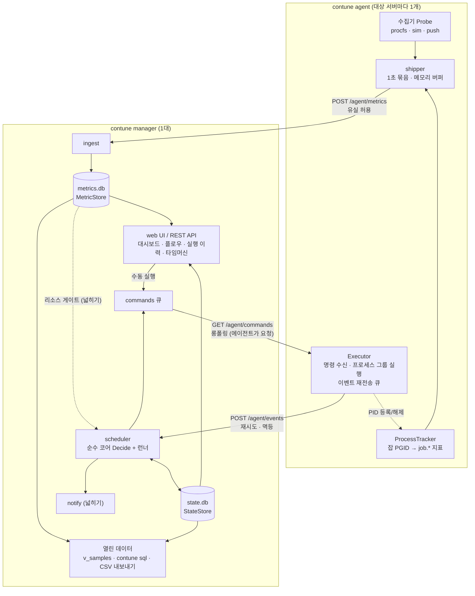
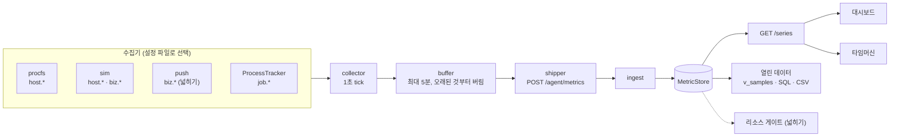
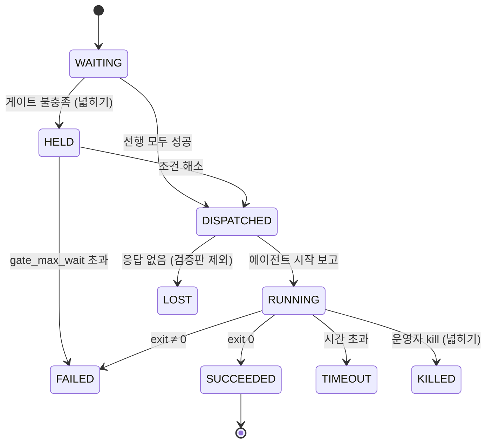

# 02. MVP 아키텍처

> 목표: 배치 스케줄러, 서버 관제, 업무 지표 수집을 한 제품으로 새로 만든 **개념 검증판**을 하루에 만든다. 모든 실행과 지표는 공개 스키마로 우리 DB에 쌓고(**데이터 주권**), 확장 지점은 처음부터 인터페이스로 열어 둔다.

**결정 사항 (2026-10-27)**

| 항목 | 결정 |
|---|---|
| 언어 | **Go** 확정 |
| 해커톤 | **하루, 2명**. 대회 규칙상 **코드는 당일 처음부터** 작성한다. 사전에는 설계 문서, 작업카드, AI 지시문, 개발 환경만 준비한다 |
| 심사 | 서류 심사 기준은 창의성 30, **업무 도구 실용성 30**, 구현 가능성 20, 기대 효과 20 ("사내에서 실제 업무 도구로 쓸 수 있는가") |
| 범위 | **새 스케줄러의 개념 검증판.** 개념 6개(스케줄, 원격 실행, 한 통로 지표, 실행 ID 연결, 데이터 주권, 보안 최소선)를 15:00까지 최소 형태로 잇는다. 기존 도구에 붙이는 래퍼나 단계적 이행 계획은 두지 않는다 |
| 데이터 주권 | 실행 이력과 지표를 공개 스키마로 저장하고, 분석용 뷰·`contune sql`·CSV 내보내기로 연다(§6.1) |
| AI | 제품 안의 AI·ML 기능은 범위에서 뺀다. AI는 **개발 수단**(사람 1명당 AI 세션 2개, 모두 4개)이다 |
| 업무 지표 | 초당 주문 건수, 응답시간 같은 처리 현황을 **시스템 지표와 같은 통로**로 받는다. 검증판 수치는 시뮬레이터가 만든다 |
| 시연 | 컨테이너 3개 + **시뮬레이터 수집기**. 수치만 가짜이고, 각 에이전트의 수집 체계(수집기 등록, 설정, 수집 루프, 전송)는 실제와 같다 |

## 1. 설계 원칙: 3원칙을 구체 규칙으로 번역

| 원칙 | 이 프로젝트에서의 규칙 |
|---|---|
| **확장성 (SOLID)** | 확장 지점은 **인터페이스 5개**로 한정합니다: `Probe`, `ProcessTracker`, `MetricStore`, `StateStore`, `Notifier`. 나머지는 구체 타입으로 시작하고, 구현이 두 번째로 필요해질 때 추상화합니다. 인터페이스는 작게 만들고 사용하는 쪽 패키지에 둡니다(Go 관례). |
| **테스트 보호** | 파서는 순수 함수 + `testdata/` 고정 파일로 테스트합니다. 저장소 구현은 **공용 계약 테스트**(LSP 검증)를 통과해야 합니다. 스케줄러는 **가짜 시계**로 표 기반 테스트를 합니다. 종단 간 스모크 테스트를 1개 둡니다. |
| **단순성** | 언어 1개, 바이너리 1개, 프로토콜 HTTP/JSON, DB SQLite, 프론트엔드 빌드 단계 없음. 새 의존성은 "표준 라이브러리로 하루 이상 걸리는가?"를 통과할 때만 추가합니다. |
| **데이터 주권** | 화면은 DB 위의 보기 중 하나입니다. 스키마(§8)를 공개하고, 분석용 뷰와 내보내기를 제품 기능으로 둡니다(§6.1). 스키마를 바꿀 때는 컬럼을 추가만 해서 기존 질의가 깨지지 않게 합니다. |

## 2. 기술 스택

| 영역 | 선택 | 이유 |
|---|---|---|
| 언어 | **Go** (에이전트와 매니저 공통) | 단일 정적 바이너리(런타임 의존성 0), goroutine과 channel, `os/exec` + `SysProcAttr{Setpgid: true}`, `net/http`, `embed`, `testing` 모두 표준. AI 코딩 도구와도 잘 맞습니다. |
| SQLite 드라이버 | `modernc.org/sqlite` | CGO가 없어 정적 빌드와 크로스 컴파일이 쉽습니다. |
| cron | `robfig/cron/v3`의 **파서만** 사용 | 실행 루프는 직접 작성합니다(가짜 시계를 주입하기 위해). |
| YAML | `gopkg.in/yaml.v3` | 플로우 정의, 에이전트 설정 |
| 잡 정의 | YAML 파일 | 정의의 기준은 파일 하나(git으로 관리). UI는 조회와 실행만 하고 CRUD 화면은 만들지 않습니다. |
| 웹 | `net/http`(Go 1.22 라우팅) + `embed` + vanilla JS + **uPlot** | 빌드 단계가 없습니다. 플로우(DAG) 화면은 단계(레벨)별 열 배치 HTML로 그려 외부 라이브러리를 늘리지 않습니다. |
| 통신 | HTTP/JSON, `Authorization: Bearer <에이전트 토큰>` | curl로 디버깅할 수 있고, 표준 TLS, 프록시, 로드밸런서를 그대로 쓸 수 있습니다. |
| 사내망 대비 | 당일 첫 커밋에서 `go mod vendor` + uPlot 파일을 저장소에 포함 | 이후 세션들이 외부 다운로드에 막히지 않습니다. 모듈을 받을 수 있는지는 사전에 확인만 합니다. 웹 화면은 외부 CDN을 쓰지 않습니다. |

> 바이너리는 하나이고 서브커맨드로 역할을 나눕니다: `contune manager`, `contune agent`, `contune dev`(매니저 + 에이전트 3개를 한 프로세스로, 노트북 시연용), `contune burn`(시연용 CPU 부하 잡), `contune sql`(두 DB를 읽기 전용으로 여는 SQL 조회, §6.1).

## 3. 기능 범위

| 영역 | contune이 하는 일 | 데이터 |
|---|---|---|
| **배치 스케줄·실행** | YAML 플로우를 cron으로 실행하고 선후행, 재시도, 시간 초과를 판단한다. 서버마다 에이전트가 명령을 받아 실행한다 | `runs`, `run_events`, `job.*` 지표(프로세스 추적기) |
| **업무 지표** | 업무 프로세스의 처리 현황(초당 주문 건수, 응답시간)을 시스템 지표와 **같은 통로**로 받고, 기동한 실행의 `exec_id`로 연결한다 | `biz.*` 지표 |
| **서버 관제** | 서버 자원을 1초 단위로 수집한다 | `host.*` 지표 |
| **열린 데이터** | 공개 스키마, 분석용 뷰, SQL 조회, CSV 내보내기 | §6.1 |

**실행(스케줄러) → 처리 현황(업무 지표) → 자원(서버·배치)** 을 `exec_id`와 시간축 하나로 잇고, 그 데이터를 우리가 직접 쓰는 것이 핵심입니다. 지금 사내에서는 이 세 영역을 서로 다른 세 도구가 따로 맡고 있습니다(기획서 1장).

## 4. 런타임 구조



> 모든 연결은 **에이전트가 매니저 쪽으로** 엽니다(방화벽 신청: 매니저 포트 1개). 실행 명령도 에이전트가 가져갑니다.

**단방향 연결로 하는 이유**
- 사내망에서 대상 서버에 **인바운드 포트를 여는 신청**은 어렵습니다. 에이전트가 바깥으로 나가는 연결만 쓰면 방화벽 작업이 매니저 포트 하나로 끝납니다.
- 엔드포인트를 3개로 나누면 지표가 밀려도 잡 이벤트와 명령은 영향을 받지 않습니다.

## 5. 지표 통로: 시스템 지표와 업무 지표를 하나로

업무 지표(초당 주문 건수, 응답시간 같은 처리 현황)는 수집기 종류가 다를 뿐, 시스템 지표와 같은 타입·전송·저장·조회·화면을 씁니다. 검증판 수치는 시뮬레이터 수집기가 만들고, 통로는 실제와 같습니다.



### 5.1 지표 이름 규칙

| 접두사 | 출처 | 예 |
|---|---|---|
| `host.*` | 서버 자원 수집기(procfs, sim) | `host.cpu.pct`, `host.mem.used_pct`, `host.load1` |
| `job.*` | 프로세스 추적기 (**`exec_id` 필수**) | `job.cpu.pct`, `job.rss.mb` |
| `biz.*` | 업무 지표 수집기(sim, push) | `biz.order.tps`, `biz.order.latency_p99_ms`, `biz.order.reject_pct`, `biz.match.tps` |

- 값은 모두 **게이지(float64) 하나**입니다. 수집기는 주기마다 **집계된 값**을 냅니다: TPS는 주기 안의 건수 ÷ 초, 응답시간은 p50/p99. 히스토그램 타입은 필요해질 때 추가합니다.
- 차원(시장, 채널 등)이 필요해지면 `series`에 `labels` 컬럼을 추가합니다. `samples` 테이블과 API 형태는 바뀌지 않습니다.

### 5.2 수집기 종류 (`Probe` 구현)

| `type` | 검증판 | 내용 |
|---|---|---|
| `procfs` | 핵심 | `/proc/stat`, `/proc/meminfo`, `/proc/loadavg` → `host.*` (`//go:build linux`) |
| `sim` | 핵심 | 프로필(`host`, `matching`, `gateway`)별 시뮬레이션: 랜덤 워크 + 장 시간대 패턴 + **이 서버에서 도는 잡의 CPU에 비례한 지연 증가**(`load_coupling`). 시드를 받아 테스트에서 결정적으로 동작 |
| `push` | 넓히기 | 에이전트가 `127.0.0.1` 포트를 열고, 업무 프로세스가 지표를 보냅니다(줄 형식 `name value [exec_id]`). 수신 값은 버퍼에 두었다가 `Collect` 때 내보냅니다 |
| `script` | 제외 | 명령을 주기적으로 실행해 stdout의 `name value` 줄을 파싱(DB 미처리 건수 등) |
| `ebpf`, `perf` | 제외 | 커널이 지원할 때 |

### 5.3 에이전트 설정 파일

```yaml
# deploy/agent-match-01.yaml (시연용 컨테이너)
host: match-01
manager: http://manager:8080
token: ${CONTUNE_TOKEN}
interval: 1s
probes:
  - type: sim
    profile: host            # host.cpu.pct, host.mem.used_pct
    seed: 1
  - type: sim
    profile: matching        # biz.order.tps, biz.order.latency_p99_ms, biz.order.reject_pct
    seed: 2
    load_coupling: 0.6       # 이 서버에서 도는 잡 CPU 1%당 p99 지연 +0.6ms

# 실서버에서는 수집기 종류만 바꿉니다
# probes:
#   - type: procfs
#   - type: push
#     listen: 127.0.0.1:9101
```

### 5.4 수집기 등록 (OCP)

새 수집기는 파일 하나를 추가하고 `Register`만 호출합니다. 다른 코드는 바뀌지 않습니다.

```go
// internal/agent/probe
type Probe interface {
    Name() string
    Collect(ctx context.Context, emit func(model.Sample)) error
}

type Env struct {
    Host    string
    JobLoad func() float64 // 이 서버에서 실행 중인 잡 CPU 합(%). sim의 load_coupling용
}

type Factory func(cfg map[string]any, env Env) (Probe, error)

func Register(kind string, f Factory)            // 각 수집기 파일의 init()에서 호출
func Build(cfgs []map[string]any, env Env) ([]Probe, error)
```

### 5.5 기동한 프로세스와 업무 지표 잇기

- Executor는 자식 프로세스에 환경변수 `CONTUNE_EXEC_ID`, `CONTUNE_FLOW`, `CONTUNE_STEP`을 넘깁니다(검증판 핵심, 한 줄).
- 그 프로세스가 `push` 수집기로 업무 지표를 보낼 때 `exec_id`를 붙이면, **어느 실행이 띄운 프로세스의 처리량인지** 바로 알 수 있습니다.
- 장 시작 전 기동해 장 마감 후 정지하는 **상주 프로세스**는 스텝 종류 `kind: service`로 다룹니다(검증판 제외). 성공 기준은 "종료 코드 0"이 아니라 "기동 후 살아 있음"입니다.

## 6. 에이전트 ↔ 매니저 계약 (API v1)

**에이전트용** (`Authorization: Bearer <토큰>` 필수)

| 메서드 · 경로 | 신뢰성 | 내용 |
|---|---|---|
| `POST /api/v1/agent/metrics` | **유실 허용** (실패하면 버퍼에 두고 다음에 재시도, 넘치면 버림) | 1초마다 샘플 묶음 전송 |
| `POST /api/v1/agent/events` | **반드시 전달** (성공할 때까지 재시도). 매니저는 `(exec_id, seq)`로 멱등 처리 | 잡 시작, 종료 보고와 요약(peak, 로그 tail) |
| `GET /api/v1/agent/commands?host=<id>&wait=25s` | 롱폴링. 에이전트는 **이미 받은 `exec_id`를 무시** | `run`, `kill`(넓히기) 명령 수신 |

**화면용** (검증판에서는 인증 없음)

| 메서드 · 경로 | 내용 |
|---|---|
| `GET /api/v1/hosts` | 호스트 목록, 마지막 수신 시각, 최신 지표 값 |
| `GET /api/v1/series?host=&name=&exec_id=&from=&to=&step=` | 시계열 조회. `step`(초) 단위 평균으로 다운샘플 |
| `GET /api/v1/runs?flow=&host=&limit=` | 실행 이력 |
| `GET /api/v1/runs/{exec_id}` | 실행 상세 + 상태 전이 이력 |
| `GET /api/v1/flows` | 플로우 목록, 스텝 구조, cron 다음 실행 시각, 최근 실행의 스텝별 상태 |
| `POST /api/v1/flows/{id}/run` | 플로우 수동 실행 |
| `GET /api/v1/export/samples?from=&to=&host=&name=&exec_id=` | 지표 CSV 내보내기 (§6.1) |
| `GET /api/v1/export/runs?from=&to=` | 실행 이력 CSV 내보내기 (§6.1) |

```jsonc
// POST /api/v1/agent/metrics
{"host":"match-01","samples":[
  {"ts":1761534000000,"name":"host.cpu.pct","value":42.5},
  {"ts":1761534000000,"name":"biz.order.latency_p99_ms","value":11.8},
  {"ts":1761534000000,"name":"job.cpu.pct","value":98.1,"exec_id":"01JBQ3..."}]}

// GET /api/v1/agent/commands 응답
{"commands":[{"type":"run","exec_id":"01JBQ3...","flow":"daily-settle","step":"settle",
              "command":["/batch/settle.sh"],"timeout_sec":1800}]}

// POST /api/v1/agent/events — 시작
{"exec_id":"01JBQ3...","seq":1,"type":"started","ts":1761534000000,"pid":4121}

// POST /api/v1/agent/events — 종료
{"exec_id":"01JBQ3...","seq":2,"type":"finished","ts":1761535800000,"status":"FAILED","exit_code":1,
 "usage":{"peak_cpu_pct":187.0,"peak_rss_mb":3120},
 "log_tail":"...마지막 200줄..."}
```

### 6.1 열린 데이터 (데이터 주권)

화면은 DB 위의 보기 중 하나입니다. 같은 데이터를 화면 없이 꺼내 쓰는 길을 제품 기능으로 둡니다.

| 수단 | 내용 |
|---|---|
| 공개 스키마 | §8의 테이블과 뷰가 곧 공개 스키마입니다. 컬럼을 지우거나 의미를 바꾸지 않고 추가만 합니다 |
| 분석용 뷰 `v_samples` | `series`와 `samples`를 조인해 `(host, name, exec_id, ts, value)`로 펼친 뷰입니다. 분석하는 사람은 이 뷰와 `runs`만 알면 됩니다 |
| `contune sql` | `contune sql --data <dir> "<SELECT ...>" [--csv]`. `metrics.db`를 읽기 전용(`mode=ro`)으로 열고 `state.db`를 읽기 전용으로 붙여(ATTACH) 한 질의에서 `runs`와 `v_samples`를 조인합니다. 쓰기 질의는 실패합니다 |
| CSV 내보내기 | `GET /api/v1/export/samples` → `ts,host,name,exec_id,value`, `GET /api/v1/export/runs` → `runs` 컬럼 그대로. 둘 다 헤더 포함 |
| 보존 정책 | 보존 기간과 수집 주기는 설정 파일로 우리가 정합니다(검증판 기본: 지표 7일, 실행 이력 무기한) |

```sql
-- 배치가 도는 동안의 체결 p99 응답시간 평균, 높은 순 5개 (contune sql로 실행)
SELECT r.flow_id, r.step_id, r.exec_id,
       ROUND(AVG(v.value), 1) AS p99_ms_during_run
FROM runs r
JOIN v_samples v
  ON v.host = 'match-01'
 AND v.name = 'biz.order.latency_p99_ms'
 AND v.ts BETWEEN r.started_at AND r.ended_at
GROUP BY r.exec_id
ORDER BY p99_ms_during_run DESC
LIMIT 5;
```

- 제품 안에 머신러닝 기능은 넣지 않습니다. 같은 데이터를 SQL이나 CSV로 꺼내 분석 도구에서 돌립니다(예: 소요 시간 이상 탐지, 배치 소요 시간 예측, 서버 용량 예측).
- 저장소를 MySQL로 바꾸면 분석하는 사람은 읽기 전용 계정으로 같은 테이블과 뷰를 조회합니다.

## 7. 확장 지점: 인터페이스 5개

```go
// internal/model — 의존성 0인 공용 타입
type Sample struct {
    TS     int64   // unix ms
    Host   string
    Name   string  // "host.cpu.pct", "job.rss.mb", "biz.order.tps"
    Value  float64
    ExecID string  // 잡 실행 태그, 일반 지표면 ""
}

// internal/agent/probe — 수집기 확장 (procfs, sim, push, script, eBPF)
type Probe interface {
    Name() string
    Collect(ctx context.Context, emit func(model.Sample)) error
}

// internal/agent/exec — 잡 프로세스 묶음 추적 (PGID 스캔 → cgroup v2)
type ProcessTracker interface {
    Track(execID string, pid int) error // 실행 직후 등록
    Collect(emit func(model.Sample))    // 추적 중인 잡별 job.* 지표
    Untrack(execID string) model.Usage  // 종료 시 요약(peak) 반환
    Load() float64                      // 실행 중인 잡 CPU 합(%) — sim 연동용
}

// internal/manager/store — 저장소 확장 (SQLite → TSDB / MySQL)
type MetricStore interface {
    Write(ctx context.Context, batch []model.Sample) error
    Query(ctx context.Context, q model.SeriesQuery) ([]model.Series, error)
}
type StateStore interface {
    UpsertRun(ctx context.Context, r model.Run) error          // exec_id 기준 멱등
    AppendEvent(ctx context.Context, e model.RunEvent) error   // 상태 전이 감사 로그, (exec_id, seq) 멱등
    GetRun(ctx context.Context, execID string) (model.Run, []model.RunEvent, error)
    ListRuns(ctx context.Context, f model.RunFilter) ([]model.Run, error)
}

// internal/manager/notify — 알림 확장 (webhook, 사내 메신저) · 검증판에서는 넓히기
type Notifier interface{ Notify(ctx context.Context, a model.Alert) error }
```

- 계약(위 타입과 인터페이스, API DTO)은 대회 규칙상 미리 코드로 쓸 수 없습니다. **당일 09:00~09:30에 리드가 이 문서를 AI 세션으로 코드로 옮겨 확정**하고 10:30에 동결합니다. 이후 변경은 리드만 합니다.
- `Executor`와 스케줄러는 인터페이스로 만들지 않습니다. 구현이 하나뿐이고, OS 의존 부분은 `ProcessTracker`가, 시간 의존 부분은 주입하는 시계가 흡수합니다(YAGNI).
- **스케줄러 코어**는 순수 함수입니다: `Decide(now, flows, runs) []Action`. 부작용(DB 쓰기, 명령 큐잉)은 런너가 처리합니다.

## 8. 데이터 모델

### metrics.db: 시계열 (series/samples, TSDB와 같은 모델)

```sql
PRAGMA journal_mode = WAL;
PRAGMA synchronous  = NORMAL;

CREATE TABLE series (
  id      INTEGER PRIMARY KEY,
  host    TEXT NOT NULL,
  name    TEXT NOT NULL,              -- 'host.cpu.pct', 'job.cpu.pct', 'biz.order.tps'
  exec_id TEXT NOT NULL DEFAULT '',   -- 잡 실행 태그 ('' = 일반 지표)
  UNIQUE (host, name, exec_id)
);

CREATE TABLE samples (
  series_id INTEGER NOT NULL,
  ts        INTEGER NOT NULL,         -- unix ms
  value     REAL    NOT NULL,
  PRIMARY KEY (series_id, ts)
) WITHOUT ROWID;

CREATE VIEW v_samples AS                 -- 분석용 공개 뷰 (§6.1)
SELECT s.host, s.name, s.exec_id, p.ts, p.value
FROM samples p JOIN series s ON s.id = p.series_id;
```

- **새 수집기를 추가해도 스키마는 바뀌지 않습니다.** 지표 이름 규칙(§5.1)만 따르면 됩니다.
- **저장량 추정:** 행당 약 25~35B, 호스트 지표 25개를 1초 간격으로 수집하면 **호스트당 하루 약 50~80MB**입니다. 검증판은 보존 7일입니다. 다운샘플(1초 → 1분)이나 TSDB가 필요해지면 `MetricStore` 구현만 바꿉니다.

### state.db: 실행 상태 (무결성 우선)

```sql
PRAGMA journal_mode = WAL;
PRAGMA synchronous  = FULL;

CREATE TABLE hosts (
  id TEXT PRIMARY KEY, last_seen INTEGER, agent_version TEXT, info TEXT
);

CREATE TABLE runs (                      -- 스텝 실행 1회 = 1행
  exec_id      TEXT PRIMARY KEY,         -- ULID
  flow_run_id  TEXT NOT NULL,            -- 같은 플로우 실행에 속한 스텝 묶음
  flow_id      TEXT NOT NULL,
  step_id      TEXT NOT NULL,
  host         TEXT NOT NULL,
  trigger      TEXT NOT NULL,            -- schedule | manual (재시도는 attempt로 구분)
  attempt      INTEGER NOT NULL DEFAULT 1,
  status       TEXT NOT NULL,            -- §10
  scheduled_at INTEGER, started_at INTEGER, ended_at INTEGER,
  exit_code    INTEGER,
  peak_cpu_pct REAL, peak_rss_mb REAL,
  log_tail     TEXT
);
CREATE INDEX ix_runs_flow ON runs(flow_id, scheduled_at);

CREATE TABLE run_events (                -- 상태 전이 + 운영자 조작 감사 로그
  exec_id TEXT NOT NULL, seq INTEGER NOT NULL, ts INTEGER NOT NULL,
  from_status TEXT, to_status TEXT NOT NULL,
  actor TEXT NOT NULL,                   -- 'scheduler' | 'agent:batch-01' | 'user:hong'
  reason TEXT,
  PRIMARY KEY (exec_id, seq)
);
```

- 플로우와 스텝 **정의**는 YAML 파일에만 있고 DB에 넣지 않습니다. 정의의 기준이 두 군데가 되는 문제를 피하기 위해서입니다.
- 재시도는 같은 `flow_run_id`, `step_id`에 `attempt`를 1씩 올린 새 행(새 `exec_id`)으로 남습니다. 시도마다 지표가 따로 태깅됩니다.

## 9. 잡 정의: 플로우 단위 스케줄

잡마다 cron을 두고 선행 잡을 지정하는 방식은 "어느 날의 선행 실행인가"를 맞추는 로직(업무일 기준 매칭)이 필요합니다. contune은 **플로우(DAG) 단위로 스케줄**하고, 한 번의 플로우 실행 안에서만 의존성을 따져 이 문제 자체를 없앱니다.

```yaml
# flows/daily-settle.yaml
id: daily-settle
schedule: "0 2 * * 1-5"       # 평일 02:00 (KST)
on_missed: skip               # 매니저 다운 등으로 놓친 실행은 건너뛰고 기록
steps:
  - id: fetch
    host: batch-01
    command: [/batch/fetch.sh]
    timeout: 10m

  - id: settle
    host: batch-01
    command: [/batch/settle.sh]
    depends: [fetch]
    timeout: 30m
    retry: { count: 2, interval: 1m }          # 재시도 (핵심)
    gate:                                      # 리소스 게이트 (넓히기): 어떤 지표든 조건으로
      - { host: match-01, metric: biz.order.latency_p99_ms, max: 50 }
      - { host: batch-01, metric: host.cpu.pct, max: 80 }
    gate_max_wait: 20m

  - id: report
    host: batch-01
    command: [/batch/report.sh]
    depends: [settle]
```

- 리소스 게이트는 **지표 통로를 그대로 재사용**합니다. 서버 지표든 업무 지표든 같은 조회로 판단하므로, "체결 지연이 높으면 배치를 미룬다" 같은 조건을 추가 개발 없이 씁니다.
- 플로우 사이의 의존(업무일 기준)과 휴일 캘린더는 검증판 범위 밖입니다.

## 10. 상태 머신



| 상태 | 검증판 | 이유 |
|---|---|---|
| `WAITING`, `DISPATCHED`, `RUNNING`, `SUCCEEDED`, `FAILED`, `TIMEOUT` | 핵심 (15:00) | 스케줄러가 실행하는 기본 흐름. `DISPATCHED`는 명령 재전송 시 **중복 실행을 막는 기준점**입니다 |
| `HELD` | 넓히기 | 게이트에 의한 대기. `gate_max_wait`이 없으면 SLA를 조용히 넘기므로 반드시 같이 넣습니다 |
| `KILLED` | 넓히기 | 운영자 kill |
| `LOST` | 제외 | 결과를 알 수 없는 상태. 복구 정책이 필요합니다 |

- **재시도(핵심):** FAILED나 TIMEOUT이고 횟수가 남아 있으면 `retry.interval` 뒤에 **새 attempt(새 `exec_id`)**를 WAITING부터 시작합니다. 시도마다 지표가 따로 태깅됩니다.
- **선행 실패:** 후행은 WAITING을 유지합니다(화면에 "선행 실패로 대기" 표시). `rerun`, `force-ok` 같은 운영자 조작은 검증판 범위 밖입니다.
- **게이트 판단 정책:** 지표가 오래되었으면(에이전트 무응답) 통과시키지 않고 HELD로 둡니다. "모르면 실행하지 않는다"는 원칙입니다.

## 11. 보안 최소선

| 구분 | 내용 |
|---|---|
| 검증판 | **에이전트 토큰**(매니저는 토큰이 맞는 에이전트만 받음) · **명령 출처는 리뷰된 YAML뿐**(UI와 API로 임의 명령을 입력하는 기능은 만들지 않음) · **에이전트는 비root로 실행** · 상태 전이에 `actor` 기록 · `contune sql`은 읽기 전용 연결 |
| 검증판 제외 | 웹 로그인, TLS, 호스트별 토큰, 조작 권한, `run_as_user`(보안 정책 협의 후). 운영에 쓰려면 필요합니다 |

## 12. 원인 추적(타임머신) 설계

실행 하나를 고르면 화면이 **결정론적으로** 근거를 모아 한 시간축에 겹칩니다. LLM은 쓰지 않습니다.

| 표시 항목 | 출처 |
|---|---|
| 실행 구간(`started_at`~`ended_at`, 앞뒤 5분)의 해당 서버 `host.*` | `GET /series?host=<run.host>&name=host.cpu.pct` |
| 그 실행의 `job.*` | `GET /series?exec_id=<exec_id>` |
| 같은 구간의 업무 지표 `biz.*` (선택한 서버) | `GET /series?host=match-01&name=biz.order.latency_p99_ms` |
| 같은 서버에서 구간이 겹친 다른 실행 | `GET /runs?host=<run.host>` 후 구간 겹침 필터 |
| 종료 코드, 소요 시간, peak, 로그 tail | `GET /runs/{exec_id}` |
| 같은 구간의 원자료 | `GET /export/samples?from=&to=` (CSV), `contune sql` |

> 확장(선택): 위 근거를 요약하는 LLM `Analyzer`나 소요 시간 이상 플래그(과거 N회 평균 대비)를 같은 근거 위에 얹을 수 있습니다. 해커톤 범위는 아닙니다.

## 13. 시연 환경: 컨테이너 + 시뮬레이터

```yaml
# deploy/docker-compose.yml (요지)
services:
  manager:  { image: contune, command: [manager, --flows, /flows, --data, /data], ports: ["8080:8080"] }
  match-01: { image: contune, command: [agent, --config, /etc/contune/agent-match-01.yaml] }
  gw-01:    { image: contune, command: [agent, --config, /etc/contune/agent-gw-01.yaml] }
  batch-01: { image: contune, command: [agent, --config, /etc/contune/agent-batch-01.yaml] }
```

| 호스트 | 역할(가정) | 수집기 |
|---|---|---|
| `match-01` | 체결 서버 | `sim/host`, `sim/matching`(`load_coupling` 켬) |
| `gw-01` | 주문 게이트웨이 | `sim/host`, `sim/gateway` |
| `batch-01` | 정산 배치 서버 | `sim/host` |

- 컨테이너 안의 `/proc/stat`은 호스트 값이라 서버별로 다르게 보이지 않습니다. 그래서 시연에서는 `host.*`도 `sim`으로 만듭니다.
- **잡 실행과 프로세스 추적은 컨테이너 안에서도 실제로 동작합니다.** 시연용 무거운 배치는 `contune burn --cpu 2 --duration 90s`로 실제 CPU를 씁니다. `match-01`에서 돌리면 `sim/matching`의 p99 지연이 그 CPU에 비례해 오릅니다.
- 시연 플로우는 2개입니다. `flows/daily-settle.yaml`(batch-01, fetch → settle → report, settle은 첫 시도만 실패해 재시도를 보여줌)과 `flows/heavy-stats.yaml`(match-01, `contune burn --cpu 2 --duration 90s`). 화면의 실행 버튼이나 `demo.sh`로 실행합니다.
- 데이터 주권 장면은 `docker compose exec manager contune sql --data /data "<질의>"`로 실행합니다(§6.1의 질의).
- Docker를 쓸 수 없으면 `contune dev`(매니저 + 에이전트 3개를 한 프로세스로)로 같은 시연을 합니다.

## 14. 확장 지점 (인터페이스별)

단계 계획이 아니라, 각 인터페이스 뒤에 무엇을 바꿔 끼울 수 있는지의 목록입니다.

| 확장 지점 | 검증판 | 바꿔 끼울 수 있는 구현 |
|---|---|---|
| `Probe` | procfs, sim, (넓히기) push | script, eBPF/perf (커널이 지원할 때) |
| `ProcessTracker` | PGID 스캔 | subreaper로 탈출 프로세스 회수, cgroup v2 (자손 포함 정확한 집계, 일괄 kill) |
| `MetricStore` | SQLite | 보존 기간 + 다운샘플, `labels` 차원, VictoriaMetrics 등 TSDB |
| `StateStore` | SQLite | MySQL/PostgreSQL (**같은 계약 테스트 재사용**) |
| `Notifier` | (넓히기) webhook | 사내 메신저, SMS 게이트웨이 |
| 스케줄러 | 플로우 cron, 선후행, 재시도, (넓히기) 리소스 게이트 | `kind: service` 상주 프로세스, 운영자 조작, LOST 복구, 휴일 캘린더, 플로우 간 의존, 매니저 HA |
| 원인 추적·분석 | 타임머신(결정론적), `v_samples`, `contune sql`, CSV | 소요 시간 이상 플래그, 근거 요약 `Analyzer`(선택) |
| 에이전트 OS | Linux | AIX/Windows용 `Probe` 구현 |

> **DB 전환 참고:** "ANSI SQL로 쓰면 그대로 재사용"은 현실과 다릅니다. upsert 문법, 플레이스홀더, 시간 함수가 DB마다 다릅니다. 전환이 가능한 근거는 SQL 문법이 아니라 **Store 인터페이스 + 계약 테스트**입니다. 구현체는 DB마다 따로 두고 같은 테스트 스위트로 검증합니다. Go의 `database/sql`이 ODBC 역할을 합니다.
