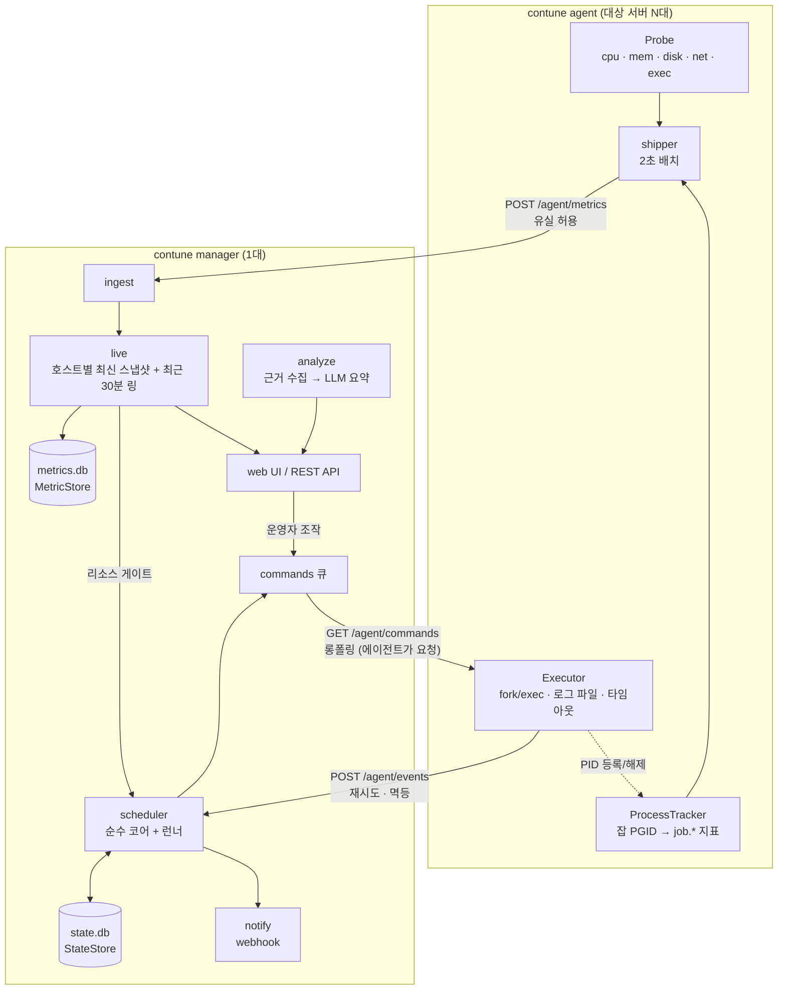
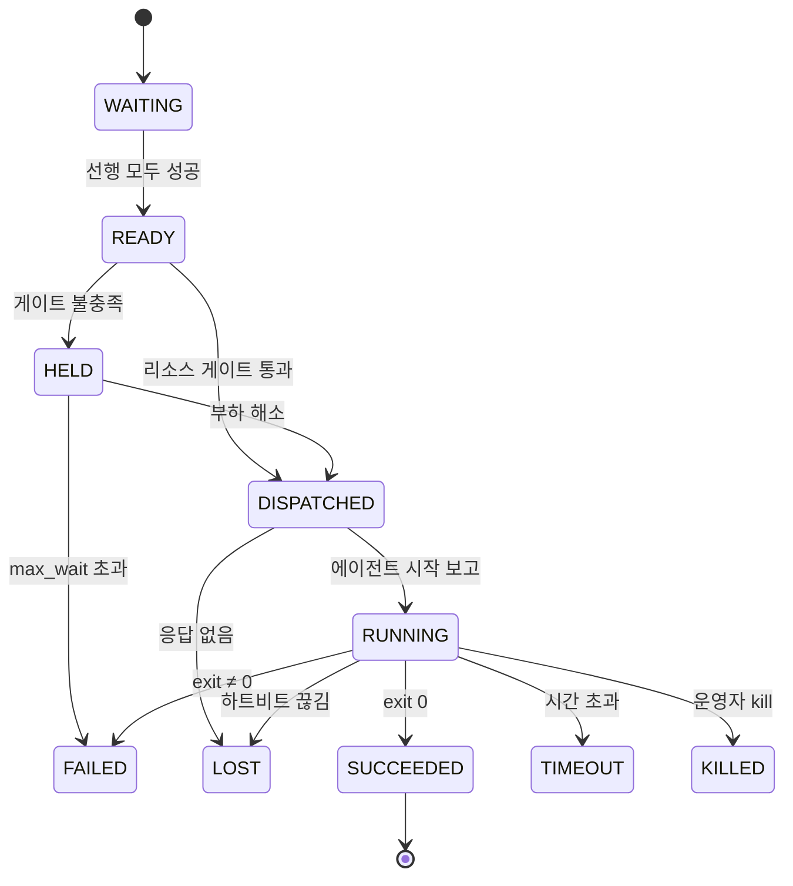

# 02. MVP 아키텍처 (권장안)

> 목표: **최소 기능으로 동작하는 통합 제품**(호스트 관제 + 잡 실행·스케줄링 + 업무 지표)을 만들되, 확장 지점은 처음부터 인터페이스로 열어둔다.

## 1. 설계 원칙: 3원칙을 구체 규칙으로 번역

| 원칙 | 이 프로젝트에서의 규칙 |
|---|---|
| **확장성 (SOLID)** | 확장 지점은 **6개 인터페이스**로 한정합니다: `Probe`, `ProcessTracker`, `MetricStore`, `StateStore`, `Notifier`, `Analyzer`. 나머지는 구체 타입으로 시작하고, 구현이 두 번째로 필요해질 때 추상화합니다. 인터페이스는 작게 만들고 사용하는 쪽 패키지에 둡니다(Go 관례). |
| **테스트 보호** | 파서는 순수 함수 + `testdata/` 고정 파일로 테스트합니다. 저장소 구현은 **공용 계약 테스트**(LSP 검증)를 통과해야 합니다. 스케줄러는 **가짜 시계**로 표 기반 테스트를 합니다. 종단 간 스모크 테스트를 1개 둡니다. |
| **단순성** | 언어 1개, 바이너리 1개, 프로토콜 HTTP/JSON, DB SQLite, 프론트엔드 빌드 단계 없음. 새 의존성은 "표준 라이브러리로 하루 이상 걸리는가?"를 통과할 때만 추가합니다. |

## 2. 기술 스택

| 영역 | 선택 | 이유 |
|---|---|---|
| 언어 | **Go** (에이전트와 매니저 공통) | 단일 정적 바이너리(런타임 의존성 0), goroutine과 channel이 링버퍼와 스레드 분리를 대체, `os/exec` + `SysProcAttr{Setpgid: true}`, `net/http`, `embed`, `testing` 모두 표준. C/C++ 대비 개발 속도가 수 배 빠르고 AI 코딩 도구와도 잘 맞습니다. |
| SQLite 드라이버 | `modernc.org/sqlite` | CGO가 없어 정적 빌드와 크로스 컴파일이 쉽습니다. |
| cron | `robfig/cron/v3`의 **파서만** 사용 | 실행 루프는 직접 작성합니다(가짜 시계를 주입하기 위해). |
| 잡 정의 | YAML 파일 | 정의의 기준은 파일 하나(git으로 관리). UI는 조회와 실행만 하고, CRUD 화면은 만들지 않습니다(시간 절약). |
| 웹 | `net/http` + `embed` + vanilla JS + **uPlot** | 빌드 파이프라인이 없습니다. DAG 그림은 **mermaid**로(텍스트로 그래프 생성). |
| 통신 | HTTP/JSON, `Authorization: Bearer <호스트 토큰>` | curl로 디버깅할 수 있고, 표준 TLS, 프록시, 로드밸런서를 그대로 쓸 수 있습니다. |
| AI | LLM 어댑터 1개 (사내 허용 모델/게이트웨이) | `Analyzer` 인터페이스 뒤에 두고, LLM을 쓸 수 없으면 근거만 표시합니다. |

> 바이너리는 하나이고 서브커맨드로 역할을 나눕니다: `contune manager`, `contune agent`, `contune dev`(매니저 + 로컬 에이전트, 노트북 데모용), `contune exec -- <cmd>`(래퍼 모드, M4).

## 3. 런타임 구조



> 모든 연결은 **에이전트가 매니저 쪽으로** 엽니다(방화벽 신청: 매니저 포트 1개).

**단방향 연결로 하는 이유**
- 사내망에서 대상 서버에 **인바운드 포트를 여는 신청**은 어렵습니다. 에이전트가 바깥으로 나가는 연결 1개만 쓰면 방화벽 작업이 매니저 포트 하나로 끝납니다.
- 엔드포인트를 3개로 나누면 Gemini 안의 "우선순위 채널"이 자연스럽게 구현됩니다. 지표가 밀려도 잡 이벤트와 명령은 영향을 받지 않습니다.

## 4. 에이전트 ↔ 매니저 계약 (API v1)

| 메서드 · 경로 | 신뢰성 | 내용 |
|---|---|---|
| `POST /api/v1/agent/metrics` | **유실 허용** (실패하면 버림) | 2초마다 샘플 배치 전송 |
| `POST /api/v1/agent/events` | **반드시 전달** (재시도). 매니저는 `(exec_id, seq)`로 멱등 처리 | 잡 시작, 종료, 실패 보고와 요약(peak, 로그 tail) |
| `GET /api/v1/agent/commands?wait=25s` | 롱폴링. 에이전트는 **이미 받은 `exec_id`를 무시** | `run`, `kill` 명령 수신 |
| `POST /api/v1/push` (M3) | 유실 허용 | 업무 앱이나 스크립트가 업무 지표를 직접 전송(curl 한 줄) |

```jsonc
// POST /api/v1/agent/metrics
{"host":"batch-01","samples":[
  {"ts":1761534000000,"name":"host.cpu.user_pct","value":12.5},
  {"ts":1761534000000,"name":"job.cpu_pct","value":98.1,"exec_id":"01JBQ3..."}]}

// GET /api/v1/agent/commands 응답
{"commands":[{"type":"run","exec_id":"01JBQ3...","flow":"daily-settle","step":"settle",
              "command":"/batch/settle.sh","timeout_sec":1800}]}

// POST /api/v1/agent/events
{"exec_id":"01JBQ3...","seq":2,"type":"finished","ts":1761535800000,"exit_code":1,
 "usage":{"peak_cpu_pct":187.0,"peak_rss_mb":3120,"io_read_kb":2048000,"io_write_kb":512},
 "log_tail":"...마지막 200줄..."}
```

## 5. 확장 지점: 인터페이스 6개

```go
// internal/model — 의존성 0인 공용 타입
type Sample struct {
    TS     int64   // unix ms
    Host   string
    Name   string  // "host.cpu.user_pct", "job.rss_mb", "biz.order_queue"
    Value  float64
    ExecID string  // 잡 실행 태그, 일반 지표면 ""
}

// agent/probe — 수집기 확장 (/proc → exec 스크립트 → eBPF/perf …)
type Probe interface {
    Name() string
    Collect(ctx context.Context, emit func(model.Sample)) error
}

// agent/tracker — 잡 프로세스 묶음 추적 (PGID 스캔 → cgroup v2)
type ProcessTracker interface {
    Track(execID string, pid int) error // 실행 직후 등록
    Collect(emit func(model.Sample))    // 추적 중인 잡별 job.* 지표
    Untrack(execID string) model.Usage  // 종료 시 요약(peak, 합계) 반환
}

// manager/store — 저장소 확장 (SQLite → TSDB / RDBMS)
type MetricStore interface {
    Write(ctx context.Context, batch []model.Sample) error
    Query(ctx context.Context, q model.SeriesQuery) ([]model.Series, error)
}
type StateStore interface {
    UpsertRun(ctx context.Context, r model.Run) error          // exec_id 기준 멱등
    AppendEvent(ctx context.Context, e model.RunEvent) error   // 상태 전이 감사 로그
    ListRuns(ctx context.Context, f model.RunFilter) ([]model.Run, error)
}

// manager/notify, manager/analyze
type Notifier interface{ Notify(ctx context.Context, a model.Alert) error }
type Analyzer interface{ Explain(ctx context.Context, ev model.Evidence) (string, error) }
```

- 위 시그니처는 **M0 골격에서 검증한 뒤 동결**합니다. 지금 확정한 것이 아닙니다.
- `Executor`와 스케줄러는 인터페이스로 만들지 않습니다. 구현이 하나뿐이고, OS 의존 부분은 `ProcessTracker`가, 시간 의존 부분은 주입하는 시계가 흡수합니다(YAGNI).
- **스케줄러 코어**는 순수 함수입니다: `Decide(now, flows, runs, hostSnapshot) []Action`. 부작용(DB 쓰기, 명령 큐잉)은 런너가 처리합니다.

## 6. 데이터 모델

### metrics.db: 시계열 (series/samples, TSDB와 같은 모델)

```sql
PRAGMA journal_mode = WAL;
PRAGMA synchronous  = NORMAL;

CREATE TABLE series (
  id      INTEGER PRIMARY KEY,
  host    TEXT NOT NULL,
  name    TEXT NOT NULL,              -- 'host.cpu.user_pct', 'job.cpu_pct', 'biz.order_queue'
  exec_id TEXT NOT NULL DEFAULT '',   -- 잡 실행 태그 ('' = 일반 지표)
  UNIQUE (host, name, exec_id)
);

CREATE TABLE samples (
  series_id INTEGER NOT NULL,
  ts        INTEGER NOT NULL,         -- unix ms
  value     REAL    NOT NULL,
  PRIMARY KEY (series_id, ts)
) WITHOUT ROWID;
```

- **새 프로브를 추가해도 스키마는 바뀌지 않습니다.** 지표 이름 규칙만 따르면 됩니다: `host.*`, `job.*`, `biz.*`.
- `host, name, exec_id`를 정수 `series_id`로 사전화해서 행 크기를 줄입니다.
- **저장량 추정:** 행당 약 25~35B, 호스트 지표 25개를 1초 간격으로 수집하면 **호스트당 하루 약 50~80MB**입니다. 10대 × 30일이면 약 15~25GB이므로, MVP는 보존 7일로 두고 이후 다운샘플(1초 → 1분)을 붙입니다. 규모가 더 커지면 `MetricStore`만 TSDB 구현으로 교체합니다.
- 이 모델은 Prometheus나 VictoriaMetrics의 (labels → samples) 구조와 같아서 나중에 그대로 옮길 수 있습니다.

### state.db: 실행 상태 (무결성 우선)

```sql
PRAGMA journal_mode = WAL;
PRAGMA synchronous  = FULL;

CREATE TABLE hosts (
  id TEXT PRIMARY KEY, last_seen INTEGER, agent_version TEXT, info TEXT
);

CREATE TABLE runs (                      -- 스텝 실행 1회 = 1행
  exec_id      TEXT PRIMARY KEY,         -- ULID
  flow_run_id  TEXT NOT NULL,            -- 같은 플로우 실행에 속한 스텝 묶음
  flow_id      TEXT NOT NULL,
  step_id      TEXT NOT NULL,
  host         TEXT NOT NULL,
  trigger      TEXT NOT NULL,            -- schedule | manual | rerun | wrapper
  attempt      INTEGER NOT NULL DEFAULT 1,
  status       TEXT NOT NULL,            -- §8
  scheduled_at INTEGER, started_at INTEGER, ended_at INTEGER,
  exit_code    INTEGER,
  peak_cpu_pct REAL, peak_rss_mb REAL, io_read_kb INTEGER, io_write_kb INTEGER,
  log_tail     TEXT
);
CREATE INDEX ix_runs_flow ON runs(flow_id, scheduled_at);

CREATE TABLE run_events (                -- 상태 전이 + 운영자 조작 감사 로그
  exec_id TEXT NOT NULL, seq INTEGER NOT NULL, ts INTEGER NOT NULL,
  from_status TEXT, to_status TEXT NOT NULL,
  actor TEXT NOT NULL,                   -- 'scheduler' | 'agent:batch-01' | 'user:hong'
  reason TEXT,
  PRIMARY KEY (exec_id, seq)
);
```

- 플로우와 스텝 **정의**는 YAML 파일에만 있고 DB에 넣지 않습니다. 정의의 기준이 두 군데가 되는 문제를 피하기 위해서입니다.
- 분석 예시(UC-04): `ATTACH 'metrics.db'` 후, 실행 구간(`started_at`~`ended_at`)으로 `samples`를 조인합니다. 장시간 분석은 `VACUUM INTO`로 만든 스냅샷에서 실행합니다.

## 7. 잡 정의: 플로우 단위 스케줄

Gemini 안은 잡마다 cron이 있고 `pre_conditions`로 선행 잡을 지정하는 방식(Control-M 방식)입니다. 이 방식은 "어느 날의 선행 실행인가"를 맞추는 로직(업무일, ODAT)이 필요합니다. MVP는 **플로우(DAG) 단위로 스케줄**하고(Dagu, Airflow 방식), 한 번의 플로우 실행 안에서만 의존성을 따지도록 해서 이 문제 자체를 없앱니다.

```yaml
# flows/daily-settle.yaml
id: daily-settle
schedule: "0 2 * * 1-5"       # 평일 02:00 (KST)
on_missed: skip               # 매니저 다운 등으로 놓친 실행: skip(기록 + 알림) | run_once
steps:
  - id: fetch
    host: batch-01
    command: /batch/fetch.sh
    timeout: 10m

  - id: settle
    host: batch-02             # 스텝마다 다른 호스트 가능
    command: /batch/settle.sh
    depends: [fetch]
    timeout: 30m
    retry: { count: 2, interval: 1m }
    gate: { max_cpu_pct: 80, min_free_mem_mb: 2048, max_wait: 20m }   # 리소스 게이트

  - id: report
    host: batch-01
    command: /batch/report.sh
    depends: [settle]
```

- 플로우 사이의 의존(업무일 기준)과 휴일 캘린더는 이후 단계에서 다룹니다.

## 8. 상태 머신



- **재시도:** FAILED나 TIMEOUT이고 재시도 횟수가 남아 있으면 **새 attempt(새 `exec_id`)**를 WAITING부터 시작합니다. 시도마다 지표가 따로 태깅됩니다.
- **선행 실패:** 후행은 WAITING을 유지합니다. 운영자가 선행을 `rerun`하거나 `force-ok` 하면 진행합니다.

| 추가된 상태 | 이유 |
|---|---|
| `DISPATCHED` | 명령은 보냈지만 시작 보고는 아직 받지 못한 상태. 재전송 시 **중복 실행을 막는 기준점**입니다. |
| `HELD` | 리소스 게이트에 의한 대기(Gemini 안의 THROTTLED). `max_wait`이 없으면 SLA를 조용히 넘기므로 반드시 필요합니다. |
| `LOST` | 결과를 알 수 없는 상태(에이전트 무응답, 매니저 재기동). "모른다"를 명시해야 운영자가 판단할 수 있습니다. |

**운영자 조작:** `rerun`(새 `exec_id`), `force-ok`(SUCCEEDED로 바꾸고 사유 기록), `hold`/`free`, `kill`. 모두 `run_events`에 `actor`와 함께 기록합니다.

**리소스 게이트 판단 정책:** 호스트 스냅샷이 **오래되었으면**(에이전트 무응답) 게이트를 통과시키지 않고 HELD로 둡니다. `max_wait`이 지나면 FAILED와 알림. "모르면 실행하지 않는다"는 원칙입니다.

## 9. 보안 최소선 (MVP에도 필수)

1. **호스트별 에이전트 토큰.** 매니저는 등록된 호스트만 받습니다.
2. **명령의 출처는 리뷰된 YAML뿐입니다.** UI나 API에서 임의 커맨드를 입력하는 기능은 만들지 않습니다(UI는 정의된 스텝을 "실행"하는 것만).
3. **에이전트는 비root로 실행.** `run_as_user`는 보안 정책을 협의한 뒤 도입합니다.
4. **웹 UI 로그인**(데모는 최소 Basic 인증)과 **조작 감사 로그**(`run_events.actor`).
5. **LLM으로 보내기 전 마스킹:** 계좌번호, 주민번호 같은 패턴을 로그 tail에서 치환합니다. 외부 LLM을 쓸 수 없으면 사내 게이트웨이나 로컬 모델을 씁니다.

## 10. AI 원인 분석 설계 (환각 통제)

**흐름:** 실패/지연 실행 → ① **Evidence 수집기**(코드, 결정론적, 단위 테스트 가능) → ② **Analyzer**(LLM, 선택) → 원인 가설 + 근거 + 권장 조치

| Evidence 항목 | 출처 |
|---|---|
| 실행 구간의 호스트 지표 이상 (평소 대비 iowait 상승, 가용 메모리 하락 등) | `samples` (해당 호스트, 실행 구간 vs 과거 같은 시간대) |
| 같은 호스트에서 겹쳐 돈 잡 | `runs` (구간 겹침) |
| 잡 자체 peak CPU/RSS/IO와 소요 시간의 과거 N회 대비 | `runs` (같은 스텝 이력) |
| 로그 tail의 에러 라인 | `runs.log_tail` (마스킹 후) |

- **근거는 코드가 모으고 LLM은 요약만 합니다.** 그래서 데모가 LLM 상태에 좌우되지 않고, 답변이 항상 실제 데이터에 근거합니다.
- 소요 시간 이상 플래그("평소보다 2.3배 오래 걸림")는 단순 통계(과거 N회 평균, 표준편차)로 충분합니다.

## 11. 확장 로드맵 (인터페이스별)

| 확장 지점 | MVP | 다음 | 그 다음 |
|---|---|---|---|
| `Probe` | /proc cpu·mem·disk·net, exec 스크립트 | 프로세스 Top-N, 로그 패턴 카운트, SQL 질의 | eBPF/perf (커널이 지원할 때) |
| `ProcessTracker` | PGID 스캔 | subreaper로 탈출 프로세스 회수 | cgroup v2 (자손 포함 정확한 집계, `memory.max`, 일괄 kill) |
| `MetricStore` | SQLite | 보존 기간 + 다운샘플 | VictoriaMetrics 등 TSDB |
| `StateStore` | SQLite | MySQL/PostgreSQL (**같은 계약 테스트 재사용**) | |
| `Notifier` | webhook | 사내 메신저, SMS 게이트웨이 | |
| `Analyzer` | 근거 수집 + LLM 요약 | 이상 탐지 모델 | 자연어 질의("어제 settle 왜 느렸어?") |
| 스케줄러 | 플로우 cron + 선행 + 게이트 + 운영자 조작 | 휴일 캘린더, 플로우 간 의존(업무일) | 매니저 HA(액티브-스탠바이) |
| 에이전트 OS | Linux | | (필요 시) AIX/Windows용 `Probe` 구현 |

> **DB 전환 참고:** Gemini 안의 "ANSI SQL로 쓰면 그대로 재사용"은 현실과 다릅니다. upsert 문법, 플레이스홀더, 시간 함수가 DB마다 다릅니다. 전환이 가능한 근거는 SQL 문법이 아니라 **Store 인터페이스 + 계약 테스트**입니다. 구현체는 DB마다 따로 두고 같은 테스트 스위트로 검증합니다. Go의 `database/sql` 자체가 ODBC 역할을 합니다.
