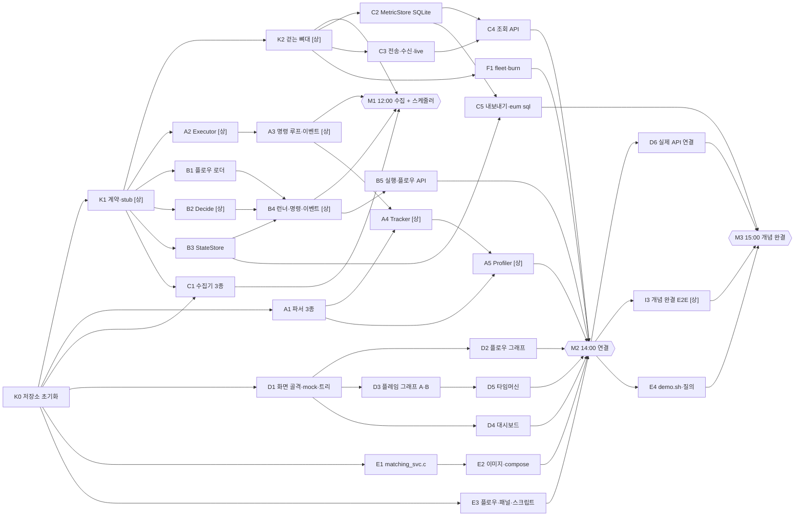

# 04. 구현 지시서: 설계 리뷰 결과와 작업카드 운영

> 이 문서는 **어떻게 나눠 만드는가**를 정합니다. 무엇을 만드는지(계약)는 [02](02-mvp-architecture.md), 언제 무엇을 시연하는지는 [03](03-roadmap.md), AI 세션에 그대로 주는 카드는 [docs/cards/](cards/README.md)에 있습니다.
>
> 1차 목표는 처음 지시와 같습니다. **동작하는 프로토타입(시스템 정보 수집 + 작업 스케줄러)** 을 먼저 손에 넣고(M1, 12:00), 그 구조 위에 실행 ID 연결, 함수 추적, 열린 데이터를 덧붙입니다(M2~M3).

## 0. 문서와 카드의 관계

| 문서 | 역할 | 바꾸는 사람 |
|---|---|---|
| 02 아키텍처 | **계약.** 타입, 인터페이스 6개, 조립 계약(§7.1), API 형식, DDL, 상태 머신 | 리드만. 10:30 이후 동결 |
| 03 당일 계획 | 시연 시나리오, 개념 완결 기준, 축소 순서, 심사 질문 | 리드 |
| 04 이 문서 | 리뷰 결과, 마일스톤, 카드 목록·의존·배정, 운영 규칙, 통합 점검표 | 리드 |
| cards/ | 카드 본문 = AI 세션 지시문. 세션은 `cards/README.md`와 자기 카드를 읽고 일함 | 리드(내용), 세션(완료 보고만) |

---

## 1. 리뷰 결과

설계 문서(01~03)와 서류 심사에 낸 기획서(15쪽)를 다시 맞대어 보았습니다. 개념 7개, 세 흐름(실행·연결·활용), 인터페이스 6개, 단방향 연결, 공개 스키마, 축소 순서, 마일스톤 시각(10:30·12:00·14:00·15:00·16:30)은 그대로입니다. 아래는 **바뀐 것**과 **메운 빈틈**이고, 모두 02·03에 반영했습니다.

### 1.1 기획서에 맞춰 바뀐 것

심사위원이 본 화면과 문구가 기준입니다. 당일 결과물이 기획서와 어긋나면 "구현 가능성" 점수를 스스로 깎게 됩니다.

| 항목 | 첫 설계 | 바뀐 내용 | 근거 |
|---|---|---|---|
| 이름 | 제품·실행 파일 `contune`, 환경변수 `CONTUNE_*` | 제품 **이음(E:UM)**, 실행 파일·Go 모듈 `eum`, 환경변수 `EUM_*`, 설정 경로 `/etc/eum`. 저장소 이름만 contune | 기획서 표지, 12쪽 `eum sql` |
| 타임머신 차트 | 한 차트에 겹치고 p99는 오른쪽 축 | 시간축을 공유하는 **띠 차트 5개**(처리량, 처리 대기, p99, 서비스 CPU, 서버 CPU). 단위가 다른 값을 한 축에 섞지 않음 | 기획서 10쪽 시안(띠 4개) + 02 §12.2의 서버 자원 |
| 구간 비교 | 구간 하나 → 플레임 그래프 1개. 함수 비교는 넓히기(서버 API `/profile/diff`) | **A(평시)·B(지연) 두 구간 → 플레임 그래프 2개를 나란히**, 비중이 가장 크게 는 함수 한 줄. 계산은 브라우저에서(서버 API 없음). 비교 표만 넓히기 | 기획서 11쪽, 14쪽 흐름 3 "지난 구간을 비교" |
| 화면 메뉴·주소 | `#flows`, `#flow/<id>`. 실행 이력 화면 없음 | 메뉴 **대시보드·서버·배치판·실행 이력**. 플로우 그래프는 `#board/<경로>/<flow-id>`, `#hosts`, `#runs` 추가 | 기획서 8~10쪽 화면 시안의 메뉴와 주소창 |
| 시연 C 서비스 | `handle_order → check_risk → match_order → book_insert` | `match_order` 안에 `price_cross` 추가, 꼬리 호출이 생기지 않게 작성 | 기획서 12쪽 결과 표의 `price_cross` |
| 분석 질의 | 2개 | 2개 + **배포 전후 비교** 질의 파일 1개(시연은 선택) | 기획서 12쪽 "배포 전후 비교" |
| 개발 환경 | 사내망 대비 `go mod vendor` 필수 | 외부망·상용 AI로 개발, 사내 데이터·소스 미사용. vendor는 선택. 실행 시에는 CDN 없이 동작(uPlot 내장) | 기획서 14쪽 마지막 줄 |
| 세션 운영 | 사람 1이 계약·뼈대와 세션 A·B를 함께 맡아 세션 수가 모호 | **세션 4개 고정**, 세션마다 카드 줄(레인). 카드마다 모델 표기([상]/[하]), 카드를 시작할 때 모델을 바꿈 | 기획서 14쪽 "AI 코딩 세션 4개" |

### 1.2 설계 빈틈을 메운 것

구현하다 막힐 자리를 미리 찾아 계약에 넣었습니다. 대부분 "단순하게 만들면 생기는 구멍"을 더 단순한 방법으로 막은 것입니다.

| 빈틈 | 그대로 두면 | 보강 | 반영 |
|---|---|---|---|
| `run_events`의 `seq`를 스케줄러 전이와 에이전트 이벤트(seq 1·2)가 함께 씀 | 스케줄러의 WAITING→DISPATCHED와 에이전트의 started가 같은 `(exec_id, seq)`로 부딪혀 하나가 사라짐 | `seq`는 매니저가 실행마다 1부터 매김. 에이전트 이벤트의 멱등은 **상태 비교 후 교체(CAS)** 로: "현재 상태가 From일 때만 To로". `UpsertRun`·`AppendEvent`를 `CreateRuns`·`Transition`으로 바꿈 | 02 §6, §7, §8, §10 |
| 명령 큐가 매니저 메모리에만 있음 | 매니저가 재시작하면 DISPATCHED인데 전달 안 된 명령이 사라져 플로우가 멈춤 | **큐를 두지 않음.** `GET /agent/commands`가 그 호스트의 DISPATCHED 실행을 state.db에서 읽어 줌. 에이전트는 받은 `exec_id`를 무시 | 02 §6, B4 |
| "플로우 실행이 끝났다"의 정의가 없음 | 선행 실패로 후행이 WAITING에 남으면 그 플로우 실행이 영원히 진행 중 → 다음 cron 발화가 매일 skip | 플로우 실행 상태를 스텝 상태에서 계산하는 순수 함수 `FlowRunStatus`. 재시도가 남지 않은 실패가 있고 더 돌 스텝이 없으면 FAILED | 02 §10, B2 |
| 놓친 스케줄의 판정 방법 | `on_missed: skip`의 뜻만 있음 | `Decide`가 `(직전 tick, 지금]`의 발화만 봄. 매니저 시작 때 직전 tick = 지금 → 놓친 발화는 실행하지 않고 로그만 | 02 §9, B2 |
| `Decide` 안의 ID 생성 | ULID를 안에서 만들면 순수 함수가 아님 | ID 생성 함수를 입력으로 받음(테스트는 고정 순번) | 02 §7, B2 |
| 최신 값 조회 | `/hosts`, `/panels`, 게이트가 2초마다 DB에서 서버 43대의 최신 값을 찾음 | 매니저 메모리의 최신 값 캐시 `live` 하나로. 인터페이스가 아닌 구체 타입. 재시작하면 1초 안에 다시 참 | 02 §7.1, C3 |
| 호스트 갱신 쓰기량 | 지표 묶음마다 state.db(`synchronous=FULL`)에 `UpsertHost` → 초당 43번 fsync | 무응답 판정은 `live`의 last_seen. state.db는 새 호스트·그룹 변경·30초마다만 | 02 §8, C3 |
| 무응답 시연 서버 | `silent` 모의 서버는 처음부터 안 보내 매니저가 그 서버를 모름 → 무응답으로 보이지 않음 | `silent`는 20초 보낸 뒤 멈춤(`after: 20s`) | 02 §13, F1 |
| 에이전트 재시작 뒤 추적 복원 | environ 표식으로 프로세스는 찾지만 함수 추적 여부를 모름. 한 컨테이너의 모의 서버 40대가 서로의 프로세스를 가져감 | 환경변수 `EUM_PROFILE`, `EUM_HOST` 추가. 추적기는 자기 호스트 표식만 가져감 | 02 §5.5, A4 |
| `/proc` 탐색 비용 | 5초마다 모든 프로세스의 environ을 읽음 | 이미 본 `(pid, 시작 시각)`은 건너뜀 | 02 §5.5, A4 |
| 프로파일러 부하 측정 | `Profiler`가 쓴 CPU를 밖에서 알 길이 없음 | `Profile`이 쓴 CPU 시간도 돌려줌. 프로파일러도 `Register`로 고름(수집기와 같은 OCP) | 02 §7, A5 |
| 시간대 | cron 주석에만 "(KST)" | 매니저 설정 `tz`(기본 Asia/Seoul) + `time/tzdata` 내장 | 02 §2, §9 |
| 매니저 설정 형식 | "기준값은 매니저 설정 파일"만 있음 | `manager.yaml` 형식 정의 | 02 §6.2, K1 |
| SQLite 동시 쓰기 | 수신 핸들러 여러 개가 동시에 씀 → `SQLITE_BUSY` | DB마다 쓰기 연결 1개 + `busy_timeout` 5초, 읽기는 별도 풀 | 02 §8, B3, C2 |
| CPU 단위 | `job.cpu.pct`와 `host.cpu.pct`가 같은 %로 보임 | `job.*`는 코어 1개 = 100, `host.*`는 서버 전체 = 100. 화면은 다른 띠에 | 02 §5.1, §12.2 |
| 기동 실패 | 명령을 못 찾으면 어떤 이벤트를 보내는지 없음 | started 없이 finished(FAILED, exit 127). 매니저는 DISPATCHED→FAILED 허용 | 02 §6, §10, A3 |
| 수동 실행 중복 | 이전 실행이 돌 때 수동 실행 규칙 없음 | `409`로 거절(cron은 같은 조건에서 skip) | 02 §6, §9, B4 |
| 시간 초과 판정 위치 | 문서마다 다름 | 에이전트가 판정해 TIMEOUT 보고. 매니저 쪽 무응답(LOST)은 검증판 밖 | 02 §10 |
| 꼬리 호출 | `-O2`에서 함수의 마지막 호출이 꼬리 호출이 되면 호출 경로에서 프레임이 빠짐 | 시연 C 서비스는 호출 결과를 쓴 뒤 반환 | 02 §13, E1 |
| **조립 계약** | 인터페이스 6개만 있고, 패키지를 이어 붙이는 생성자·핸들러 등록 형태가 없음 → 세션마다 조립 파일을 고쳐 충돌 | 패키지마다 공개 생성자와 `Mount(mux)`를 계약으로 정함. K1이 빈 구현까지 만들어 처음부터 컴파일되게 하고, 이후 카드는 자기 패키지만 채움 | 02 §7.1, K1 |
| 병합 시점 | 정해진 시각(12:00, 14:00)에만 병합 | 카드 의존 때문에 카드가 끝날 때마다 병합(조건 충족 시). 정해진 시각은 통합 점검 | §7 |

### 1.3 알려진 한계 (검증판에서 그대로 둠)

| 한계 | 결과 | 넓히는 길 |
|---|---|---|
| 에이전트가 실행 도중 재시작 | 종료 이벤트가 사라져 그 실행이 RUNNING에 남음(프로세스 추적은 복원됨) | 에이전트 이벤트 큐를 파일로, 또는 LOST 상태와 복구 정책 |
| 에이전트가 명령을 받고 started를 보내기 전에 재시작 | 같은 명령을 다시 받아 한 번 더 실행할 수 있음 | 받은 `exec_id`를 파일에 기록 |
| `sudo`·`su`로 다른 사용자가 된 프로세스, 환경변수를 지우는 프로세스 | 추적에서 빠짐 | `ProcessTracker`를 cgroup v2 구현으로 교체 |

---

## 2. 원칙 → 카드 규칙

| 원칙 | 카드에서 지키는 방법 |
|---|---|
| **1. SRP·OCP·LSP·DIP** | 카드 1장 = 책임 1개 = 패키지(또는 파일 묶음) 1개. 확장은 등록 함수(`probe.Register`, `profile.Register`)와 인터페이스(`MetricStore`, `StateStore`, `ProcessTracker`, `Notifier`) 뒤에서만. 저장소 구현은 **공용 계약 스위트를 통과해야 완료**(LSP). 스케줄러·조회는 인터페이스와 함수 값(`Now`, `NewID`)에만 의존하고, 조립은 `cmd/eum`·`internal/agent`·`internal/manager` 세 곳에서만(DIP). 예: 첫 수집기가 CPU만 읽어도 `/proc/diskstats`는 읽기 함수 1개, eBPF 수집기는 파일 1개 + `Register` 한 줄로 붙습니다 |
| **2. 테스트로 수정을 보호** | 카드의 "테스트 먼저" 표를 먼저 쓰고(실패 확인) 구현합니다. 의존을 줄이려고 파서·판정·`Decide`는 순수 함수, OS 의존은 `//go:build linux` 파일로 나눕니다. 테스트 등급(§9)의 **필수**는 미루지 않고, 화면·시연 스크립트는 리드 지시로 미룰 수 있습니다(해커톤 예외) |
| **3. 단순성** | 외부 의존성 4개(`modernc.org/sqlite`, `gopkg.in/yaml.v3`, `robfig/cron/v3` 파서, `oklog/ulid/v2`)로 고정. 프레임워크·ORM·프런트엔드 빌드 없음. DB 접근은 `database/sql`(ODBC 역할)만 써서 SQLite → MySQL은 store 패키지 하나 추가 + 같은 스위트로 끝납니다 |

---

## 3. 마일스톤

| 마일스톤 | 시각 | 목표 | 판정 (리드가 직접 실행) |
|---|---|---|---|
| **M0 계약·뼈대** | 10:30 | 계약 코드 동결. 걷는 뼈대: 수집기 → 전송 → 수신 → 저장 → `/series` → 브라우저 차트 | `go vet ./... && go test ./...` 통과 / `eum dev` 뒤 5초 안에 `curl -s localhost:8080/api/v1/series?name=host.cpu.pct`에 점이 있음 / 브라우저 차트가 움직임 |
| **M1 1차 구조** | 12:00 (늦어도 12:30) | **동작하는 프로토타입: 시스템 정보 수집 + 작업 스케줄러.** procfs·sim 수집이 쌓이고, 선후행·재시도가 있는 플로우를 수동 실행하면 에이전트가 실행해 끝까지 감 | `eum dev --flows internal/e2e/testdata/flows` → `curl -XPOST localhost:8080/api/v1/flows/hello/run` → 15초 안에 `/api/v1/runs?flow=hello`의 스텝 3개가 SUCCEEDED, `b`는 attempt 2 / 매니저를 재시작해도 `/runs`가 남음(statesql) |
| **M2 연결** | 14:00 | 실행 ID로 업무·자원·함수 기록이 이어짐. 시연 규모(서버 43대·플로우 39개) | `docker compose up` → `/hosts` 43대·`/flows` 39개 / `market-open` 실행 → `start-matching` 종료 뒤에도 `/series?exec_id=<그 실행>&name=job.procs` 값 ≥ 1 / `/panels`에 biz 값과 `exec_id` / `/profile?exec_id=`에 표본 |
| **M3 개념 완결** | 15:00 | 세 흐름(실행·연결·활용)이 화면과 SQL까지 | 03 §2 점검표 7개 / I3 개념 완결 E2E 통과 / 시연 장면 2~6 리허설, 1차 녹화 |
| **M4 넓히기** | 16:30 | 넓히기 카드 중 끝난 것만 병합 | 코드 동결, `go test ./...` 통과 |

---

## 4. 카드 목록

표기: **[상]** 상위 모델(동시성, 프로세스 제어, 상태 판단, 계약, 통합), **[하]** 하위 모델(계약이 정해진 구현, 파서, 저장소, 화면). 시간은 AI 세션 기준 예상입니다.

| ID | 카드 | 모델 | 세션 | 선행 | 예상 | 마일스톤 | 파일 |
|---|---|---|---|---|---|---|---|
| K0 | 저장소 초기화 | 사람 | 1 | — | 10분 | M0 | [K](cards/K-contract.md#k0) |
| K1 | 계약 코드와 패키지 골격(stub) | [상] | 1 | K0 | 35분 | M0 | [K](cards/K-contract.md#k1) |
| K2 | 걷는 뼈대(`eum dev`, 토큰, 스모크) | [상] | 1 | K1 | 45분 | M0 | [K](cards/K-contract.md#k2) |
| A1 | 순수 파서 3종(`/proc/<pid>/stat`·`environ`, `perf script`) | [하] | 2 | K0 | 35분 | M2 | [A](cards/A-agent-exec.md#a1) |
| A2 | Executor: 프로세스 그룹 실행 | [상] | 2 | K1 | 45분 | M1 | [A](cards/A-agent-exec.md#a2) |
| A3 | 명령 루프·이벤트 전송 큐 | [상] | 2 | A2 | 45분 | M1 | [A](cards/A-agent-exec.md#a3) |
| A4 | ProcessTracker: 서비스 프로세스 추적 | [상] | 2 | A1, A3 | 60분 | M2 | [A](cards/A-agent-exec.md#a4) |
| A5 | Profiler(perf)와 프로파일 루프 | [상] | 2 | A1, A4 | 60분 | M2 | [A](cards/A-agent-exec.md#a5) |
| A6 | (넓히기) kill 명령 | [상] | 2 | A3 | 40분 | M4 | [A](cards/A-agent-exec.md#a6) |
| B1 | 플로우 로더·검증·깊이·배치판 | [하] | 2 | K1 | 35분 | M1 | [B](cards/B-scheduler.md#b1) |
| B2 | 스케줄러 코어 `Decide`·`FlowRunStatus` | [상] | 1 | K1 | 50분 | M1 | [B](cards/B-scheduler.md#b2) |
| B3 | StateStore 계약 스위트·메모리·SQLite | [하] | 3 | K1 | 50분 | M1 | [B](cards/B-scheduler.md#b3) |
| B4 | 런너·명령 조회·이벤트 처리·수동 실행 | [상] | 1 | B1, B2, B3 | 50분 | M1 | [B](cards/B-scheduler.md#b4) |
| B5 | 화면용 실행·플로우 API, 실행 CSV | [하] | 1 | B4 | 45분 | M2 | [B](cards/B-scheduler.md#b5) |
| B6 | (넓히기) 리소스 게이트(HELD) | [상] | 1 | B4, C3 | 60분 | M4 | [B](cards/B-scheduler.md#b6) |
| C1 | 수집기 3종: procfs·sim·push | [하] | 3 | K0(파서), K1(등록) | 60분 | M0~M1 | [C](cards/C-collect-data.md#c1) |
| C2 | MetricStore 계약 스위트·SQLite(지표·프로파일·뷰) | [하] | 3 | K2 | 55분 | M1 | [C](cards/C-collect-data.md#c2) |
| C3 | 전송기·수신·`live` 캐시·호스트 등록 | [하] | 3 | K2 | 50분 | M2 | [C](cards/C-collect-data.md#c3) |
| C4 | 조회 API: series·hosts·panels·profile | [하] | 3 | C2, C3 | 60분 | M2 | [C](cards/C-collect-data.md#c4) |
| C5 | 열린 데이터: CSV·접힌 스택 내보내기, `eum sql` | [하] | 3 | C2, B3 | 50분 | M3 | [C](cards/C-collect-data.md#c5) |
| D1 | 화면 골격·mock·트리 | [하] | 4 | K0 | 55분 | M0 | [D](cards/D-web.md#d1) |
| D2 | 플로우 그래프·배치판·실행 이력 | [하] | 4 | D1 | 50분 | M2 | [D](cards/D-web.md#d2) |
| D3 | 플레임 그래프 A·B | [하] | 4 | D1 | 40분 | M2 | [D](cards/D-web.md#d3) |
| D4 | 대시보드: 열지도·이상 목록·업무 패널·배치판 진행, 서버 목록 | [하] | 4 | D1 | 60분 | M2 | [D](cards/D-web.md#d4) |
| D5 | 타임머신(띠 차트 5개, A·B 구간)·서버 상세 | [하] | 4 | D3 | 60분 | M2 | [D](cards/D-web.md#d5) |
| D6 | 실제 API 연결 점검과 정리 | [하] | 4 | D2~D5, B5, C4 | 45분 | M3 | [D](cards/D-web.md#d6) |
| E1 | 시연용 체결 서비스 `matching_svc.c` | [하] | 4 | K0 | 40분 | M2 | [E](cards/E-demo.md#e1) |
| E2 | 이미지·compose·에이전트·매니저·fleet 설정 | [하] | 사람 2 | E1 | 40분 | M2 | [E](cards/E-demo.md#e2) |
| E3 | 시연 플로우·보조 플로우 생성·업무 패널·스크립트 | [하] | 사람 2 | K0 | 50분 | M2 | [E](cards/E-demo.md#e3) |
| E4 | `demo.sh`와 질의 파일 | [하] | 사람 2 | E2, E3 | 25분 | M3 | [E](cards/E-demo.md#e4) |
| F1 | `eum fleet`·`eum burn` | [하] | 1 | K2 | 40분 | M2 | [X](cards/X-integration.md#f1) |
| I3 | 개념 완결 E2E 테스트 | [상] | 1 | M2 | 45분 | M3 | [X](cards/X-integration.md#i3) |
| X1 | (넓히기) 임계치 알림 webhook | [하] | 3 | C3 | 40분 | M4 | [X](cards/X-integration.md#x1) |
| X2 | (넓히기) 함수 비교 표 | [하] | 4 | D5 | 30분 | M4 | [X](cards/X-integration.md#x2) |

- 카드 34장 중 넓히기 4장(A6, B6, X1, X2)을 빼면 30장이 15:00까지의 몫입니다.
- **[상] 11장:** K1, K2, A2~A6, B2, B4, B6, I3. 나머지는 [하]입니다. 사람이 맡는 E2~E4는 짧은 [하] 카드라 사람 2가 직접 하거나 비어 있는 세션에 맡깁니다.

---

## 5. 의존 그래프



**임계 경로**는 `K1 → B2 → B4 → (M1) → B5 → (M2) → I3`(세션 1)과 `A2 → A3 → A4 → A5`(세션 2)입니다. 둘 다 사람 1의 [상] 세션이라, 사람 1은 이 두 세션의 검수를 가장 먼저 합니다.

---

## 6. 세션 배정과 시간표

세션 1개 = 브라우저 탭(또는 터미널) 1개 = 카드 줄 1개입니다. 카드를 시작할 때 **카드의 모델 표기대로 모델을 바꿉니다**([상] 카드 앞에서 올리고, [하] 카드 앞에서 내림).

| 시간 | 세션 1 · 사람 1 (계약·스케줄) | 세션 2 · 사람 1 (실행·함수 추적) | 세션 3 · 사람 2 (수집·데이터) | 세션 4 · 사람 2 (화면·시연 C) | 사람 2 직접 |
|---|---|---|---|---|---|
| 09:00–10:30 계약·뼈대 | K0(사람, 10분) → **K1** → **K2** | A1 → B1 | C1(파서부터, K1 병합 뒤 등록) → B3 시작 | E1 → D1 | 작업카드 확인, E3 초안 |
| **10:30** | **M0 · 계약 동결** | | | | |
| 10:30–12:00 병렬 구현 | **B2** → **B4** | **A2** → **A3** | B3 → C2 | D2 → D3 | E2, E3 |
| **12:00** | **M1 · 1차 구조 점검** (리드) | | | | |
| 12:00–14:00 병렬 구현 | B5 → F1 | **A4** → **A5** | C3 → C4 | D4 → D5 | 검수, E2·E3 마무리 |
| **14:00** | **M2 · compose 통합** | | | | |
| 14:00–15:00 통합 | **I3**, 통합 버그 | 통합 버그(A 쪽) | C5 | D6 | E4, 화면 연결 확인 |
| **15:00** | **M3 · 개념 완결 점검**, 리허설, 1차 녹화 | | | | |
| 15:00–16:30 넓히기 | **B6** 게이트 | **A6** kill | X1 알림 | X2 함수 비교 표 | 시연 대본, 발표 자료 |
| **16:30** | **코드 동결** | | | | |
| 16:30–17:30 마감 | 리허설 2회, 최종 녹화, 발표 자료에 실제 수치 | | | | |

- 굵은 카드는 [상]입니다. 사람 1은 [상] 세션 둘을 돌리며 서로의 결과를 검수합니다. 사람 2의 [하] 세션 결과도 병합 전에 사람 1이 한 번 훑습니다(§7 규칙 5).
- **먼저 끝난 세션은 대기열에서 카드를 가져갑니다.** 선행이 끝났고 아직 아무도 잡지 않은 카드 중, 마일스톤이 이른 것부터 고릅니다. [하] 카드는 어느 세션이든 가져갈 수 있고, [상] 카드는 사람 1의 세션만 가져갑니다. 카드를 잡으면 §7의 카드 판에 이름을 적습니다.
- 늦어지는 줄이 생기면 리드가 카드를 다른 세션으로 옮깁니다. 가장 흔한 이동은 B5·F1(세션 1)과 C5(세션 3)를 비어 있는 세션으로 넘기는 것입니다.

---

## 7. 카드 운영 규칙

1. **카드 1장 = 브랜치 1개.** 브랜치 이름은 `card/<ID>-<짧은 이름>`(예: `card/a2-executor`). 브랜치는 시작 시점의 `main`에서 만듭니다.
2. **세션 시작 지시문은 한 줄입니다.** 세션에 다음을 붙여 넣습니다.
   ```text
   docs/cards/README.md를 읽고, 이어서 docs/cards/<파일>.md의 <ID> 절을 읽은 뒤 그 카드대로 작업하라. 카드 범위 밖의 변경이 필요하면 멈추고 제안만 보고하라.
   ```
   같은 세션에서 다음 카드로 넘어갈 때는 `/clear`(또는 새 대화)로 맥락을 비우고 같은 지시문을 다시 줍니다. 앞 카드의 맥락이 섞이면 담당 경로 밖을 고치기 쉽습니다.
3. **계약은 리드만 바꿉니다.** 02 §6~§10, §7.1과 `internal/model`, `internal/api`, 인터페이스가 계약입니다. 세션이 계약 변경이 필요하다고 판단하면 멈추고 "무엇을, 왜, 대안"을 보고합니다. 리드가 승인하면 리드가 고치고 `main`에 먼저 넣습니다.
4. **담당 경로 밖은 고치지 않습니다.** 카드 머리의 "쓰는 경로"가 전부입니다. 다른 패키지에 버그가 보이면 고치지 말고 보고합니다.
5. **병합 조건**(카드가 끝날 때마다): 최신 `main`으로 rebase → `go vet ./... && go test ./...` 통과 → diff가 쓰는 경로 안 → 완료 보고 작성. 이 넷이 맞으면 그 세션을 운영하는 사람이 `main`에 fast-forward 병합합니다. [하] 카드는 병합 전에 사람 1이 diff를 훑습니다(5분 이내). [상] 카드는 사람 1이 직접 검수합니다.
6. **정해진 시각(10:30, 12:00, 14:00, 15:00)은 병합 시각이 아니라 점검 시각**입니다. 리드는 §8 점검표를 직접 실행하고, 실패한 항목을 카드로 돌려보냅니다.
7. **완료 보고 양식**(세션이 마지막에 출력):
   ```text
   [완료] <ID> <카드 이름>
   변경: <파일 목록>
   테스트: go test 결과 요약(통과 수 / 건너뜀 수와 이유)
   완료 기준: 항목별 확인 결과
   남은 문제·다음 카드에 알릴 것:
   계약 변경 제안: 없음 | <내용>
   ```
8. **카드 판.** 저장소 밖(공유 메모나 화이트보드)에 카드 ID별로 `대기 / 진행(세션 번호) / 검수 / 병합`을 적습니다. 발표 자료의 "개발 기록"(세션 수, 카드 수, 커밋, 테스트 수)도 여기서 셉니다.

---

## 8. 통합 점검표

리드가 정해진 시각에 직접 실행합니다. 실패하면 원인 카드를 정하고 그 세션에 돌려보냅니다.

### G0 · 10:30 계약 동결 (M0)
- [ ] `go vet ./... && go test ./...` 통과
- [ ] `go run ./cmd/eum dev` → 5초 안에 `curl -s 'localhost:8080/api/v1/series?name=host.cpu.pct'`에 `points`가 있음
- [ ] 토큰 없이 `curl -XPOST localhost:8080/api/v1/agent/metrics -d '{}'` → `401`
- [ ] 브라우저 `localhost:8080/?mock=1`(D1)에서 트리가 mock으로 뜨고, `localhost:8080`(실제 API)에서 대시보드 임시 차트 1개가 움직임
- [ ] 02 §7·§7.1과 `internal/model`, `internal/api`, 인터페이스가 일치 → **동결 선언**

### G1 · 12:00 1차 구조 (M1)
- [ ] `go run ./cmd/eum dev --flows internal/e2e/testdata/flows` 실행
- [ ] `rm -f /tmp/eum-hello.once; curl -XPOST localhost:8080/api/v1/flows/hello/run` → `201`
- [ ] 15초 안에 `curl -s 'localhost:8080/api/v1/runs?flow=hello'`: `a`, `b`(attempt 1 FAILED, attempt 2 SUCCEEDED), `c` 모두 끝남
- [ ] 같은 요청을 실행 중에 한 번 더 → `409`
- [ ] 매니저를 끄고 다시 켜도 `/runs`가 남음(`store: sqlite`)
- [ ] `/series?name=host.*`에 dev 호스트 3대의 `host.cpu.pct`, `host.mem.used_pct`
- [ ] 이 시점의 화면: 트리·플로우 그래프는 mock으로 동작

### G2 · 14:00 연결 (M2)
- [ ] `docker compose -f deploy/docker-compose.yml up --build` 한 번에 뜸
- [ ] `/hosts` 43대(그룹 8개), `ext-04`는 20초 뒤 `silent`, `dw-02`는 `crit`
- [ ] `/flows` 39개(배치판 6개), `대외송수신/ext-send-margin`은 재시도 2회 뒤 FAILED
- [ ] `deploy/demo.sh run`(또는 `POST /flows/market-open/run`) → 스텝 5개 SUCCEEDED, `load-equity` attempt 2
- [ ] `start-matching` 종료 뒤에도 `/series?exec_id=<그 실행>&name=job.procs` 최신 값 ≥ 1, `/panels` 체결 타일에 값과 같은 `exec_id`
- [ ] 30초 뒤 `/profile?exec_id=<그 실행>`에 `matching_svc;main;handle_order;...` 표본, `agent.profiler.cpu_pct` < 1
- [ ] 화면이 실제 API로 트리·대시보드·플로우 그래프를 그림(타임머신은 D6에서 마무리)

### G3 · 15:00 개념 완결 (M3)
- [ ] 03 §2 점검표 7개 전부
- [ ] `go test ./internal/e2e/...`(I3) 통과
- [ ] `demo.sh surge` 동안 p99·처리 대기가 오르고, 타임머신에서 A(폭주 전)·B(밀린 구간)를 고르면 B의 `book_insert` 비중이 A보다 큼
- [ ] `docker compose exec manager eum sql --data /data "$(cat deploy/queries/capacity.sql)"`, `slow-functions.sql`이 행을 냄
- [ ] 타임머신의 CSV·접힌 스택 내려받기가 열림
- [ ] 시연 장면 2~6 리허설, 1차 녹화

### G4 · 16:30 코드 동결 (M4)
- [ ] 넓히기 카드는 `go test ./...`를 통과한 것만 병합
- [ ] G3 항목을 다시 한 번 확인, 최종 녹화

---

## 9. 테스트 등급

| 등급 | 대상 | 규칙 |
|---|---|---|
| **필수** (먼저 쓰고 미루지 않음) | 파서(`/proc/stat`·`meminfo`·`loadavg`, `/proc/<pid>/stat`·`environ`, `perf script`, push 줄), 플로우 YAML 검증·깊이·배치판, `Decide`·`FlowRunStatus` 표 테스트, 저장소 계약 스위트(메모리·SQLite), 상태 비교 후 교체 멱등, 서버 상태 판정, 전송 버퍼 폐기 순서, 이벤트 재전송, 중복 실행 방지 | 카드 완료 조건. 미루려면 리드 승인이 아니라 **카드를 줄여야** 합니다 |
| **권장** (가능하면 먼저) | Executor·Tracker·Profiler 통합 테스트(`//go:build linux`, perf가 없으면 `t.Skip`), 조회 API 핸들러, 내보내기 행 수, `eum sql` 쓰기 거부 | 시간이 모자라면 핵심 경로 1개만 남깁니다 |
| **미룸 가능** (해커톤 예외) | 화면(D), 시연 스크립트(E), fleet 설정 | 리드가 지시하면 수동 확인으로 대신합니다. 대신 완료 보고에 "수동 확인 항목"을 적습니다 |

- 개발 PC가 macOS면 `/proc`과 perf가 없습니다. 리눅스 전용 테스트는 컨테이너에서 돌립니다: `docker run --rm -v "$PWD":/src -w /src --cap-add PERFMON golang:1.22 go test ./...` (perf가 필요한 테스트는 이미지에 perf를 설치한 경우만 돌고 나머지는 건너뜀).

---

## 10. 늦어질 때

03 §2의 축소 순서를 카드 단위로 옮긴 것입니다. **세 흐름과 서버·배치판 트리, 플로우 그래프, 프로파일 수집은 줄이지 않습니다.**

| 순서 | 줄이는 것 | 카드에서 버리는 부분 |
|---|---|---|
| 1 | 서버 열지도 → 이상 서버 목록만 | D4의 열지도 |
| 2 | CSV·접힌 스택 내보내기 → 넓히기로 | C5의 `/export/*`(단 `eum sql`은 남김) |
| 3 | 구간 끌어 고르기 → 고정 구간 A·B | D5의 구간 선택 |
| 4 | 플레임 그래프 → 상위 함수 표 | D3를 표로 |
| — | (그 밖에 미룰 수 있는 것) | B5의 `/export/runs`, C4의 `/series` 자동 `step`, D2의 실행 중 깜박임 |

**11:30에 B2가 끝나지 않았으면** 리드는 B4를 세션 2로 넘기지 말고 B2에 같이 붙습니다(스케줄러는 M1의 중심). **13:30에 A5가 끝나지 않았으면** perf 대신 고정 접힌 스택을 돌려주는 가짜 Profiler로 M2를 통과시키고, A5는 15:00까지 끝냅니다(가짜는 테스트용으로만 남기고 시연에는 쓰지 않음).
