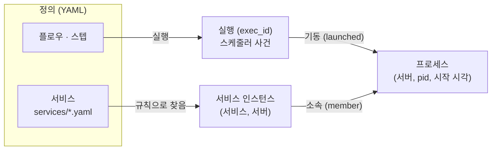

# 06. 실행 · 프로세스 · 서비스 — 무엇을 보는가 (2026-11-11)

> 화면이 배치(실행)에 묶여 있다는 문제 제기에 대한 개념 정리다. 결론부터:
> **관측의 주어는 서비스(와 그 프로세스)이고, 실행 ID는 "누가 언제 띄웠나"를 답하는 출처 링크다.**
> 지금은 실행 ID 하나가 실행 기록·프로세스 소속·업무 지표의 주인을 모두 맡아, 상주 서비스에서 셋이 어긋난다.
> §10은 권장안대로 결정됐고(11-11), P0~P3을 카드 [P-A~P-G](cards/P-service.md)로 구현했다. 결과는 §12.

## 1. 질문과 답

| 질문 | 답 |
|---|---|
| 업무 지표(예: 대기 큐)가 특정 배치(`start-matching`)에 묶이는 관계가 맞나 | **아니다.** 대기 큐는 체결 서비스의 값이지 그 서비스를 띄운 스텝의 값이 아니다. 스텝은 05:30에 3초 돌고 끝나지만 서비스는 장 내내 돌고, 다른 실행이 다시 띄울 수도, 이음 밖(systemd·사람·다른 스케줄러)에서 뜰 수도 있다. 화면은 서비스를 보고, 실행은 그 서비스 시간축 위의 **사건**(기동·재기동·종료)으로 놓는다 |
| 운영 서버는 어떤 배치가 돌지 모르는데 화면이 고정되는 게 맞나 | **화면 구성을 파일로 정하는 것은 맞다**(업무마다 보는 지표가 달라 정의가 필요하다. Grafana의 대시보드 정의와 같다). 틀린 것은 그 정의의 **닻**이 실행이라는 점과, 타임머신의 업무 트랙이 화면 코드에 업무 이름으로 박혀 있다는 점(§2 ③)이다. 닻을 서비스로 옮기면 어떤 배치가 띄우든 화면은 그대로다 |
| 배치 하나가 프로세스 여럿을 띄우면 관리가 애매하다 | 맞다. 지금은 실행 = 프로세스 하나처럼 합쳐서 잰다(CPU·RSS 합, 프로파일 한 덩어리, 서버 프로세스 탭 한 줄). **프로세스를 하나씩 보이고**, 각 프로세스에 "어느 서비스인가"와 "어느 실행이 띄웠나"를 따로 붙인다 |
| 배치 이름만으로는 무슨 프로세스가 도는지 모른다 | 실행·플로우 그래프·서버 화면에 **기동한 프로세스**(`matching_svc` 등)를 함께 보이고, 스텝 YAML에 띄울 서비스를 선언할 수 있게 한다(`starts:`, 선언과 실제가 다르면 경고) |

## 2. 지금 무엇이 묶여 있나 (근거)

| # | 위치 | 지금 | 생기는 일 |
|---|---|---|---|
| ① | `internal/manager/query/panels.go` 집계(`case "max"`…) · `pages/biz.js` 타일 클릭 | 타일 값은 지표 이름으로 모으지만, **눌렀을 때 가는 곳은 값이 가장 큰 계열의 `exec_id`** → `#run/<exec_id>` | 대기 큐 = `start-matching` 실행. 같은 서비스를 다른 실행이 하나 더 띄우면 값에 따라 링크가 두 실행 사이를 오간다. 이음 밖에서 뜬 서비스는 `exec_id`가 비어 타일을 누를 수 없다 |
| ② | `pages/tm.js`의 타임머신 | 조사 화면의 단위가 실행 하나(`#run/<exec_id>`), 프로파일 조회도 `GET /profile?exec_id=` | 10:12에 재기동하면 오전과 오후가 다른 실행으로 갈라져 **재기동 전후 A·B 비교가 안 된다** |
| ③ | `pages/tm.js` `BIZ_BANDS` | 업무 트랙을 `biz.order.`·`biz.quote.` 접두사로 **화면 코드에 박음** | 새 업무를 붙이려면 화면 코드를 고쳐야 한다(패널 YAML 원칙과 어긋남) |
| ④ | `internal/agent/exec/tracker.go` `measure` | 실행에 속한 프로세스의 CPU·RSS·스레드를 **합쳐** `job.*` 하나로 | 스크립트가 서비스 셋을 띄우면 어느 것이 뜨거운지 모른다. 같은 실행 파일 두 개도 한 덩어리 |
| ⑤ | `query/hosts.go` `handleProcs` · `pages/server.js` 프로세스 탭 | 한 줄 = 실행 하나(`플로우 › 스텝`, 프로세스 수) | 운영자가 아는 이름(`matching_svc`, pid)이 아니라 배치 이름으로 보인다 |
| ⑥ | `tracker.go` `Targets` · 스텝 YAML `profile: true` | 함수 추적은 **실행 단위로 켬** | 이음 밖에서 뜬 서비스는 함수 추적이 안 된다 |
| ⑦ | 로그 경로 `{log_dir}/matching_svc.{exec_id}.log` · push 줄 `name value [exec_id]` | 업무 로그·지표의 주인을 실행 ID로 앎 | 실제 서비스는 로그 이름에 실행 ID를 넣지 않고, push는 서비스가 `EUM_EXEC_ID`를 읽어야 한다 |
| ⑧ | 02 §11 보안 최소선 | "프로파일 대상은 이음이 띄운 프로세스뿐" | 관측 범위 = 기동 범위. 가장 중요한 상주 서비스가 이음 밖에서 뜨면 핵심 기능(함수 추적·종료 보고·업무 지표 연결)이 모두 빠진다 |
| ⑨ | `internal/agent/exec/kill.go` | 강제 종료는 **도는 스텝**에만(`실행 중이 아님`이면 무시) | 타임머신은 `● 상주 프로세스 실행 중`이라고 보이지만 그 실행으로는 서비스를 멈출 수 없다 |

### 2.1 예: `BATCH_JOB` → `start_job.sh` → `svr_a` · `svr_b` · `svr_c`

플로우 `BATCH_JOB`의 스텝 `start`가 `start_job.sh`를 돌리고, 스크립트가 서버 프로그램 셋을 `setsid nohup`으로 띄운 뒤 2초 만에 끝난다고 하자. 지금 코드로 따라가면:

| 운영자가 알고 싶은 것 | 지금 보이는 것 | 근거 |
|---|---|---|
| 무엇이 떠 있나 | 실행 이력: `BATCH_JOB › start` 성공 2초. `svr_*` 이름은 어디에도 없음 | 실행 행에 프로세스 정보 없음 |
| 서버에서 누가 CPU를 쓰나 | 프로세스 탭 한 줄: `BATCH_JOB › start · 프로세스 3 · CPU 180%`. 셋 중 누가 180%인지 모름 | ④⑤ |
| `svr_a`가 느리다, 왜? | 타임머신 `#run/<X>`: 자원 트랙은 셋의 합, 플레임 그래프도 한 장(스텝에 `profile: true`를 달았을 때만). `svr_*`가 보내는 `biz.svr.*`는 `BIZ_BANDS`에 없어 업무 트랙이 아예 안 나옴 | ②③⑥ |
| 업무 패널에서 들어가기 | 타일을 누르면 실행 X로. `svr_a`·`svr_b`가 같은 지표 이름을 쓰면 값이 합쳐지고 누구 값인지 모름 | ① |
| `svr_b`가 죽었다 | 종료 보고서는 `svr_b` 단위로 생김(좋음). 그러나 근거의 **프로세스 지표는 실행 X의 합**이라 `RSS 처음 → 마지막`이 `svr_b`의 것이 아니다 | `exits/pack.go` `evJob`이 `job.rss.mb`(실행 단위)를 읽음 |
| `svr_b`만 다시 띄우기 | 못 한다. 강제 종료는 도는 스텝에만(실행 X는 이미 끝남), 재실행은 스크립트 전체 | ⑨ |
| 운영자가 `svr_c`를 손으로 다시 띄움 | 새 `svr_c`에는 `EUM_EXEC_ID`가 없어 이음에서 **사라진다**(자원·프로파일·종료 보고의 근거 대부분) | ⑦⑧ |
| 어제와 오늘 `svr_a` 비교 | 날마다 실행 ID가 달라 실행 둘을 오가야 하고, A·B 비교는 실행 하나 안에서만 | ② |

즉 지금 체계는 이 잡을 "**2초 만에 성공한 실행 하나 + 이름 없는 프로세스 3개의 합**"으로 본다. 운영자의 머릿속 모양("BATCH_JOB이 `svr_a`·`svr_b`·`svr_c`를 띄웠고, 셋이 각자 돈다")과 맞지 않는다. 바뀐 뒤의 같은 예는 §7.1.

## 3. 원인: 실행 ID 하나가 세 가지 일을 한다

| 하는 일 | 성격 | 수명 |
|---|---|---|
| (a) 실행 기록의 ID — 언제·몇 번째 시도·성공/실패 | 스케줄러 | 스텝 명령이 끝날 때까지(초~분) |
| (b) 프로세스 소속 — 어느 프로세스를 잴지 | 관측 | 프로세스가 살아 있는 동안(시간~일) |
| (c) 업무 지표·로그의 주인 — 어느 업무의 숫자인가 | 관측 | 서비스가 존재하는 동안(계속, 재기동을 넘어) |

짧은 배치는 셋이 겹친다(돌고, 끝나고, 그 프로세스가 곧 그 배치). **상주 서비스는 셋이 갈라진다.** 이음의 시연 장면(주문 폭주 → 체결 지연 → 함수)이 바로 갈라지는 경우라서, 실행에 매달린 지금 모양은 시연 1회에서는 맞아 보이지만 재기동·다중 프로세스·이음 밖 기동에서 무너진다.

## 4. 제안: 개체 셋, 관계 둘



| 개체 | 무엇 | 식별 | 끝나는 때 | 붙는 데이터 |
|---|---|---|---|---|
| **실행** | 스텝을 한 번 돌린 사건 | `exec_id` | 스텝 명령이 끝날 때. 남은 프로세스가 있어도 실행은 끝난다 | 상태·시도·종료 코드·실행 로그·**스텝이 도는 동안**의 자원(`job.*`), 기동한 프로세스 목록 |
| **프로세스** | OS 프로세스 하나 | `(서버, pid, 시작 시각)` | 프로세스가 끝날 때 | 이름·실행 파일·명령(비밀 가림)·사용자·자원·종료 보고서, 속성 `exec_id`(기동한 실행, 없으면 빈 값)·`service`(맞은 서비스, 없으면 빈 값) |
| **서비스** | 늘 떠 있어야 하는 업무 프로세스 묶음(체결, 시세) | `서비스 ID`, 서버마다 인스턴스 `(서비스, 서버)` | 없음(정의가 있는 한) | 업무 지표·애플리케이션 로그·자원 합(`svc.*`)·함수 프로파일·종료 이력·패널·알림 |

규칙:
1. **관측 데이터의 주인은 하나다.** 프로세스가 서비스에 맞으면 자원·프로파일의 주인은 서비스 인스턴스, 아니면 실행. 실행은 "기동한 서비스"로 링크만 갖는다(같은 CPU를 두 번 세지 않는다).
2. **실행 ID는 출처로 남긴다.** 프로세스·업무 지표·로그·종료 보고에 `exec_id`가 있으면 그대로 기록한다. "이 프로세스는 05:30 `market-open › start-matching`이 띄웠다"를 답하는 데 쓴다. 없어도(이음 밖 기동) 관측은 된다.
3. **규칙이 없어도 지금처럼 동작한다(자동 서비스).** 이음이 띄워 스텝이 끝난 뒤에도 사는 프로세스는 실행 파일 이름(`matching_svc`)으로 서비스가 된다. 설정 없이 지금 시연이 그대로 돌고, 규칙은 이름·범위를 다듬고 이음 밖 프로세스를 잡을 때만 쓴다. 실행 ID가 주던 "설정 없이 이어짐"은 잃지 않는다.
4. **조사 화면의 단위는 (대상, 시간 구간)이다.** 대상은 서비스 인스턴스·실행·프로세스 중 하나. 실행 타임머신은 지금처럼 실행 구간을, 서비스 타임머신은 운영자가 고른 구간(알림 시각 앞뒤)을 본다.

## 5. 서비스를 알아보는 법

```yaml
# services/체결.yaml — 정의의 기준은 파일(플로우·패널과 같은 원칙). 누가 띄웠는지와 무관하게 이 규칙으로 찾는다.
id: matching
title: 체결
group: 매매/체결              # 이 서버 묶음에서만 찾는다(서버 트리 경로)
match:                         # 위에서부터, 하나라도 맞으면 이 서비스
  - env: EUM_SERVICE=matching  # 명시 표식: 스텝 YAML이나 systemd Environment=로 붙임(Datadog DD_SERVICE와 같은 방식)
  - exe: /app/bin/matching_svc # 실행 파일 경로(glob)
  # - comm: matching_svc       # 경로를 모를 때
  # - cmdline: '--port 9100'   # 같은 실행 파일을 역할별로 띄울 때(RE2)
profile: true                  # 함수 추적은 서비스에 켠다
expect: { count: 1, active: mon-fri 08:30-15:40 }   # (3단계) 떠 있어야 하는 때·수 → 서비스 미기동 알림
```

- **찾는 곳은 에이전트다.** 지금 추적기가 5초마다 새 프로세스의 `environ`을 읽듯, 새 프로세스의 `comm`·`exe`·`cmdline`도 읽어 규칙에 맞춘다(이미 본 `(pid, 시작 시각)`은 건너뜀, 비용 같음). 규칙은 매니저가 로그 수집 설정과 같은 롱폴링 경로로 보낸다(05 §17).
- **보안: 무엇을 볼지는 매니저, 어디까지 봐도 되는지는 서버 YAML**(05 §16·§17과 같은 심층 방어). 에이전트 YAML에 `observe: {users: [mts], exe_roots: [/app/bin]}`을 두고, 기본은 비어 있다(= 지금처럼 이음이 띄운 것만). 매니저가 뚫려도 서버 담당자가 허락한 범위 밖 프로세스는 보지 않는다. 02 §11의 "이음이 띄운 프로세스뿐"은 "이음이 띄운 프로세스와, 서버 YAML이 허락한 범위에서 서비스 규칙에 맞는 프로세스"로 바뀐다.
- **업무 지표·로그의 주인**: push 수신구와 로그 파일에 `service:` 한 줄(`- type: push, listen: 127.0.0.1:9101, service: matching`). 포트·파일이 서비스를 말하므로 업무 프로그램이 `EUM_EXEC_ID`를 몰라도 된다. 줄 끝 `exec_id`·경로의 `{exec_id}`는 있으면 출처로 쓴다.
- **스텝 선언(선택)**: `starts: [matching]`. 실행 전에도 플로우 그래프가 "이 스텝은 체결을 띄운다"를 보이고, 스텝이 성공했는데 그 서비스 인스턴스가 1분 안에 안 보이면 경고한다(02 §5.5가 확장으로 남긴 `kind: service`의 가벼운 판).

## 6. 데이터의 주인

| 데이터 | 지금 키 | 바뀐 뒤 키 | 비고 |
|---|---|---|---|
| `host.*` | (서버) | 그대로 | |
| `job.*` | (서버, exec_id) | (서버, exec_id) — **스텝이 도는 동안, 서비스에 맞지 않은 프로세스만** | 배치가 쓴 자원 |
| `svc.*`(새) | — | (서버, 서비스) — 인스턴스의 프로세스 합 | `svc.cpu.pct`·`svc.rss.mb`·`svc.procs`·`svc.threads` |
| 프로세스별 자원 | 없음(합만) | live 캐시에 프로세스 한 줄씩(저장은 서비스 합) | 프로세스 표·종료 보고서 |
| `biz.*` · `log.*` | (서버, exec_id) | (서버, **서비스**, exec_id) | `series`에 `service` 열(02 §5.1이 예고한 차원 넓히기의 첫 칸) |
| 함수 프로파일 | (exec_id, 구간) | (서비스 또는 exec_id, 서버, 구간) | 재기동을 넘어 A·B 비교 |
| 종료 보고 | 프로세스(exec_id 링크) | 프로세스(service·exec_id 링크) | 목록을 서비스로 거름, "같은 서비스의 이전 종료" |
| 프로세스 기록 | 없음 | state.db `procs`(서버, pid, 시작, comm, exe, user, service, exec_id, 끝, exit_id) | "그때 무엇이 떠 있었나"에 답함 |

## 7. 화면이 어떻게 바뀌나

| 화면 | 지금 | 바뀐 뒤 |
|---|---|---|
| 업무 패널 타일 | 누르면 값을 보낸 실행 | 패널 YAML `service: matching`. 누르면 **서비스 타임머신**(그 서버·그 시각). 값은 그 서비스의 계열만 |
| 타임머신 | 실행 하나, 업무 트랙은 코드에 박음 | 대상(서비스 인스턴스·실행) + 구간. 업무 트랙은 **패널 YAML의 `charts`**에서. 서비스 시간축에 **사건 표시**: 기동·재기동한 실행(`05:30 market-open › start-matching`), 운영자 조작, 프로세스 종료(Grafana 주석·Datadog 배포 표시와 같은 모양) |
| 서버 › 프로세스 탭 | 한 줄 = 실행(`플로우 › 스텝`) | 한 줄 = 프로세스(이름 · pid · 서비스 · 기동한 실행 · CPU · RSS · 가동 시간), 서비스별로 묶음(systemd `status`의 CGroup 나무처럼). 서비스에 맞지 않은 상주 프로세스에는 `서비스로 등록` |
| 실행 이력 · 플로우 그래프 | `플로우 › 스텝`만 | 줄·노드에 기동한 프로세스·서비스 칩(`→ 체결 · matching_svc`). 선언(`starts:`)과 실제가 다르면 주황 |
| 실행 타임머신 머리 | `● 상주 프로세스 실행 중` | `기동한 서비스: 체결(match-01, 실행 중) →` 링크. 실행 자체는 스텝이 끝나면 끝 |
| 종료 보고서 | 머리 끝에 `실행 market-open/start-matching` | 주어는 프로세스: `matching_svc · pid · 서비스 체결 · 기동 market-open › start-matching`(이음 밖이면 `기동한 실행 없음`). **P0에서 먼저 반영**(이 커밋) |
| 서비스 화면 `#svc/<id>`(새) | 없음 | 인스턴스별 상태(떠 있음·없음·재기동 수) · 프로세스 · 패널 타일 · 최근 종료 · 사건. 업무 탭과 서버 탭 사이의 다리 |

### 7.1 같은 예, 바뀐 뒤

실행 화면(P1): 실행은 2초짜리 사건이고, 그 실행이 **기동한 프로세스**가 이름으로 보인다.

```
BATCH_JOB › start  #4Q2K9M   성공 · 2초 · 09:00:01 시작
기동한 프로세스 3개
  svr_a   pid 4101   실행 중      CPU  38%   RSS   210MB   서비스 svr_a →
  svr_b   pid 4102   ■ SIGSEGV 10:12                       종료 보고서 →
  svr_c   pid 4103   실행 중      CPU 121%   RSS 1,204MB   서비스 svr_c →
```

서비스(P2): `svr_a`·`svr_b`·`svr_c`가 각자 서비스 인스턴스가 된다(규칙이 없으면 실행 파일 이름으로 자동, §4 규칙 3).

| 운영자가 알고 싶은 것 | 바뀐 뒤 |
|---|---|
| 무엇이 떠 있나 | 서버 프로세스 탭에 `svr_a`·`svr_b`·`svr_c`가 한 줄씩, 각 줄에 `기동 BATCH_JOB › start` |
| 누가 CPU를 쓰나 | 줄마다 자기 CPU·RSS. `svr_c` 121% |
| `svr_a`가 느리다 | `svr_a` 서비스 타임머신: 자기 자원·자기 프로파일, 업무 트랙은 패널 YAML에서. 시간축에 `09:00 BATCH_JOB › start 기동` 표시 |
| `svr_b`가 죽었다 | 종료 보고서의 프로세스 지표가 `svr_b` 자신의 것. `svr_b` 서비스는 `지금 없음`(P3 `expect`면 `서비스 미기동` 알림) |
| `svr_c`를 손으로 다시 띄움 | 실행 파일 규칙(또는 자동 서비스 이름)으로 **같은 서비스 `svr_c`가 이어진다**. 시간축에 `11:30 이음 밖 기동(pid 5120)` |
| 어제와 오늘 비교 | 서비스 하나 안에서 구간 둘(A 어제, B 오늘). 재기동·실행이 바뀌어도 같은 화면 |
| 배치 이름만 보고 알기 | 스텝 YAML `starts: [svr_a, svr_b, svr_c]` → 플로우 그래프 노드에 `svr_a ● svr_b ■ svr_c ●`. 셋 중 하나가 안 뜨면 주황 |

### 7.2 계보: 서비스가 어느 실행에서 나왔나 (11-11 추가)

§7.1은 배치 → 서비스 방향(플로우 그래프 칩, 실행 이력 칩, 실행 화면 표)만 그림이 있고, 서비스 → 배치 방향은 머리의 `기동 batch-job › start #…` 글 한 줄이었다. 그래서 `svr_b`를 보면서 ① 같은 실행이 `svr_a`·`svr_c`도 띄웠다는 것, ② 사이에 `start_job.sh`가 있다는 것, ③ 09:00 실행이 띄운 `svr_b`가 죽고 09:05 재실행이 다시 띄웠다는 이어짐이 보이지 않았다(머리 글은 지금 살아 있는 인스턴스만).

계보는 실행 → 스텝 명령(리더) → 띄운 프로세스 → 그것이 띄운 것의 가로 트리다(`static/lineage.js`). 데이터는 이미 있는 것만 쓴다(계약 변경 없음): 프로세스 기록의 `exec_id`·`flow_id`·`step_id`·`leader`·`ppid`·`started_at`·`ended_at`·`exit_id`.

```
BATCH_JOB › start ──▶ start_job.sh ──┬─ svr_a  ● 실행 중
실행 #PBHNQ8 09:00    pid 4100       ├─ svr_b  ■ SIGSEGV →            ← 이 서비스(굵은 테두리), 나머지는 흐리게
                                     └─ svr_c  ● 실행 중
BATCH_JOB › start ──▶ start_job.sh ──── svr_b  ● 10:11부터 [재기동]   ← 수동 재실행(살아 있는 svr_a · svr_c는 건너뜀)
실행 #X3HYZP 10:11    pid 4180
```

| 화면 | 계보 |
|---|---|
| 서비스 타임머신 `#svc/<id>?host=` | 머리 아래 `계보` 카드. 고른 구간에 이 서버의 이 서비스 프로세스를 띄운 실행(최근 4개)마다 `GET /procs?exec_id=`(구간 없이: 스텝 명령은 몇 초 만에 끝난다)로 그 실행의 프로세스 전부를 받아 그린다. 이 서비스는 강조, 같이 뜬 것은 흐리게, 칸마다 실행 → 실행 타임머신 · 서비스 → 서비스 타임머신 · 종료 → 종료 보고서 |
| 실행 타임머신 `#run/<id>` | `기동한 프로세스`의 평평한 표를 같은 트리로(실행 칸은 빼고 스텝 명령부터, 살아 있으면 CPU · RSS) |

규칙:
- 묶음은 **실행 ID로 먼저** 잡는다. 부모(`ppid`)는 같은 실행 · 같은 서버 안에서만 잇는다(같은 pid가 여럿이면 자식보다 먼저 뜬 것 중 가장 늦은 것: pid 재사용).
- 부모 기록이 없으면 스텝 명령 바로 아래. 데몬처럼 부모를 끊고 나간 것(`setsid` · double fork)은 `ppid`가 1이나 에이전트(subreaper)가 되므로 대개 여기로 온다. 실제 리허설의 `start_job.sh`도 그렇다(`svr_*`의 `ppid` = 에이전트).
- 이음 밖에서 뜬 것(`exec_id` 없음)은 `이음 밖 기동` 칸 아래 서버별로. 그 너머는 추적할 근거가 없다.
- `재기동`: 같은 서버의 같은 서비스에서 먼저 뜬 프로세스가 끝난 것. 끝난 시각은 에이전트가 알아챈 때라 새 기동보다 조금 늦을 수 있어 시각 순서는 보지 않는다.
- 한 부모 아래 8개까지(강조할 것 먼저), 넘치면 `+n개`. 700px보다 좁으면 들여쓰기 세로 트리.

확인: mock(BATCH_JOB 정기 실행 + `svr_b` SIGSEGV 뒤 수동 재실행이 `svr_b`만 다시 띄움), 별도 포트 18099 실제 바이너리(`demo.sh batch` → `svr-crash` → `batch`)에서 서비스 `svr_b`에 실행 둘, 실행 화면에 같은 트리.

## 8. 참고한 사례

| 사례 | 가져온 것 |
|---|---|
| Kubernetes Job·Deployment·Pod | 끝나는 작업(Job)과 계속 도는 작업(Deployment)을 다른 개체로. Pod은 `ownerReferences`로 만든 쪽을 가리키지만, 대시보드는 만든 쪽이 아니라 `app=` 라벨(=서비스)로 묶는다 |
| HashiCorp Nomad | 잡 종류 `batch`·`service`를 처음부터 나눔 |
| systemd | 단위(unit) = 서비스. `systemctl status`가 그 단위의 프로세스를 나무로 보이고, 로그는 누가 띄웠는지와 무관하게 `journalctl -u <unit>` |
| OpenTelemetry 자원 규약 | 텔레메트리의 주어는 `service.name`·`service.instance.id`, 그 아래 `process.pid`·`process.executable.name`·`process.command_line`·`host.name`. 띄운 작업은 별도 속성 |
| Datadog 통합 서비스 태깅 · 프로세스 체크 | 환경변수 `DD_SERVICE`로 서비스를 표시(우리 `EUM_SERVICE`), 표식이 없으면 `search_string`(실행 파일·명령) 규칙으로 프로세스 묶음을 정의. 배포는 시간축 위 사건 |
| Dynatrace 프로세스 그룹 | 실행 파일·명령·환경변수로 프로세스 그룹을 자동 감지하고 규칙으로 다듬음. 지표는 서버별 인스턴스(PGI)에 붙음 — 우리 "자동 서비스 + 규칙"과 같은 구조 |

## 9. 단계

| 단계 | 내용 | 푸는 질문 | 크기 |
|---|---|---|---|
| **P0** (이 커밋) | 종료 보고서 정리: 주어를 프로세스로, 실행은 `기동` 한 줄. 글자 크기·문구 통일 | 보고서의 혼란 | 화면만 |
| **P1** 프로세스를 하나씩 | 에이전트가 실행마다 소속 프로세스 목록(pid·시작·comm·exe·명령 가림·사용자·CPU·RSS·스레드)을 live로 보냄. `GET /hosts/{id}/procs`·`GET /runs/{id}`가 프로세스 행을 돌려줌. 서버 프로세스 탭·실행 이력·플로우 그래프·타임머신 머리에 기동한 프로세스 | 배치 하나에 프로세스 여럿, 배치 이름만으로는 모름 | 작음(저장 모양 그대로, `job.*` 합 유지) |
| **P2** 서비스 | `services/*.yaml`·자동 서비스·에이전트 `observe` 범위, 추적기 서비스 태깅과 주인 규칙, `series`·`profile_samples`의 `service` 열과 `procs` 표, push·로그 파일 `service:`, 패널 `service:`, 서비스 타임머신·사건 표시, `BIZ_BANDS` 지움, 서비스 화면 | 화면이 배치에 묶임, 이음 밖 기동, 재기동 전후 비교 | 큼(카드 묶음 하나) |
| **P3** 서비스 운영 | `expect`(서비스 미기동 알림), 스텝 `starts:` 확인, 서비스 정지·재기동 조작(허용 목록 안), `서비스로 등록` 마법사 | 운영 완결 | 중 |

- 이전 데이터: `exec_id`만 있는 지난 계열은 `service = ''`로 남고, 실행 타임머신으로 계속 본다. P2 이후 계열부터 서비스 화면에 나온다.
- 시연은 오히려 쉬워진다: "체결 패널이 빨갛다 → 서비스 타임머신 → 시간축에 05:30 `start-matching` 기동 표시 → 재기동을 넘어 A·B → `book_insert`". 실행 ID의 가치(설정 없이 이어짐)는 자동 서비스와 사건 표시로 남는다.

## 10. 정할 것

| # | 질문 | 권장 |
|---|---|---|
| 1 | 실행과 서비스를 다른 개체로 나누는가 | 나눈다(§4). 나누지 않으면 ①②⑥⑨가 남는다 |
| 2 | 이음이 띄우지 않은 프로세스를 볼 수 있게 하는가(보안 최소선 변경) | 서버 YAML `observe` 범위 안에서, 서비스 규칙에 맞는 것만. 기본은 지금과 같음 |
| 3 | 서비스 정의는 어디에 | 매니저 `services/` 파일(패널·플로우와 같은 "기준은 파일"), 서버 YAML은 허락 범위만 |
| 4 | 순서 | P1(작고 바로 효과) → P2 카드 → P3 |

## 11. 바꾸지 않는 것

- 실행 ID 발급·상태 머신·재시도·`run_events`·감사: 스케줄러의 진실은 그대로 실행이다.
- 패널 YAML로 화면을 정의하는 원칙: 닻만 서비스로 옮긴다.
- 한 통로 수집·열린 데이터: `v_samples`에 `service` 열이 하나 늘 뿐이다.

## 12. 결과 (11-11)

카드 [P-A~P-G](cards/P-service.md)를 계약 커밋 뒤 일곱 레인으로 동시에 진행해 모두 병합했다. **설계와 달라진 것**: 서비스 몫의 지표·로그·프로파일은 새 `service` 열 대신 **주인 키**(`exec_id` 칸에 `svc:<서비스>@<서버>`)로 저장한다. §4 규칙 1(주인은 하나)을 그대로 옮긴 모양이라 수집·저장·조회·프로파일 경로가 바뀌지 않았다(§6 표의 `service` 열 대신).

별도 포트 18097 리허설(실제 바이너리, `eum dev` 43대)에서 확인:

| 장면 | 결과 |
|---|---|
| `demo.sh batch` → `batch-job › start`(§2.1의 BATCH_JOB) | 실행은 0초에 성공, 실행 상세·실행 이력·플로우 그래프에 기동한 프로세스 `svr_a`·`svr_b`·`svr_c`. 스텝이 끝나고 10초 뒤 자동 서비스 셋(`svc:svr_c@batch-01`의 `svc.cpu.pct` 약 190%, 셋이 따로) |
| `demo.sh svr-crash` | `svr_b` 종료 보고서에 `서비스 svr_b`, 근거의 프로세스 지표가 셋의 합이 아니라 `svr_b` 자신(§2.1 문제 해결). 서비스 목록에서 `svr_b` ■ down, 시간축에 종료 사건. `eum burn`은 Go라 밖에서 보낸 SIGSEGV를 종료 코드 2로 끝낸다(오류 종료) |
| `demo.sh run` → 체결 | `matching_svc`는 규칙(`comm`)으로 처음부터 서비스 `matching`, `biz.order.*`의 주인이 `svc:matching@match-01`, 체결 패널 타일 `service: matching`·`host: match-01` → 누르면 서비스 타임머신. 시간축에 `market-open › start-matching 기동` |
| `eum dev`를 내렸다 다시 띄움 | 떠 있던 `svr_a`·`svr_c`를 같은 자동 서비스·같은 기동 실행으로 다시 잡음. 꺼진 사이 끝난 `matching_svc`의 열린 기록은 1분 뒤 마지막으로 본 시각에 닫힘 |
| e2e `TestConcept` 5단계 | 실행이 띄운 프로세스 → `job.*` → 자동 서비스 `svc.*` → `/runs/{id}`의 기동한 프로세스 → `/services` 인스턴스 up |

리허설에서 고친 것: `/flows` 스텝에 `starts`가 빠짐, 플로우 노드 칩이 넘침(2개 + `+n`, 내려간 것 먼저), 종료 보고서 제목·띠의 같은 말 반복, 선언 확인이 시드 시각 때문에 잘못 울림(그 실행이 기동한 프로세스도 뜬 것으로), 감시 시간 밖이면 살아 있어도 CPU·가동 시간이 비어 보임, 차트 세로선 이름표 겹침, 꺼진 사이 끝난 프로세스가 "실행 중"으로 남음.

남은 것: 서비스 정지·재기동 조작(지금은 기동한 스텝 재실행), `서비스로 등록`은 YAML 조각 복사까지(저장은 파일 + 다시 읽기), 이음 밖 프로세스 관측(`observe`)은 단위 테스트로만 확인(dev는 한 PC에 에이전트가 여럿이라 켜지 않음), 이 PC는 perf가 커널과 맞지 않아 서비스 주인 키의 프로파일은 리허설에서 표본 0(e2e는 perf가 있으면 두 주인 키를 다 본다), 에이전트가 끊기면 서비스 인스턴스도 down(서버 무응답 알림과 함께 미기동 알림).
