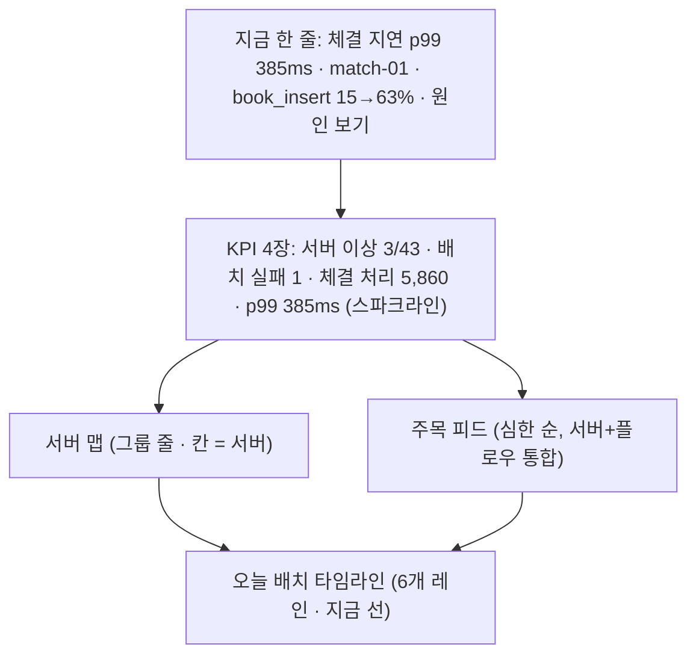

# 이음 UI 개선 제안: "3초 안에 상황 파악, 3번 클릭이면 원인"

> [!NOTE]
> 함께 볼 것: 인터랙티브 목업 [ui-mockup.html](file:///home/han/.gemini/antigravity/brain/15444f3b-6504-40c6-87f9-c97bc2f63df9/ui-mockup.html). 상단 탭 **관제 / 배치 / 원인 추적**을 눌러 보세요. 목업은 설명용이라 Tailwind를 썼고, 실제 구현은 지금처럼 **CDN 없이 vanilla JS + uPlot + SVG**로 합니다.

---

## 1. 현재 화면 진단

코드(`internal/manager/web/static/*`)를 기준으로 짚은 문제입니다.

| # | 문제 | 근거(현재 코드) | 영향 |
|---|---|---|---|
| 1 | **발표 문구가 UI에 박혀 있음** | 섹션 머리마다 `서버 관제가 하던 일`, `스케줄러가 하던 일`, `업무 관제가 하던 일 · panels/체결.yaml로 구성` ([dash.js](file:///home/han/work/contune/internal/manager/web/static/dash.js#L186-L194), [L277-L308](file:///home/han/work/contune/internal/manager/web/static/dash.js#L277-L308)) | 운영 화면이 설명서처럼 보임 |
| 2 | **범례·안내문이 장문** | `CPU … 70% 미만 (0–25 / 25–45 / 45–60 / 60–70)`, `오른쪽 숫자는 그룹 평균`, `누르면 타임머신 →`, `줄을 누르면 타임머신으로 이동합니다`, `노드를 누르면 해당 스텝 최신 시도의…`, `차트에서 평시 구간(A)과 지연 구간(B)을 차례로…` | 글자가 데이터보다 먼저 눈에 들어옴 |
| 3 | **"지금 괜찮은가?"에 답하는 자리가 없음** | 대시보드가 열지도 → 패널 → 배치판 세로 나열, 모두 같은 무게 | 5초 규칙 실패. 심사위원이 어디를 봐야 할지 모름 |
| 4 | **이상 신호가 흩어져 있음** | 이상 서버(오른쪽 위)와 실패 플로우(맨 아래 배너)가 따로 | 같은 사건의 증상이 다른 곳에 보임 |
| 5 | **배치 진행이 비율 막대뿐** | 배치판별 `sbar` | "언제 무엇이 돌았고 지금 몇 시인지"가 안 보임(Control-M의 핵심 화면 부재) |
| 6 | **이음의 핵심 스토리가 화면에서 안 보임** | 실행번호로 업무→실행→자원→함수를 잇는다는 차별점이 타임머신 안쪽에만 있음 | 심사위원에게 차별점이 전달되지 않음 |
| 7 | **하드코딩 값** | 실패 배너에 `실패 1`, `종료 코드 2`, 시각 fallback `'10:12'` 고정 ([dash.js L264-L270](file:///home/han/work/contune/internal/manager/web/static/dash.js#L264-L270)), 플로우 노드 설명 사전 `STEP_DESC` ([flow.js L4-L14](file:///home/han/work/contune/internal/manager/web/static/flow.js#L4-L14)) | 실제 데이터와 어긋남(버그) |
| 8 | 상단 시계 `· 2초마다 갱신`, 섹션 제목 `서버 43대 · 그룹별 CPU · 칸 하나가 서버 하나` | [app.js L16](file:///home/han/work/contune/internal/manager/web/static/app.js#L16) | 불필요한 글자 |

---

## 2. 벤치마크: 무엇을 가져올까

| 솔루션 | 대표 화면 / 관례 | 이음에 가져올 것 |
|---|---|---|
| **Control-M** (BMC) | Monitoring 도메인의 **Viewpoint**(필터된 관점), 상태 색 관례(초록 Ended OK · 빨강 Ended NOT OK · 파랑 Executing · 노랑 Wait · 회색 Hold), **Gantt 뷰**, 폴더로 올라가는 실패 집계, Batch Impact Manager(SLA 마감 예측) | ① 상태 색을 Control-M 관례에 맞춤(운영자에게 학습 비용 0) ② **오늘 배치 타임라인(Gantt)** ③ 트리 = Viewpoint(범위 필터)로 역할 명확화 |
| **onTune** (팀스톤) | 2초 단위 수집, 임계치에 따라 서버 아이콘 색 변화, 여러 차트를 **같은 시간 표시선**으로 비교, Top 프로세스 | ① 서버 맵 칸 색 = 임계치 상태 ② 원인 추적 띠 차트의 **공유 커서 선** 강조 ③ 실행 단위 Top 함수(우리는 프로세스보다 한 단계 더 깊음) |
| **Datadog** | Host Map(칸 = 호스트, 색 = 지표, 그룹핑), Watchdog **Story**(증상 → 원인 사슬) | ① 서버 맵 유지하되 글자 제거 ② **"지금" 한 줄 헤드라인** + **증거 사슬 카드**(LLM 없이 결정론적으로) |
| **Airflow** | **Grid View**(가로 = 날짜/실행, 세로 = 태스크, 칸 = 상태) | 플로우 화면의 최근 실행 표를 **스텝 × 날짜 격자**로 바꿈 |
| **Dagster / Prefect** | 노드에 상태 배지, 노드 hover 시 상·하류 강조, 그룹 접기 | DAG 노드 단순화(이름 + 소요 + 상태 막대), hover 시 경로 강조 |
| **Grafana Pyroscope** | **Diff flame graph**(기준 대비 증가 = 빨강, 감소 = 파랑) | A·B 플레임 두 개를 **하나의 차이 그래프**로(토글로 나란히 보기 유지) |
| **PagerDuty / incident.io** | 심한 순 단일 피드 | 이상 서버 + 실패/지연 플로우를 **"주목" 피드 하나**로 통합 |

---

## 3. 설계 원칙

1. **숫자 먼저, 글자는 나중.** 섹션 제목은 2~4자(`서버`, `주목`, `오늘 배치`). 설명은 `ⓘ` 말풍선이나 발표 모드로.
2. **이상한 것만 색.** 정상은 무채색/옅은 청록, 상태 색(빨강·주황·파랑)은 문제와 실행에만. "모든 게 빨가면 아무것도 빨갛지 않다."
3. **위에서 아래로 질문 순서.** 지금 괜찮나? → 어디가? → 언제부터? → 왜?
4. **한 번 클릭 = 한 단계 깊이.** 어떤 화면이든 빨간 것을 누르면 다음 증거로 간다.
5. **제약 유지.** 외부 CDN 금지, uPlot + SVG/DOM, 백엔드 API 변경 없음(현재 `/hosts`, `/flows`, `/runs`, `/series`, `/panels`, `/profile`로 전부 가능).

---

## 4. 화면별 개선안

### 4.1 관제 홈 (`#dashboard`)

| 영역 | 내용 | 바뀌는 점 |
|---|---|---|
| **지금 한 줄** | 가장 심각한 사건 1개를 문장으로. 업무 패널 타일 중 crit → 그 `exec_id`의 실행 → 서버 CPU → (있으면) 최근 프로파일 top leaf 변화 | 신규. 심사위원이 첫 3초에 "무슨 일이 났는지" 읽음. 누르면 원인 추적으로 직행 |
| **KPI 4장** | 큰 숫자 + 단위 + 15분 스파크라인. 임계 넘은 것만 빨강 | 업무 패널 타일 5개 + 상태 배지 → 핵심 4장. 나머지 타일은 그룹 선택 시 노출 |
| **서버 맵** | 그룹 이름(짧게) · 칸 · 평균 %. 범례는 아이콘 7개만(글자 없음, hover 설명) | 장문 범례 제거, 이상 칸은 은은한 깜박임 |
| **주목 피드** | `[상태 아이콘] 이름 / 그룹 … 이유` 한 줄씩. 서버·플로우·업무 지표 이상을 한 목록에. 맨 아래 `✓ 서버 40대 · 플로우 36개 정상` | 이상 서버 목록 + 실패 배너 통합 |
| **오늘 배치** | Control-M Gantt 스타일. 배치판 6개 레인, 플로우 실행 막대(상태 색), 예정은 옅은 막대(`next_run`), 현재 시각 세로선 | 비율 막대 대체. "운영 하루"가 한눈에 보임 |

### 4.2 배치 / 플로우 (`#board/…`)

- **호스트 스윔레인 DAG:** 노드 위에 호스트 이름을 적는 대신 배경 띠(레인)로 호스트를 표현. 서버를 넘는 선은 굵은 주황 선 하나로 충분(라벨 `서버를 넘어 실행` 제거, 범례 한 줄).
- **노드 다이어트:** `스텝 id` + `소요 · N회차`만. `STEP_DESC` 사전 삭제(YAML에 `desc`가 있으면 hover로).
- **열 머리 `단계 0 / 단계 1 · 병렬 / 단계 2 · 합류` 제거** — 그래프 모양이 이미 말해 줌.
- **최근 실행 = Airflow Grid:** 스텝 × 최근 14회 격자. 재시도·실패 패턴이 한눈에. 칸 클릭 = 그 실행.
- **노드 클릭 = 오른쪽 드로어**(로그 끝, 소요, peak, `원인 추적 →`). 페이지 이동은 드로어의 버튼으로만.
- 배치판 목록은 표 유지하되 `상태 막대 | 이름 | 다음 실행 | 최근 소요(스파크)` 4열로 축소.

### 4.3 원인 추적 (`#run/<exec_id>`, 기존 "타임머신")

- **증거 사슬 카드 4장**(맨 위): `1 업무 p99 385ms → 2 실행 start-matching → 3 자원 CPU 100% → 4 함수 book_insert 15→63%`. 이음의 핵심 개념("실행번호 하나로 잇는다")을 **화면 자체가 설명**. 각 카드를 누르면 해당 띠/플레임으로 스크롤.
- **띠 차트 5개 유지**, 왼쪽 제목만(단위는 hover). A·B 빈 상태일 때 설명 문단 대신 차트 위에 **반투명 "드래그해서 A 선택" 오버레이**.
- **"무엇이 달라졌나" 패널:** leaf 비중 변화 상위 4개를 A→B 막대로. verdict 한 줄은 패널 제목 아래 굵게.
- **Diff flame graph:** 폭 = B 비중, 색 = A 대비 증감(빨강 증가 · 파랑 감소, Pyroscope 관례). `나란히 보기` 토글로 기존 A·B 두 개 표시 유지.
- 요약·상태 전이·로그는 접힌 `세부` 섹션으로 내림.

### 4.4 전역

| 항목 | 제안 |
|---|---|
| 상단 메뉴 | `대시보드 · 서버 · 배치판 · 실행 이력` → `관제 · 배치 · 실행 · 원인 추적` 4개. 서버 목록은 관제의 서버 맵 → 전체 보기 |
| 빠른 이동 | `/` 키로 **검색 팔레트**: 서버·플로우·exec_id 앞 6자로 점프 (`/hosts`, `/flows`, `/runs` 캐시만 사용) |
| 트리 | 기능 유지. 역할을 "범위 필터(Viewpoint)"로 명확히: 맨 위에 현재 범위 칩 `매매 ✕` |
| 테마 | 관제실 느낌의 **다크 기본** + 토글(현재는 OS 설정만 따름). 상태 색은 다크/라이트 동일 대비 확보 |
| 숫자 | `font-variant-numeric: tabular-nums`, 값 변화 시 짧은 하이라이트(라이브감) |
| 시계 | `10:42:31 ●`(초록 점 = 수신 정상, 주황 = 지연). `2초마다 갱신` 문구 삭제 |

---

## 5. 문구 다이어트 (예시)

| 지금 | 바꾼 뒤 |
|---|---|
| `서버 43대 (범위: 매매) · 그룹별 CPU · 칸 하나가 서버 하나` / `서버 관제가 하던 일` | `서버 43` |
| `이상 있는 서버 · 심한 순 · 최근 15분 CPU` | `주목` |
| `업무 패널 · 매매/체결 (체결) [01JC…] / 업무 관제가 하던 일 · panels/체결.yaml로 구성` | `체결` |
| `배치판 · 오늘 플로우 39개` / `스케줄러가 하던 일` | `오늘 배치  31 완료 · 2 실행 · 1 실패 · 5 예정` |
| `CPU ■■■■ 70% 미만 (0–25 / 25–45 / 45–60 / 60–70) · 오른쪽 숫자는 그룹 평균` | `CPU ■■■■  ! ✕ –` (hover 시 구간) |
| `누르면 타임머신 →` | (타일 전체가 링크, hover 시 커서만) |
| `노드를 누르면 해당 스텝 최신 시도의 실행 기록(타임머신)으로 이동합니다.` | (삭제) |
| `차트에서 평시 구간(A)과 지연 구간(B)을 차례로 끌어서 고르거나 … 버튼을 누르면 …` | 차트 위 오버레이 `드래그 → A` |
| `10:42:31 · 2초마다 갱신` | `10:42:31 ●` |

> [!TIP]
> 지운 설명 문구("서버 관제가 하던 일" 등)는 버리지 말고 **발표 모드**(`?present=1`)의 번호 말풍선으로 옮기면, 평소엔 깔끔하고 발표 때는 스토리텔링 도구가 됩니다.

---

## 6. 심사위원 어필 장치

1. **30초 데모 동선(클릭 3번):** 관제 홈 `지금` 빨간 줄 클릭 → 원인 추적(증거 사슬 4장이 이미 채워짐) → 드래그 2번(A·B) → diff flame에서 `book_insert`가 빨갛게 확대. "스케줄러·관제·프로파일러 3개 도구가 하던 일이 한 화면, 한 번호로" 메시지를 화면이 직접 말함.
2. **발표 모드 `?present=1`:** 화면 위에 ①②③ 번호 말풍선(서버 관제 → 배치 → 업무 → 함수)과 "기존엔 도구 3개" 대비 문구. 키보드 `→`로 다음 말풍선.
3. **라이브감:** 실행 중 노드·막대 펄스, 현재 시각 선 이동, KPI 숫자 변화 하이라이트, `surge` 시 `지금` 줄이 실시간으로 나타남.
4. **익숙함:** Control-M 상태 색, onTune식 서버 칸·공유 시간선 → 금융권 운영자 출신 심사위원에게 "우리가 쓰던 그 화면인데 더 깊다"는 인상.
5. **`?mock=1` 예비 화면 유지**(발표 중 백엔드 장애 대비).

---

## 7. 작업 계획

| 단계 | 내용 | 파일 | 규모 |
|---|---|---|---|
| **P0** 정리 | 문구 다이어트 전부, 하드코딩(`실패 1`·`종료 코드 2`·`10:12`·`STEP_DESC`) 실제 값으로, 시계 표시, 상단 메뉴 이름 | `dash.js`, `flow.js`, `tm.js`, `pages.js`, `app.js`, `index.html`, `style.css` | 작음 |
| **P1** 관제 홈 재구성 | `지금` 한 줄, KPI 4장 + 스파크라인, 주목 피드 통합, 오늘 배치 타임라인(Gantt) | `dash.js`(대부분 재작성), `style.css` | 중간 |
| **P1** 플로우 | 호스트 스윔레인 DAG, 노드 다이어트, Airflow 격자, 노드 드로어 | `flow.js`, `pages.js` | 중간 |
| **P2** 원인 추적 | 증거 사슬 카드, 드래그 오버레이, 함수 변화 패널, diff flame + 나란히 토글 | `tm.js`, `flame.js`(`renderDiffFlame` 추가) | 중간 |
| **P2** 전역 | `/` 검색 팔레트, 다크 기본 + 토글, 발표 모드 `?present=1` | `app.js`, 신규 `palette.js`·`present.js`, `style.css` | 중간 |

- **API 변경 없음.** 모든 계산은 기존 응답으로 브라우저에서.
- `mock.js`도 함께 맞춰 `?mock=1`에서 새 화면이 완전히 동작하게 함.
- 완료 확인: `go test ./...`(정적 파일 임베드 깨짐 없음), `eum dev` + 브라우저 수동 확인, `?mock=1` 확인, 1280px 스크린샷.

> [!IMPORTANT]
> 결정이 필요한 것
> 1. 진행 범위: **P0만 / P0+P1 / 전부(P0~P2)** 중 어디까지?
> 2. 다크 테마를 **기본값**으로 바꿀지(현재는 OS 설정을 따름)?
> 3. 메뉴 이름 `타임머신` → `원인 추적`으로 바꿔도 되는지? (기획서 용어와 맞출 필요가 있으면 유지)
> 4. 발표 모드(`?present=1`)를 넣을지?
